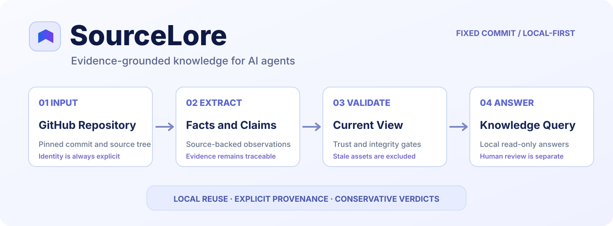
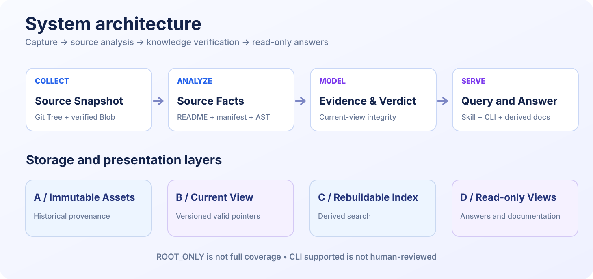
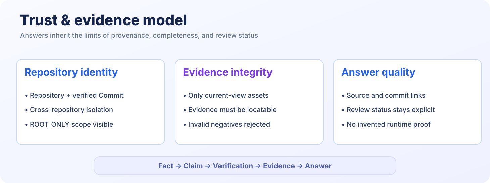

# SourceLore




[简体中文](README.zh-CN.md) · English

> A local, evidence-grounded GitHub knowledge base for AI agents — versioned by fixed commit, queryable offline, and designed to be auditable rather than plausible.

SourceLore turns a public GitHub repository into a **versioned, queryable knowledge base**: it records verifiable "path-level observations" about a fixed commit, attaches facts, claims, verifications and evidence to them, and serves answers through a Skill + CLI that agents such as OpenBot, DSH and Hermes can call. It deliberately does **not** guess what a project does from its file names, and it does not execute third-party code.

This repository contains **source code, documentation and tests only**. The knowledge database, captured content bytes, third-party snapshots and local caches are kept outside the repository and are excluded by `.gitignore`.

## Why SourceLore

One-shot LLM summaries of a repository are not reproducible, cannot be re-queried, and cannot show where a conclusion came from. SourceLore is built around a different idea:

- **Fix the version.** Knowledge is bound to a specific commit, not a moving branch, so a conclusion can be re-checked later against the same bytes.
- **Observe, do not infer.** The collector records what is actually present (paths, README structure, manifest fields, source declarations); it does not claim runtime behaviour or test results it did not observe.
- **Separate observation from judgment.** Facts (observations), Claims (propositions), Verifications (adjudications) and Evidence (locatable references) are distinct assets.
- **Make the current view explicit.** Immutable historical assets are separated from the currently valid pointers, so a stale adjudication can never silently become today's answer.
- **Stay offline-first.** Once a snapshot exists locally, queries make zero network requests.

## Current status

| Area | Status |
|---|---|
| Repository registration, fixed commit, Git tree/blob identity | Implemented |
| Path-observation facts, claims, verifications, evidence | Implemented |
| Immutable A layer / current-pointer B layer / rebuildable index C layer | Implemented |
| Content-level extraction (README, package.json, pyproject.toml) | Implemented |
| Source knowledge (Python AST; JS/TS tree-sitter; tsconfig-aware module resolution) | Implemented |
| Project knowledge documents (`derive`) | Implemented |
| Natural-language Q&A (`answer`, six intents) | Implemented |
| Knowledge cards and Obsidian export | Implemented |
| P0 trust-integrity rules (identity, evidence gating, view isolation) | Implemented |
| Recursive subtree capture / full call graph / runtime analysis | Planned or blocked by API budget |
| Public distribution | Blocked (`distribution_allowed=false`; internal preview only) |

Statuses follow the vocabulary `IMPLEMENTED` / `PARTIAL` / `PLANNED` / `BLOCKED` / `NOT_VERIFIED` used in the requirements document. See [docs/en/REQUIREMENTS.md](docs/en/REQUIREMENTS.md) for the per-feature matrix with source references.

## Architecture at a glance

```mermaid
flowchart LR
    U[User / OpenBot / DSH / Hermes] --> S[SourceLore Skill]
    S --> C[CLI: analyze / query / answer / derive / card]
    C --> G[Collector: GitHub client, request budget, capture policy]
    G --> P[Analyzers: content, Python AST, JS/TS tree-sitter, module resolution]
    P --> E[Fact / Claim / Verification / Evidence]
    E --> ST[(Storage: A immutable, B current pointers, C index)]
    ST --> Q[Query / Answer / Derived views]
    Q --> D[Project knowledge documents]
```






- **A layer** — immutable authoritative assets (`assets`), protected by database triggers.
- **B layer** — the current view (`current_view`): which asset is valid now, versioned with compare-and-swap.
- **C layer** — a rebuildable derived index (`index_rows`, FTS when available), never authoritative.
- **D layer** — read-only query/answer projections and generated project documents.

See [docs/en/ARCHITECTURE.md](docs/en/ARCHITECTURE.md) and [docs/en/DATA-MODEL.md](docs/en/DATA-MODEL.md).

## Requirements

- Python 3 (developed and tested on 3.14).
- No external service is required for queries; queries are local and offline.
- Optional: `tree-sitter` grammars for JS/TS source analysis, isolated in a project-local virtual environment (`requirements-treesitter.txt`). If unavailable, the parser reports `PARSER_UNAVAILABLE` rather than falling back to regex.
- Optional: `GITHUB_TOKEN` to raise the GitHub API limit (unauthenticated 60 requests/hour). Never required for offline queries.

There is no top-level `requirements.txt`; the CLI is launched directly from `skill/sourcelore/scripts/sourcelore.py`, which locates the project root itself (or via `SOURCELORE_PROJECT_ROOT`).

## Install the Skill

Copy the `skill/sourcelore/` directory into the agent's skill directory (e.g. `~/.agents/skills/sourcelore/`). The Skill is discovered by the platform's filesystem mechanism; restart is not required. The CLI entry point is:

```sh
python3 <skill-dir>/scripts/sourcelore.py <subcommand> [options]
```

The data root is resolved in order: `--data-root` → `SOURCELORE_DATA_ROOT` → `~/.config/sourcelore/config.json` (`data_root`) → `~/.sourcelore/`. The database file `kb.db` is never written into the source repository.

See [docs/en/INSTALLATION.md](docs/en/INSTALLATION.md).

## Five-minute setup

Start with the [English Quick Start](docs/en/QUICKSTART.md) / [中文快速入门](docs/zh-CN/QUICKSTART.md). **The `sourcelore` examples below are CLI shorthand, not a system binary installed by cloning this repository.** Install the Skill and create the shell function, or invoke `python3 ~/.agents/skills/sourcelore/scripts/sourcelore.py` directly. The installed launcher needs a root marker or `SOURCELORE_PROJECT_ROOT` to locate the source checkout.

## Basic usage

```sh
# What repositories are registered
sourcelore repositories

# Offline reuse requires a matching cached snapshot; first use --plan and then authorized online capture
sourcelore analyze https://github.com/<owner>/<repo> --commit <sha> --offline

# Inspect a repository's registered knowledge
sourcelore inspect <repository_id>

# Query observations / claims / content / source structure / module relations
sourcelore query <repository_id> --commit <sha> --type claims
sourcelore query <repository_id> --commit <sha> --type content --path README.md
sourcelore query <repository_id> --commit <sha> --type code
sourcelore query <repository_id> --commit <sha> --type relation
sourcelore query <repository_id> --commit <sha> --type project

# Natural-language project Q&A (content first, read-only)
sourcelore answer <repository_id> "介绍这个项目"
sourcelore answer <repository_id> "怎么使用这个库"
sourcelore answer <repository_id> "核心函数的实现是什么"

# Regenerate derived project documents (D layer only)
sourcelore derive <repository_id>

# Render a knowledge card
sourcelore card --repository-id <repository_id> --claim-id <claim_id>
```

Run `sourcelore help` or `sourcelore <subcommand> --help` for the authoritative option list. See [docs/en/USER-GUIDE.md](docs/en/USER-GUIDE.md).

## Evidence and trust




SourceLore separates three counts that must not be conflated: the number of immutable verification **assets**, the number of **current** adjudications adopted by the current view, and the number of **trustworthy findings** after evidence-integrity gating (with untrustworthy claims excluded). A `supported` verdict always carries a `review_status` (`pending_review` means a CLI adjudication, not human confirmation).

Key rules (enforced by `src/trust/policy.py`):

- A commit is trusted only if bound to a registered snapshot of that repository; a 40-hex placeholder such as `aaaa…` is never authenticated.
- Claims and facts are identity-checked against the repository and commit; cross-repository commits are blocked.
- Only the current view (`current_view`) decides today's valid assets; historical verdicts are never silently mixed in.
- Evidence completeness is `FULLY_LOCATABLE`, `PARTIALLY_LOCATABLE` or `UNRESOLVED_NO_INTEGRITY`; an unresolvable reference downgrades a verdict to `insufficient_evidence`, never to `refuted`.
- `ROOT_ONLY` means only the repository root was enumerated; it is never presented as full `COMPLETE` coverage. Missing content is "not analyzed", not "does not exist".

See [docs/en/SECURITY.md](docs/en/SECURITY.md) and [docs/zh-CN/DESIGN-RATIONALE.md](docs/zh-CN/DESIGN-RATIONALE.md).

## License and public release

SourceLore's **first-party code** is released under the [MIT License](LICENSE).
You may use, copy, modify, merge, publish, distribute, sublicense and sell it,
subject to the license terms. This is separate from two other decisions:
**repository visibility** (the visibility change requires the owner's final
approval) and the runtime `distribution_allowed=false` policy for captured
**third-party knowledge output**, which remains closed. See
[public release readiness](docs/en/PUBLIC-RELEASE.md) /
[简体中文](docs/zh-CN/PUBLIC-RELEASE.md) and the license boundary in
[SECURITY.md](docs/en/SECURITY.md).

## Limitations

- Tree coverage is currently `ROOT_ONLY` for the registered repositories: subdirectories are not systematically captured.
- No call graph, runtime behaviour or test-pass evidence is produced; the tool does not run repository code.
- README analysis is structural (headings, links, code-block languages); functional semantics come only from quoted README text.
- `answer` is deterministic retrieval and assembly — it does not call an LLM and does not perform open-ended reasoning.
- Output is internal preview (`distribution_allowed=false`); distribution gates B-1/B-2/B-3 remain open.
- Content is bounded by per-blob/per-batch budgets (256 KiB per blob, 2 MiB per batch, 32 candidate paths, 100 facts per file).

## Documentation

| English | 简体中文 |
|---|---|
| [Requirements](docs/en/REQUIREMENTS.md) | [需求规格](docs/zh-CN/REQUIREMENTS.md) |
| [Architecture](docs/en/ARCHITECTURE.md) | [系统架构](docs/zh-CN/ARCHITECTURE.md) |
| [Design rationale](docs/en/DESIGN-RATIONALE.md) | [设计思路](docs/zh-CN/DESIGN-RATIONALE.md) |
| [Data model](docs/en/DATA-MODEL.md) | [数据模型](docs/zh-CN/DATA-MODEL.md) |
| [Pipeline](docs/en/PIPELINE.md) | [处理流水线](docs/zh-CN/PIPELINE.md) |
| [Installation](docs/en/INSTALLATION.md) | [安装指南](docs/zh-CN/INSTALLATION.md) |
| [User guide](docs/en/USER-GUIDE.md) | [使用手册](docs/zh-CN/USER-GUIDE.md) |
| [Security](docs/en/SECURITY.md) | [安全与授权](docs/zh-CN/SECURITY.md) |
| [Testing](docs/en/TESTING.md) | [测试](docs/zh-CN/TESTING.md) |
| [Roadmap](docs/en/ROADMAP.md) | [路线图](docs/zh-CN/ROADMAP.md) |
| [Versioning](docs/en/VERSIONING.md) | [版本管理](docs/zh-CN/VERSIONING.md) |
| [Upgrading](docs/en/UPGRADING.md) | [升级与卸载](docs/zh-CN/UPGRADING.md) |
| [Changelog](CHANGELOG.md) | [更新日志](CHANGELOG.md) |
| [Contributing](CONTRIBUTING.md) | [贡献指南](CONTRIBUTING.zh-CN.md) |
| [Release artifacts](docs/en/RELEASE-ARTIFACTS.md) | [发行产物](docs/zh-CN/RELEASE-ARTIFACTS.md) |
| [Public release readiness](docs/en/PUBLIC-RELEASE.md) | [公开发布核查](docs/zh-CN/PUBLIC-RELEASE.md) |

Third-party sources and licensing notes are in [THIRD_PARTY_NOTICES.md](THIRD_PARTY_NOTICES.md). First-party code is MIT-licensed; captured third-party knowledge output and the user's database are not covered by that license and remain under the runtime `distribution_allowed=false` policy.

## Development and contribution

Run the standalone test scripts file-by-file (`python3 <test_file>` from the
test directory, with `PYTHONPATH=src`), as encoded in CI — several files use
module-level `sys.exit` and are not compatible with `unittest discover`. The
release installer and ZIP self-bootstrap are covered by
`tests/release_installer/`. The current release is `v0.1.0-beta.3`; the
standalone ZIP embeds its own `install.py`, so ZIP-only users can install
without cloning the repository. Do not commit the knowledge database, captured
bytes, third-party snapshots or local configuration. Keep source changes and
Skill-installation copies in sync.
