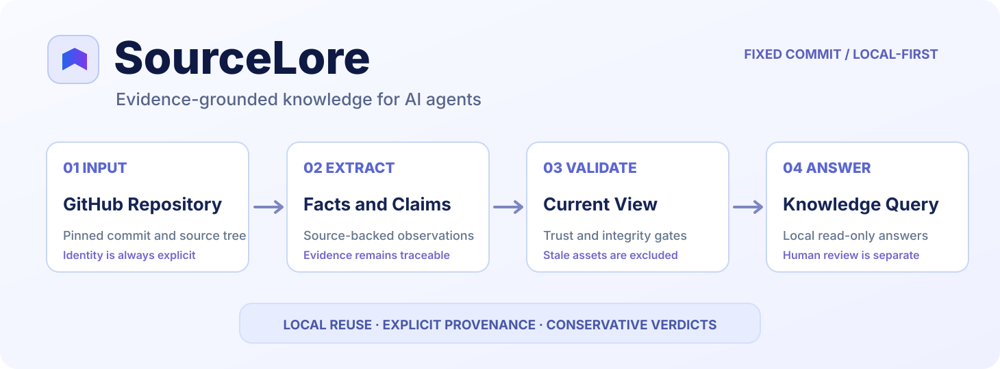
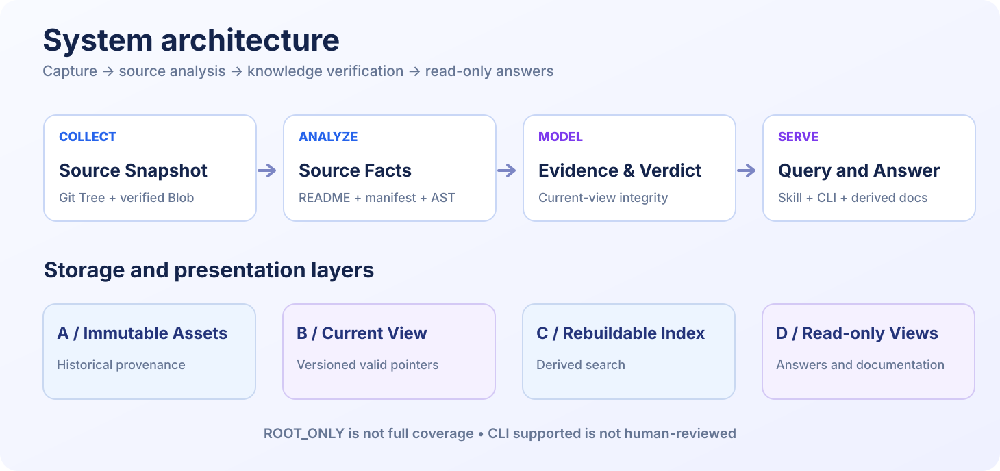
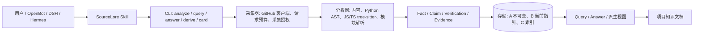
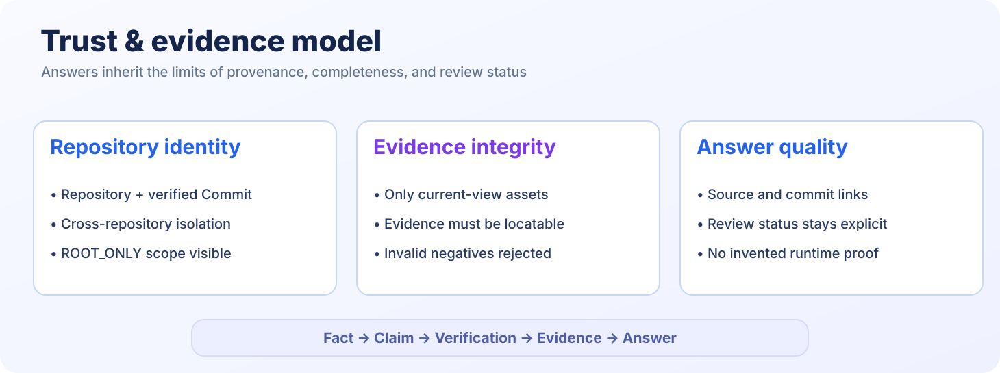

# SourceLore




简体中文 · [English](README.md)

> 面向 AI Agent 的本地、证据可核查的 GitHub 知识库：以固定 Commit 为版本基础，可离线查询，设计目标是"可审计"而非"说得像"。

SourceLore 把一个公开 GitHub 仓库变成**版本化、可查询的知识库**：它记录某个固定 Commit 上可核验的"路径观察"，把 Fact、Claim、Verification 与 Evidence 挂接到这些观察上，并通过 Skill + CLI 供 OpenBot、DSH、Hermes 等 Agent 调用。它**不**从文件名猜测项目功能，也**不**执行第三方仓库代码。

本仓库只包含**源代码、文档和测试**。知识数据库、已捕获的内容字节、第三方快照与本地缓存都放在仓库之外，并由 `.gitignore` 排除。

## 为什么需要 SourceLore

对仓库做一次性 LLM 总结不可复现、无法再次查询，也无法说明结论从何而来。SourceLore 基于另一套思路：

- **固定版本**：知识绑定到具体 Commit，而不是会移动的分支，因此日后可以对同一份字节复核结论。
- **只观察，不推断**：采集器记录实际存在的东西（路径、README 结构、Manifest 字段、源码声明），不声称未观察到的运行时行为或测试结果。
- **观察与判断分离**：Fact（观察）、Claim（命题）、Verification（裁决）、Evidence（可定位引用）是四类不同资产。
- **当前视图显式化**：不可变历史资产与当前有效指针分离，过期裁决不会被悄悄当成今天的答案。
- **离线优先**：快照一旦在本地，查询就是零网络请求。

## 当前状态

| 领域 | 状态 |
|---|---|
| 仓库登记、固定 Commit、Git Tree/Blob 身份 | 已实现 |
| 路径观察 Fact、Claim、Verification、Evidence | 已实现 |
| 不可变 A 层 / 当前指针 B 层 / 可重建索引 C 层 | 已实现 |
| 内容级抽取（README、package.json、pyproject.toml） | 已实现 |
| 源码知识（Python AST、JS/TS tree-sitter、tsconfig 感知的模块解析） | 已实现 |
| 项目知识文档（`derive`） | 已实现 |
| 自然语言问答（`answer`，六类意图） | 已实现 |
| 知识卡片、Obsidian 导出 | 已实现 |
| P0 可信性规则（身份、证据准入、视图隔离） | 已实现 |
| 递归子目录采集 / 完整调用图 / 运行时分析 | 规划中，或受 API 预算阻断 |
| 公开分发 | 阻断（`distribution_allowed=false`，仅内部预览） |

状态采用需求文档中的 `IMPLEMENTED` / `PARTIAL` / `PLANNED` / `BLOCKED` / `NOT_VERIFIED` 词汇。逐项状态与源码依据见 [需求规格](docs/zh-CN/REQUIREMENTS.md)。

## 架构概览






- **A 层**：不可变权威资产（`assets`），由数据库触发器保护。
- **B 层**：当前视图（`current_view`），决定哪个资产当前有效，带版本 CAS。
- **C 层**：可重建的派生索引（`index_rows`，可用时含 FTS），永不作为权威。
- **D 层**：只读的查询/答案投影与生成的项目文档。

详见 [系统架构](docs/zh-CN/ARCHITECTURE.md) 与 [数据模型](docs/zh-CN/DATA-MODEL.md)。

## 运行环境

- Python 3（开发与测试环境为 3.14）。
- 查询不需要外部服务；查询是本地且离线的。
- 可选：JS/TS 源码分析所需的 `tree-sitter` grammar，隔离在项目专用虚拟环境中（`requirements-treesitter.txt`）。缺失时解析器返回 `PARSER_UNAVAILABLE`，不用正则凑数。
- 可选：`GITHUB_TOKEN` 用于提高 GitHub API 配额（未认证 60 次/小时）。离线查询从不要求它。

仓库顶层没有 `requirements.txt`；CLI 直接从 `skill/sourcelore/scripts/sourcelore.py` 启动，脚本会自行定位工程根（也可用 `SOURCELORE_PROJECT_ROOT` 指定）。

## 安装 Skill

把 `skill/sourcelore/` 目录复制到 Agent 的 Skill 目录（如 `~/.agents/skills/sourcelore/`）。Skill 由平台的文件系统发现机制加载，无需重启。CLI 入口：

```sh
python3 <skill-dir>/scripts/sourcelore.py <子命令> [选项]
```

知识库根目录默认 `~/.sourcelore/`，可用 `--data-root` 或 `SOURCELORE_DATA_ROOT` 覆盖。数据库文件 `kb.db` 永不写入源码仓库。

见 [安装指南](docs/zh-CN/INSTALLATION.md)。

## 基础用法

```sh
# 列出已登记仓库
sourcelore repositories

# 以固定 Commit 分析公开仓库（本地已有则离线复用）
sourcelore analyze https://github.com/<owner>/<repo> --commit <sha> --offline

# 查看仓库已登记知识
sourcelore inspect <repository_id>

# 查询观察 / 命题 / 内容 / 源码结构 / 模块关系
sourcelore query <repository_id> --commit <sha> --type claims
sourcelore query <repository_id> --commit <sha> --type content --path README.md
sourcelore query <repository_id> --commit <sha> --type code
sourcelore query <repository_id> --commit <sha> --type relation
sourcelore query <repository_id> --commit <sha> --type project

# 自然语言项目问答（内容优先、只读）
sourcelore answer <repository_id> "介绍这个项目"
sourcelore answer <repository_id> "怎么使用这个库"
sourcelore answer <repository_id> "核心函数的实现是什么"

# 重新生成派生项目文档（仅 D 层）
sourcelore derive <repository_id>

# 生成知识卡片
sourcelore card --repository-id <repository_id> --claim-id <claim_id>
```

以 `sourcelore help` 或 `sourcelore <子命令> --help` 的输出为准。见 [使用手册](docs/zh-CN/USER-GUIDE.md)。

## 证据与可信性




SourceLore 严格区分三个不可混为一谈的计数：不可变 verification **资产数**、当前视图采纳的**当前裁决数**、证据完整性门禁后的**可采信 findings 数**（不可信 Claim 被排除）。任何 `supported` 都带 `review_status`：`pending_review` 表示 CLI 裁决，非人工确认。

关键规则（由 `src/trust/policy.py` 强制执行）：

- Commit 只有绑定到本仓库已登记快照才可信；像 `aaaa…` 这样的 40 位占位值永不认证。
- Claim/Fact 按仓库与 Commit 做身份核对，跨仓库 Commit 被阻断。
- 只有当前视图（`current_view`）决定今天的有效资产，历史裁决不会被悄悄混入。
- 证据完整性为 `FULLY_LOCATABLE`、`PARTIALLY_LOCATABLE` 或 `UNRESOLVED_NO_INTEGRITY`；不可解析引用使裁决降级为 `insufficient_evidence`，绝不变为 `refuted`。
- `ROOT_ONLY` 表示只枚举了仓库根目录，绝不表述为完整 `COMPLETE` 覆盖；缺少内容属于"未分析"，不是"不存在"。

见 [安全与授权](docs/zh-CN/SECURITY.md) 与 [设计思路](docs/zh-CN/DESIGN-RATIONALE.md)。

## 公开发布准备

维护者已要求将 SourceLore 第一方工程代码公开。目前 GitHub 仓库仍为 Private，尚需处理 Git 历史中的本机路径与第一方许可证决定。**仓库可见性与第三方知识数据的 `distribution_allowed=false` 是两项不同的决策。** 见[公开发布核查](docs/zh-CN/PUBLIC-RELEASE.md) / [English](docs/en/PUBLIC-RELEASE.md)。

## 限制

- 当前已登记仓库的 Tree 为 `ROOT_ONLY`：子目录未被系统性采集。
- 不产出调用图、运行时行为或测试通过证据；工具不运行仓库代码。
- README 分析偏结构性（标题、链接、代码块语言），功能语义仅来自引用的 README 原文。
- `answer` 是确定性检索与组装，不接 LLM，不做开放式推理。
- 输出为内部预览（`distribution_allowed=false`），分发门禁 B-1/B-2/B-3 仍开放。
- 内容受预算约束（单 Blob 256 KiB、单批 2 MiB、候选路径 32、单文件 100 Facts）。

## 文档导航

| 简体中文 | English |
|---|---|
| [需求规格](docs/zh-CN/REQUIREMENTS.md) | [Requirements](docs/en/REQUIREMENTS.md) |
| [系统架构](docs/zh-CN/ARCHITECTURE.md) | [Architecture](docs/en/ARCHITECTURE.md) |
| [设计思路](docs/zh-CN/DESIGN-RATIONALE.md) | [Design rationale](docs/en/DESIGN-RATIONALE.md) |
| [数据模型](docs/zh-CN/DATA-MODEL.md) | [Data model](docs/en/DATA-MODEL.md) |
| [处理流水线](docs/zh-CN/PIPELINE.md) | [Pipeline](docs/en/PIPELINE.md) |
| [安装指南](docs/zh-CN/INSTALLATION.md) | [Installation](docs/en/INSTALLATION.md) |
| [使用手册](docs/zh-CN/USER-GUIDE.md) | [User guide](docs/en/USER-GUIDE.md) |
| [安全与授权](docs/zh-CN/SECURITY.md) | [Security](docs/en/SECURITY.md) |
| [测试](docs/zh-CN/TESTING.md) | [Testing](docs/en/TESTING.md) |
| [路线图](docs/zh-CN/ROADMAP.md) | [Roadmap](docs/en/ROADMAP.md) |

第三方来源与许可说明见 [THIRD_PARTY_NOTICES.md](THIRD_PARTY_NOTICES.md)。本项目尚未选择开源许可证，目前仅供内部使用。

## 开发与贡献

测试按目录用 `unittest discover` 运行（带 `__init__.py` 的包目录加 `-t .`，普通测试目录不加；混用会触发同名模块冲突，属运行方式问题而非逻辑回归）。不要把知识数据库、已捕获字节、第三方快照或本地配置提交进仓库。源码改动与 Skill 安装副本要保持同步。
