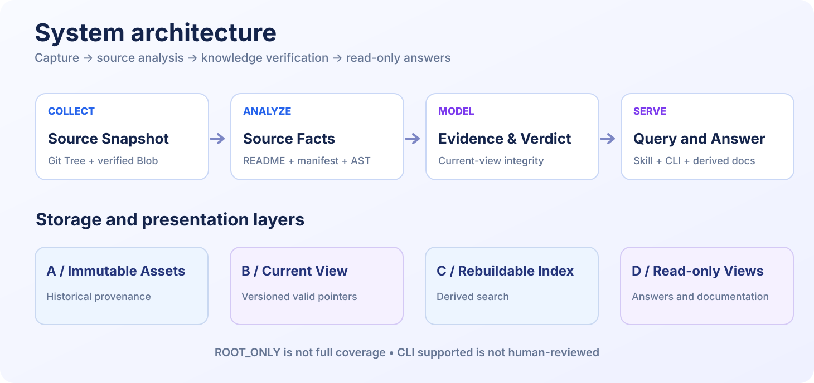
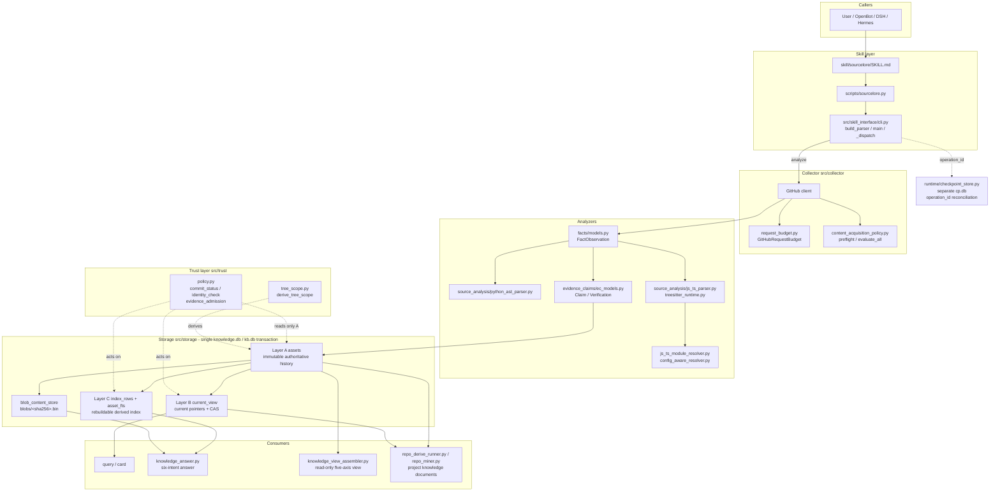
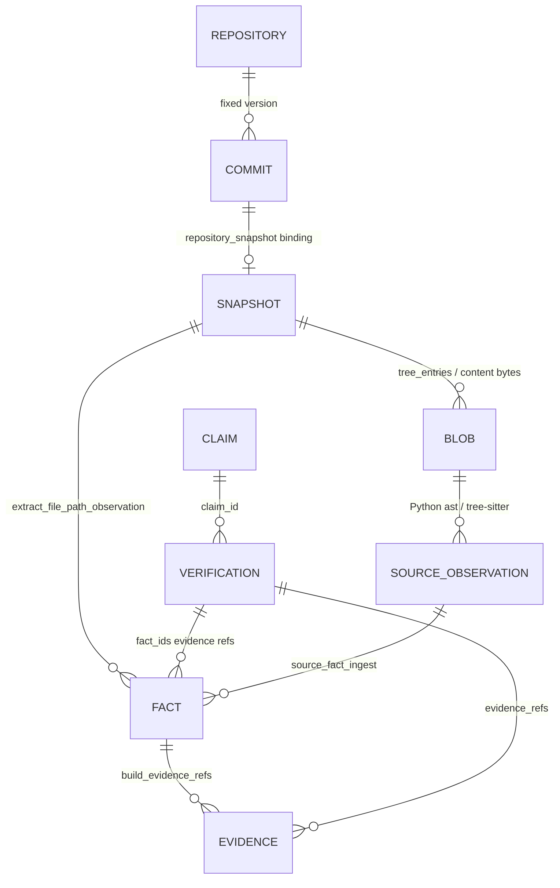

# SourceLore System Architecture



> Schematic illustration, not a runtime test or a claim of complete feature coverage.

> This document describes the **current implementation**, evidenced from `src/` source code, `tests/`, and the design records under `docs/implementation/` and `docs/fusion/`. Every architectural conclusion is traceable to a source path or design record; historical planning is kept separate from current behavior, with no speculation. Commands, status codes, and enum values are kept verbatim from the source.

## 5.1 Overall Architecture

SourceLore is a **local, evidence-grounded GitHub knowledge base**, not a model service, and it never executes third-party code (`README.md`). It pins a public repository to a fixed commit, registers mechanically verifiable observations as assets, and serves answers through a Skill + CLI that agents such as OpenBot, DSH and Hermes can call. Its core stance: observe, do not infer; fix the version; make the current view explicit; stay offline-first.

### End-to-end data flow

User / OpenBot / DSH / Hermes → **Skill** (`skill/sourcelore/SKILL.md` + `scripts/sourcelore.py`) → **CLI** (`src/skill_interface/cli.py`: `analyze` / `query` / `answer` / `derive` / `card`) → **Collector** (`src/collector/`: GitHub client, request budget, acquisition authorization) → **Analyzers** (`src/facts/`, `src/source_analysis/`: content extraction, Python `ast`, JS/TS tree-sitter, module resolution) → **Fact / Claim / Verification / Evidence** → **Storage** (`src/storage/`: layers A/B/C) → **Query / Answer / derived views** (`src/views/`, `src/skill_interface/knowledge_answer.py`) → **project knowledge documents** (documents produced by `repo_miner`).



**Key architectural decisions** (each with source evidence):

1. **Single authoritative database**: layers A/B/C live in one database file constrained by one transaction; the logical name is `knowledge.db` (`docs/implementation/F2_P1B_STORAGE_ARCHITECTURE.md`), resolved by `db_path()` in `src/skill_interface/paths.py` to `<data_root>/kb.db`. Checkpoint is a separate `cp.db`; there is no global ACID between them — reconciliation is by `operation_id` (`src/runtime/asset_checkpoint_coordinator.py`).
2. **The Skill is a thin CLI**: `skill_interface` only parses arguments and dispatches; a second GitHub implementation or second Renderer is forbidden (`docs/implementation/F2_P5A_SKILL_CONTRACT.md`).
3. **One trust-judgment implementation**: `src/trust/policy.py` is shared by Asset Ingest / Index Rebuild / Current View / Knowledge Query / Evidence Resolver / Claim Verifier / Derived Views; it reads only layer A and creates no new reason_code.
4. **No repository code is executed**: analysis uses only Python `ast` and tree-sitter grammars; if a grammar is missing the result is `PARSER_UNAVAILABLE`, never a regex fallback (`src/source_analysis/treesitter_runtime.py`).

---

## 5.2 Module Design

For each module: real source path, responsibility, dependencies, inputs/outputs, error handling, and why it exists. Paths are relative to the project root `SourceLore/`.

| Module (source path) | Responsibility | Main dependencies | Input → Output | Error handling | Why it exists |
|---|---|---|---|---|---|
| `src/skill_interface/cli.py` | Unified CLI: `build_parser()` defines commands; `main()` parses arguments and exit codes; `_dispatch()` delegates to existing modules; `_preflight_budget()` preflights remote capture | `paths`, `result`, business modules | argv → structured JSON on stdout / summary on stderr / exit code 0/1/2/3 | `SkillError` → `emit_error`; other exceptions become `INTERNAL_ERROR` with the last traceback lines; underlying errors are not swallowed | Agents have one entry point; keeps the machine-readable "stdout is always JSON" contract |
| `src/skill_interface/knowledge_answer.py` | User-facing Q&A: `detect_intent()` six intents; `answer()` read-only retrieval with on-demand `audit` | `repo_miner`, `repo_derive_runner`, `paths`, `trust/policy`, `knowledge_store` | repository_id + natural-language question → `{intent, blocks[], audit, network_requests:0, wrote_assets:0}` | Unregistered repository → `REPOSITORY_NOT_REGISTERED` | Ordinary users want purpose/installation/examples, not Fact/Claim statistics; content first, audit isolated |
| `src/skill_interface/paths.py` | Single authority for data root, package root, import path; `db_path()`, `guard_inside_project_db()` | none | --data-root / env var / config file → data root | Path inside project root → `RuntimeError` | No cwd dependency, no hardcoded machine path; one discovery rule for CLI/Skill/schedulers |
| `src/collector/request_budget.py` | `GitHubRequestBudget`: plan items, response-header observation, three-gate `can_spend()`; `classify_rate_limit()` distinguishes primary/secondary limits | none | plan item + response headers → `BUDGET_OK` / `REQUEST_BUDGET_INSUFFICIENT` / `BUDGET_EXHAUSTED` / `BUDGET_RATE_LIMITED` | No authoritative headers → treat as insufficient (rather send nothing) | Local counts are not the network's real quota (anonymous quota is per-IP, other processes consume it); remaining is inferred only from headers |
| `src/collector/content_acquisition_policy.py` | Acquisition preflight: `preflight()` and five-dimension `evaluate_operation()` / `evaluate_all()` | none | repo/commit/path/authorization ref → `ACQUISITION_ALLOWED` / `METADATA_ONLY` / `ACQUISITION_BLOCKED` / `AUTHORIZATION_UNKNOWN`; per-dimension `ALLOW`/`DENY`/`UNKNOWN` | Unsafe path, incomplete identity, non-`internal_analysis` purpose → `DENY`; distribution always `DISTRIBUTION_GATE_OPEN_BLOCKED` | Public visibility ≠ permission to copy permanently; `fetch`/`persist_bytes`/`derive_facts`/`internal_preview`/`external_distribution` are judged separately |
| `src/storage/asset_models.py` | Shared A/B/C models: `AssetDraft`, `Asset`, `SourceSnapshot`; `content_hash_of()`, `reject_sensitive()`, `validate_id()` | none | payload → valid draft / `ModelError` | Invalid type / ID characters / sensitive field / version < 1 → `ModelError` before any write | Logical identity ≠ content hash ≠ physical version; sensitive fields rejected by name |
| `src/storage/knowledge_store.py` | Authoritative store: `_init_schema()` builds A/B/C tables and triggers; `append_asset_and_advance()` implements W-1..W-5; `current_pointer()`, `bind_repo()`, `history()` | `asset_models` | `AssetDraft` + expected_version → `{ok, asset_id, pointer_version}` | `CONFLICT` / `NOT_FOUND` / `PERMISSION_DENIED` / `CHECKPOINT_CORRUPT` | A/B in one transaction; postcondition before commit; cross-repo same-name identities never merge; IDs internally generated to block path traversal |
| `src/storage/index_store.py` | Layer C: `rebuild_index()` reloads from A; `query()` structured + full-text search; `_decorate()` attaches provenance | `knowledge_store`, `trust/policy` | filter criteria → results with `asset_id`/`is_current`/`authority` | Missing index table → `INDEX_MISSING` (never an empty list) | Missing index ≠ missing knowledge; FTS5 used if available, LIKE fallback otherwise — the code does not depend on it |
| `src/storage/blob_content_store.py` | Stores content bytes by `content_sha256` at `<data_root>/blobs/<sha256>.bin`; `get_bytes()` verifies before returning | none | data_root + digest → raw bytes or error | Digest mismatch → verification failure | Body text is not in the asset payload (only metadata); bytes and metadata are bound by digest |
| `src/facts/models.py` | Deterministic observations: `FactObservation`, `make_fact_id()`, `make_content_hash()`, `build_evidence_refs()`; three observation states + UNKNOWN reasons | none | snapshot + rule + parameters → Fact | Invalid observation state / UNKNOWN without reason → `ValueError` | Fact identity excludes `observed_at`; UNKNOWN must not be faked with `[]`/`False`/`NOT_FOUND` |
| `src/evidence_claims/ec_models.py` | Claims and adjudications: `Claim`, `Verification`, `make_claim_id()`, `make_verification_id()`; supported claim types and closed reason_code table | `facts` (same path rules) | Fact set + rule → Verification | Unsupported claim → `UNSUPPORTED_CLAIM_TYPE`; `insufficient_evidence` requires a reason_code | claim_id depends on the proposition alone, not evidence; evidence/rule change yields a new verification_id |
| `src/trust/policy.py` | Unified trust: `commit_status()`, `identity_check()`, `current_asset_ids()`, `resolve_verification_for_claim()`, `evidence_admission()`, `refutation_soundness()` | `knowledge_store` | payload + snapshot set → `{ok, reasons[], commit_status}` | Cross-repo/placeholder/conflicting commits → `REPOSITORY_MISMATCH`/`COMMIT_MISMATCH` | P0 unified admission; stops consumers from judging identity separately or treating historical verdicts as current |
| `src/trust/tree_scope.py` | Derives real tree coverage from objective snapshot fields: `derive_tree_scope()`, `snapshot_for_commit()` | `knowledge_store` | snapshot payload → `COMPLETE`/`ROOT_ONLY`/`PARTIAL` | Read-only derivation; never modifies a frozen snapshot | Historical snapshots mislabeled ROOT_ONLY as COMPLETE; this rebuilds true coverage without fabricating COMPLETE |
| `src/source_analysis/python_ast_parser.py` | Python source structure: symbol declarations + static imports via built-in `ast` | Python `ast` | captured bytes → observation | Parse failure → explicit status, no guessing | Static structural observation without executing repository code |
| `src/source_analysis/treesitter_runtime.py` | tree-sitter runtime: `get_parser()`, `parse_bytes()`, `language_for_path()`; pinned grammar versions | grammars in project `.venv` | bytes + language → tree + diagnostics | Missing grammar → `PARSER_UNAVAILABLE`; `TREE_SITTER_CORE_MISSING` / `GRAMMAR_LOAD_FAILED` | Dependency isolation, no automatic download; `MAX_NODES`/`MAX_DEPTH` budget against hostile large trees |
| `src/source_analysis/js_ts_import_export_rules.py` / `js_ts_module_resolver.py` / `config_aware_resolver.py` | JS/TS import/export static rules and module resolution | tree-sitter | AST nodes → import/export observations + resolution status | Dynamic specifier → `DYNAMIC_MODULE_SPECIFIER`; missing subpath → `SUBPATH_NOT_IN_EXPORTS` | `require("x")` is recorded as `LITERAL_REQUIRE_CALL_OBSERVED` (a call observation), not an ESM declaration; multiple conditions yield `MULTIPLE_CONDITIONS_AVAILABLE`, never an arbitrary pick |
| `src/views/repo_miner.py` | Project knowledge mining: `mine_project_knowledge()` assembles five document classes; **calls no LLM**, deterministic assembly only | `blob_content_store`, `bot_card` | captured bytes + tree + claims → documents + project metadata | Missing body/snapshot → writes "not analyzed", never fabricates | Turns evidence into readable project documents; README first paragraph and manifest fields are quoted directly, not inferred |
| `src/views/knowledge_view_assembler.py` | Layer D read-only projection: `assemble_from_verification()` with five separate status axes, no `is_valid` | `view_models`, `view_integrity`, `lc_models` | committed assets → KnowledgeView or diagnostic code | Corrupt evidence chain → `EVIDENCE_CORRUPT`; no usable evidence still assembles with annotations | No second adjudicator; historical observations never masquerade as current live state |
| `src/views/repo_derive_runner.py` | Makes derived-view generation a reproducible command `derive <rid>`; `_load_assets()` / `_code_rows()` | `repo_graph_derivation`, `repo_card_projection`, `repo_miner`, `query` | repository ID → derived views + project documents | No snapshot → `NO_SNAPSHOT` | Replaces one-off throwaway scripts with source, an entry point, and tests |
| `src/lifecycle/lc_models.py` | Freshness model: `VERSION_ALIGNED` / `POSSIBLY_STALE` / `UNKNOWN` / `NOT_APPLICABLE_TO_PINNED` | none | observed ref and baseline → freshness assessment | Invalid state / missing trusted commit → `ValueError` | Whether knowledge pinned to a commit may be stale is a status axis independent of evidence adjudication |
| `src/runtime/asset_checkpoint_coordinator.py` | Cross-store reconciliation: `RECONCILED` / `RETRY_SAFE` / `NEEDS_HUMAN` | `checkpoint_store`, `knowledge_store` | operation_id → reconciliation state | Unreadable store / corrupt checkpoint → `NEEDS_HUMAN` | No global transaction across the two stores; decisions use only persisted records, not "I think I committed" |
| `src/content_persistence/module_relation_pipeline.py` | **Shared static module-relation pipeline** used by online, local and offline paths: verified bytes → parser → import observations → same-commit tree → resolver → evidence check → idempotent ingest | `module_relation_ingest`, `module_relation_adapter`, resolvers | captured source/config entries + tree → relations + honest status | Missing tree/config → `INSUFFICIENT_TREE_COVERAGE` / `CONFIG_NOT_CAPTURED`; unresolved never written as authoritative A-layer fact | One contract for all capture paths; importer/config/target evidence identities are strictly separated; P2-A closes the online ingest gap |
| `src/content_persistence/relation_backfill.py` | Offline incremental backfill: reuses already-captured bytes only, zero network, idempotent, A-layer unchanged | `captured_blob_loader`, shared pipeline | repository + commit → backfill report | Missing bytes → skip, never re-download | Exposed as `cli.py backfill-relations <rid> --commit <sha>`; repeated runs reuse instead of duplicating relations |

---

## 5.3 Data Architecture (Layers A/B/C/D)

### Layer meanings

| Layer | Carrier | Authority | Mutability | Source evidence |
|---|---|---|---|---|
| **A — immutable source assets** | `assets` table in the same database | Knowledge authority | Append-only; `UPDATE`/`DELETE` hard-blocked by `A_LAYER_IMMUTABLE` triggers | `knowledge_store.py` `_init_schema()` |
| **B — current pointers** | `current_view` table in the same database | Authority for the currently valid version | Advanced with `pointer_version` CAS | `knowledge_store.py` `append_asset_and_advance()` |
| **C — derived index** | `index_rows` + `asset_fts` in the same database | **Not authoritative** | Deletable and rebuildable; rebuild does not touch A/B, returns `a_b_unchanged` | `index_store.py` `rebuild_index()` |
| **D — read-only view** | In-memory KnowledgeView projection | Not authoritative | Purely read-only; five axes separate, no `is_valid` | `knowledge_view_assembler.py`, `F2_P3D_VIEW_CONTRACT.md` |

- **A/B/C in one database file, one transaction**: a deliberate decision. `F2_P1B_STORAGE_ARCHITECTURE.md` experimentally tested `ATTACH` cross-database commits and concluded that SQLite does not promise atomic cross-database commits when both databases are in WAL mode; therefore A/B/C share one database and one `BEGIN IMMEDIATE` transaction.
- **Checkpoint is a separate `cp.db`**: maintained by `src/runtime/checkpoint_store.py` with an independent transaction boundary; reconciled with the knowledge store by `operation_id` (`operation_log.result_hash` must equal `checkpoints.result_digest`). Three outcomes: `RECONCILED` (assets committed, checkpoint backfilled), `RETRY_SAFE` (not committed, safe idempotent retry), `NEEDS_HUMAN` (unreadable/contradictory/corrupt — never auto-redone).
- **schema_version = 1** in the `meta` table. A mismatch raises `RuntimeError` directly; no silent migration. Corruption is never treated as an empty database or auto-rebuilt (`PRAGMA integrity_check` != ok → `CHECKPOINT_CORRUPT`).
- **PRAGMA order is deliberate**: `busy_timeout=5000` → `synchronous=FULL` → `foreign_keys=ON` → `journal_mode=WAL` (with idempotent retry; P1A demonstrated the consequences of a wrong order).

### Write contract W-1..W-5 (`append_asset_and_advance`)

```
W-1 Build AssetDraft (model validation: type / ID characters / sensitive fields / version)
W-2 Validate structure and references (including source_snapshot sha format)
W-3 Read current_view pointer_version, compare with expected_version → CONFLICT if unequal
W-4 INSERT assets + UPDATE/INSERT current_view (same transaction)
     + postcondition(cursor) runs BEFORE COMMIT
     + layer C index augmentation + operation_log write (same transaction)
W-5 COMMIT; any exception → ROLLBACK, never expose partial state
```

A raising `postcondition` rolls everything back; `test_failing_postcondition_rolls_back_everything` asserts 0 A rows, no B pointer, 0 C rows. Pointer states: `ok`, `dangling_pointer` (points to a missing asset, carries `last_known_good` for diagnosis only), no record → `NOT_FOUND`. A dangling pointer must **never** be reported as `NOT_FOUND`.

---

## 5.4 Knowledge Model

### Entity relationships



- **Repository / Commit / Blob**: `repository_id` is the repository anchor; `commit_sha` is the version identity (40 hex characters); `captured_blob_content` assets store only metadata, with real bytes at `<data_root>/blobs/<sha256>.bin`, read back and verified by `blob_content_store.get_bytes()` (audit correction in `src/views/repo_miner.py`).
- **Snapshot**: a `repository_snapshot` asset payload contains `commit_sha`, `root_tree_sha`, `tree_query_ref`, `tree_entries`, `completeness_status`. The three fields are **semantically distinct and not interchangeable** — when the GitHub Trees API is queried with a commit-ish ref, the returned `sha` echoes the request identifier, not the root tree SHA (`docs/fusion/BASELINE.md`, F0-D01).
- **Fact**: `FactObservation`; identity `SL-FACT-<40 hex>` derived from `repository_id + snapshot_logical_identity + rule_id + rule_version + normalized_parameters + item_key`, excluding `observed_at`. Three observation states: `OBSERVED_PRESENT`, `OBSERVED_ABSENT_IN_COVERED_SCOPE`, `UNKNOWN`.
- **Claim**: `Claim`; identity `SL-CLAIM-<40 hex>` derived from the proposition itself (repository_id / commit_sha / claim_type / normalized_parameters / schema), **not from evidence**. Supported types include `repository_path_exists`, content-level claims, and source-structure claims.
- **Verification**: `Verification`; identity `SL-VERIF-<40 hex>` derived from `claim_id + sorted fact_ids + sorted fact_content_hashes + rule_version + parameters`; timestamps do not participate. Three verdicts: `supported` / `refuted` / `insufficient_evidence`.
- **Evidence**: structured `evidence_refs` (`source_snapshot` + `tree_entry`), not natural language; the existence of an evidence object is not the same as evidence sufficient for a conclusion.

### Data-flow example (path claim)

1. `analyze <url>` → fix the Commit → fetch the tree → ingest a `repository_snapshot` asset (layer A).
2. `extract_file_path_observation` produces a Fact for the target path: `OBSERVED_PRESENT` (real tree_entry), `OBSERVED_ABSENT_IN_COVERED_SCOPE` (only under COMPLETE coverage), or `UNKNOWN` (with a `UNKNOWN_REASONS` code).
3. `verify_path_claim` takes the Fact set + rule → a Verification: `supported` requires supporting facts; refutation requires `refutation_soundness` to pass (exact path match, adequate coverage declaration).
4. A/B advance in one transaction; layer C index is augmented.
5. `query --type claims` / `card` / `derive` / `answer` project from B/C pointers and A assets; historical verdicts appear only in `list_historical_verifications()` and the view's `history_refs`, never mixed into current conclusions.

---

## 5.5 Trust Architecture

This section consolidates the trust mechanisms as fixed by P0; each is tied to source and a historical defect.

### Commit binding and three-field separation

`commit_status()` (`src/trust/policy.py`) yields **five codes**: `COMMIT_UNKNOWN` (not 40 hex characters), `COMMIT_FORMAT_VALID` (valid format but not bound to this repository's snapshot, or a known placeholder `aaaa…`/`000…`/`ffff…`), `COMMIT_BOUND_TO_REPOSITORY` (commit hit in a `repository_snapshot` of this repository), `COMMIT_SNAPSHOT_VERIFIED` (hit with a snapshot payload), `COMMIT_IDENTITY_CONFLICT` (multiple payloads for the same commit with differing `root_tree_sha`). Only the two codes accepted by `is_authenticated_commit()` may serve as a current trusted version identity. `identity_check()` always emits `COMMIT_MISMATCH` for cross-repository or placeholder commits, **even if payload.repository_id is disguised as correct** — this fixes the P0/D1 defect where a Claim referenced a cross-repository commit.

`SourceSnapshot`'s `commit_sha` / `root_tree_sha` / `tree_query_ref` are independent and separately validated (the last may equal the commit but is not the tree SHA), per the F0-D01 Trees API echo experiment.

### Cross-repository pollution defense

`repository_id` is the repository anchor, `subject_id` is the knowledge-subject identity, `commit_sha` is the version, and `workspace_id` is a run scope and **not** a Subject identity. `repo_bindings` must carry `evidence_ref`; `bind_repo()` without it returns `PERMISSION_DENIED`. `same_subject_across_repos()` lists relations without merging identities. `rebuild_index()` applies `identity_check()` admission to all assets except `repository_snapshot`; polluted/placeholder assets go into the `quarantined` list and are excluded from C, while A remains untouched.

### Current-view isolation

`current_asset_ids()` is the **only** permitted source of "currently valid assets": it JOINs `current_view` with `assets`, returning only identities adopted by the current pointer that actually exist and match. `resolve_verification_for_claim()` recognizes only current verifications; historical versions are queried via `list_historical_verifications()`. `answer()`'s audit statistics are likewise filtered by `current_asset_ids()`, so historical verifications not adopted by the current pointer never leak in. `dangling_pointer` returns `CHECKPOINT_CORRUPT` + `last_known_good`, never `NOT_FOUND`.

### Evidence-integrity gate

`evidence_admission()` defines four levels: `EV_FULL = FULLY_LOCATABLE`, `EV_PARTIAL = PARTIALLY_LOCATABLE`, `EV_UNRESOLVED = UNRESOLVED_NO_INTEGRITY`, `EV_NONE = NO_EVIDENCE`. Only `FULLY_LOCATABLE` admits the raw verdict; all others are downgraded to `insufficient_evidence` with a reason_code (`EVIDENCE_FIELD_MISSING` / `FACT_NOT_FOUND` / `PARTIAL_EVIDENCE_INSUFFICIENT`). Non-current verdicts are not admitted (`SCOPE_NOT_COVERING`).

### Three-state adjudication and refutation constraints

`VERIFICATION_STATES = {supported, refuted, insufficient_evidence}`. `insufficient_evidence` must carry a reason_code from the closed table; `supported` must have supporting facts; non-insufficient verdicts must not carry a reason_code. `refutation_soundness()` requires the counter-fact to declare `COMPLETE` coverage; a non-root-level path under unexpanded subtrees cannot refute (`PARTIAL_CANNOT_REFUTE`); paths must match exactly (README ≠ README.md; Git paths are case-sensitive), otherwise `PATH_MISMATCH`.

### Not collected ≠ does not exist / ROOT_ONLY

`UNKNOWN` is never faked with `[]` / `False` / `NOT_FOUND`; it must carry a `UNKNOWN_REASONS` code (e.g. `SCOPE_NOT_COVERING`, `TREE_TRUNCATED`, `PARTIAL_SNAPSHOT`). `OBSERVED_ABSENT_IN_COVERED_SCOPE` holds only within fully covered scope. Historical snapshots mislabeled ROOT_ONLY as COMPLETE; `derive_tree_scope()` (P0/D5) re-derives from objective fields: `DEEP_WALK_COMPLETE` without truncation → `COMPLETE`; root-level enumeration with unexpanded subtrees → `ROOT_ONLY` (`ROOT_ONLY_SUBTREES_UNENUMERATED`); truncation → `PARTIAL`. `repo_miner`'s `coverage_note` states truthfully "root level only; subdirectory content not collected", and `derive`'s `tree_status=ROOT_ONLY` must not be "corrected" to COMPLETE.

### Immutable asset protection

`assets_no_update` / `assets_no_delete` triggers hard-block in-place modification with `A_LAYER_IMMUTABLE`; deduplication goes through `UNIQUE(repository_id, logical_identity, asset_version)`, not content_hash (two different pieces of knowledge may share a payload); same-version same-content is idempotent, same-version different-content is `CONFLICT`. Asset IDs are internally generated `SL-A-` + first 32 sha256 hex characters including `repository_id`, avoiding cross-repository primary-key collisions; user input is data only and never determines a file path or ID.

---

## 5.6 Knowledge-Q&A Architecture

### Intent routing

`detect_intent()` (ordered `_PATTERNS` priority, defaulting to `introduce`) maps natural language to six intents: `usage` (how to use/install/API/examples), `evidence` (why trustworthy/evidence), `completeness` (coverage/integrity), `architecture` (architecture/modules/dependencies), `code` (source/function/symbol), `introduce` (purpose/overview, default). `_INTENT_PLAN` specifies the `document_id` + `section_id` blocks per intent; Chinese-to-English heading keyword mapping (`使用/安装 → install/usage`, `性能 → benchmark`, etc.) lets Chinese questions hit English README headings.

### Why project knowledge is the default, not statistics

`knowledge_answer.py`'s iron rule is "content first": it answers purpose/capability/usage/structure/code by default; `audit` (`claim_count` / `verdict_distribution` / `coverage_note`, etc.) is attached only for `evidence` / `completeness`, and is `null` for other intents so statistics never drown out ordinary answers. Answer blocks use `blocks[].body` (real body text), with `refs` for traceability, and fixed fields `distribution_allowed=false`, `freeze_state=FROZEN_INTERNAL_RESTRICTED`, `network_requests=0`, `wrote_assets=0`.

### Body text and literal-matching status

`repo_miner.mine_project_knowledge()` reads verified bytes from `<data_root>/blobs/*.bin`: the README first paragraph is quoted directly as "project purpose", manifest fields directly as "technology stack". Source symbols have two paths:
- **AST path**: `answer()` first calls `repo_derive_runner._code_rows()` (via `query --type code`) to obtain source-structure observations (symbols/imports/exports); `repo_miner`'s `entrypoints` / `imports` sections prefer these `code_rows` (`refs` marked `source_fact`).
- **Literal fallback path**: when no AST observation exists, `extract_symbols_from_source()` uses regexes on captured source text and explicitly states in the body "this Commit has no AST structural analysis, so literal matching is used"; `require` is recorded as `LITERAL_REQUIRE_CALL_OBSERVED`, and anonymous exports become `(anonymous function)` with no invented name.

### Known limitation: AST Facts are not yet fully wired into answer

Today, `answer`'s "purpose", "stack", and "file structure" sections come mainly from README / manifest / tree rather than directly consuming `extracted_fact` / `source_structure_observation` assets; `code_rows` enter the export/dependency sections only when source observations exist, and `repo_miner` retains a regex fallback. In other words, existing AST Facts and claims such as `source_import_declared` are not yet fully connected to every answer intent — a consumer-layer gap, not an analysis-layer absence (see `content-qa.md`: inventory existing capabilities before building "content understanding"). All missing areas are labeled "not analyzed / insufficient evidence"; functionality is never inferred from file names.

---

## 5.7 Agent Integration

### Skill installation and single maintenance source

The single maintenance source is the in-repo `SourceLore/skill/sourcelore/` (`SKILL.md`, `references/`, `scripts/sourcelore.py`), copied under control to `~/.agents/skills/sourcelore/`. The installed directory carries `.sourcelore-skill.json` recording `project`, `project_root`, `source`, and `source_tree_hash`, used to tell whether the installed copy is in sync with the engineering version; out-of-sync means reinstall, not editing logic in the installed directory. The entry point is always:

```
python3 ~/.agents/skills/sourcelore/scripts/sourcelore.py <subcommand>
```

Flat modules under `src/` are injected into `sys.path` by `paths.ensure_import_path()`; cwd is irrelevant. Discovery on the DSH side is by skill-directory scanning + frontmatter `description` triggering.

### OpenBot / Hermes-ACP / DSH relationship

`README.md` states that answers are delivered through a "Skill + CLI" callable by agents such as OpenBot, DSH and Hermes. `docs/fusion/F1B_DSH_ADAPTER_DECISIONS.md` states explicitly: DSH discovery is by skill-directory scanning + frontmatter description ("partially verified"); **BotHarness-side discovery is not tested → UNVERIFIED**; approval prompts exist on the DSH side but in-Skill approval propagation is **UNVERIFIED**. These are stated coverage boundaries, not speculation.

### Data-root discovery

Priority (single authority): `--data-root` argument → `SOURCELORE_DATA_ROOT` environment variable → `data_root` in `~/.config/sourcelore/config.json` → `~/.sourcelore` (legacy default). The current `config.json` points to `SourceLore_Data`. `db_path()` returns `<data_root>/kb.db`; content bytes are at `<data_root>/blobs/<sha256>.bin`. `guard_inside_project_db()` refuses to place the knowledge base inside a Git repository. `answer()` handles `data_root=None` via `data_root or DEFAULT_DATA_ROOT` to avoid falsely reporting "content not collected".

### CLI call chain

`main()` → `build_parser()` → `_dispatch()`. Commands: `status`, `repositories`, `inspect`, `history`, `analyze`, `query` (`--type` = `path`/`claims`/`version`/`content`/`code`/`relation`/`project`), `derive`, `answer`, `card`. Remote capture always goes through `_preflight_budget()`: build the request DAG → inventory local assets marked `LOCAL_REUSE` → at most one bootstrap to obtain authoritative headers → three-condition decision; if the preflight fails, no capture occurs but already-completed assets remain queryable. `analyze --resume` connects to real resume inventory; "declarative empty parameters" such as `--language` / `--relation` were removed (D-61) rather than left as fake capabilities.

### Known limitations (stated honestly)

- `answer` / `derive` are read-only, zero-network, and write nothing; captured content is reused, never re-fetched just to answer.
- Cards set `distribution_allowed=false` and `freeze_state=FROZEN_INTERNAL_RESTRICTED`.
- Historical defects D-1 (`index_rows.commit_sha` once entirely NULL, fixed by payload fallback parsing) and D-2 (rate-limit hang of ~8 minutes, fixed by instantiating analyze with `max_retries=0, max_retry_after=0` so it returns `RATE_LIMITED` within 2 seconds) were fixed and recorded.
- No global ACID across the two stores is claimed; no exactly-once guarantee for external GitHub requests; no Claim semantic state machine; no custom database-file permission model (default umask).
- No LLM participates in assembly; repository code is never executed; a missing tree-sitter grammar yields `PARSER_UNAVAILABLE`, never a regex-guess fallback.
