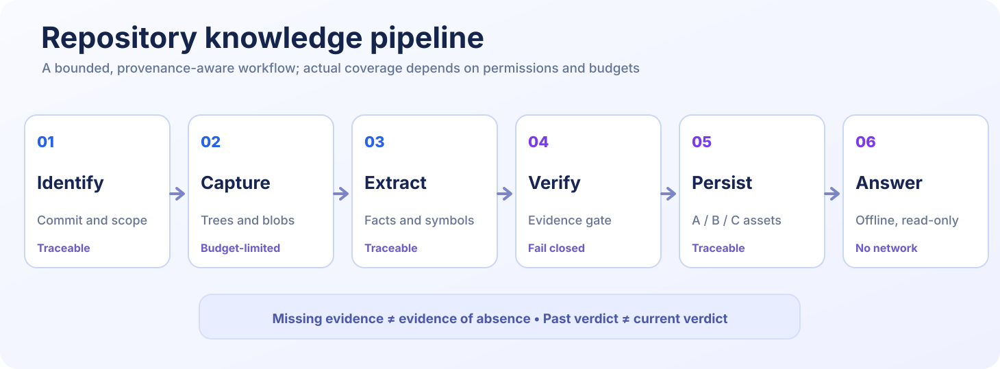

# SourceLore Pipeline



> Schematic illustration, not a runtime test or a claim of complete feature coverage.

> This document describes the real path a repository takes from "public GitHub repository" to "queryable, citable project knowledge", together with the CLI commands, status codes and recovery at each step. Commands come from the real CLI `--help` and source code (`src/skill_interface/cli.py`, `src/collector/`, `src/runtime/`); where this document differs, the actual `--help` output wins. For design trade-offs see [Design rationale](DESIGN-RATIONALE.md); for structure see [Architecture](ARCHITECTURE.md).

---

## 1. Overview

```mermaid
flowchart TD
    U[User / Skill / Agent] --> CLI[CLI: analyze / query / answer / derive / card]
    CLI --> OFF{Offline-first decision}
    OFF -->|--commit hits complete snapshot| REUSE[Reuse local snapshot, 0 network requests]
    OFF -->|--offline and no local copy| MISS[OFFLINE_CACHE_MISS, exit code 3]
    OFF -->|need a newer version| NET[Bounded HTTP client + budget preflight]
    NET --> TREE[Git Tree collection: resolve ref, enumerate tree, mark COMPLETE/PARTIAL/ROOT_ONLY]
    TREE --> BLOB[Blob capture: Git OID + sha256 verification, five-gate authorization]
    BLOB --> BYTES[(blobs/: verified bytes)]
    BYTES --> EXTRACT[Content extraction: README / package.json / pyproject.toml, budget-bounded]
    TREE --> AST[Source parsing: Python ast / JS-TS tree-sitter]
    EXTRACT --> FACTS[Fact ingest, immutable layer A]
    AST --> FACTS
    FACTS --> EC[Claim / Verification / Evidence adjudication, tri-state]
    EC --> STORE[(Storage: A immutable / B current_view / C derived index)]
    STORE --> DERIVE[derive: derived layer-D project documents]
    STORE --> QUERY[query / answer / card consumption]
    DERIVE --> DOC[project-overview and four other documents]
    STORE -.operation_id reconciliation.--> CP[(checkpoint DB, independent transaction)]
```

Three storage responsibilities:
- **Layer A** `assets`: immutable authoritative assets, protected by the `A_LAYER_IMMUTABLE` trigger.
- **Layer B** `current_view`: current pointer; CAS decides which asset is valid.
- **Layer C** `index_rows` / FTS: rebuildable derived index, **not authoritative**.
- **checkpoint DB**: authoritative execution state, independent transaction from assets, reconciled via `operation_id`.

---

## 2. Entry point and global conventions

```sh
python3 <skill-dir>/scripts/sourcelore.py <subcommand> [options]
```

- stdout is structured JSON, stderr is an error summary, and **exit codes are real**.
- The data root defaults to `~/.sourcelore`, overridable with `--data-root` or `SOURCELORE_DATA_ROOT`; the database file is `kb.db` and is **never written into the source repository** (`paths.guard_inside_project_db`).
- Core subcommands: `status`, `repositories`, `help`, `analyze`, `inspect`, `history`, `query`, `derive`, `answer`, `card`.

**CLI exit codes** (`src/skill_interface/result.py` / SKILL.md):

| Code | Meaning |
|---|---|
| 0 | Success (stdout JSON carries `ok: true`) |
| 1 | Execution failure (including GitHub errors) |
| 2 | Argument error |
| 3 | Knowledge DB unavailable / not created (e.g. `KNOWLEDGE_DB_MISSING`, `OFFLINE_CACHE_MISS`, `REPOSITORY_NOT_REGISTERED`) |

**Five result states** (`src/runtime/execution_result.py`, orthogonal to exit codes): `SUCCESS` / `FAILED` / `TIMEOUT` / `CANCELLED` / `UNKNOWN`. Hard rules: `TIMEOUT` must not be inferred as "not executed"; `UNKNOWN` is neither `FAILED` nor `NOT_FOUND` but "no determinable evidence", and is non-terminal — when side effects may have occurred but the receipt is missing, only `UNKNOWN` is allowed. Storage / authorization errors are separate: `NOT_FOUND` / `CONFLICT` / `PERMISSION_DENIED` / `CHECKPOINT_CORRUPT`.

---

## 3. Stage 1: repository registration and offline-first decision

```sh
# Register the repository / check status
sourcelore status
sourcelore repositories
sourcelore analyze https://github.com/<owner>/<repo> --commit <sha>
```

`analyze` does a local lookup first and only then decides whether to go online (SKILL.md, "offline-first and caching"):

| Situation | Behaviour |
|---|---|
| `--commit <sha>` and a complete local snapshot | **Reuse directly, 0 network requests** |
| `--offline` and local copy exists | Reuse, explicitly marked "GitHub not contacted" |
| `--offline` and no local copy | `OFFLINE_CACHE_MISS`, exit code 3, nothing fabricated |
| `--refresh` | Allow a network re-capture of a newer version |
| No `--commit` (mutable branch) | Returns `branch_current_unknown: true` |

**Key discipline**: a local snapshot proves only "a version observed in the past", not that the branch still points at it. A saved historical version is not the remote's current version.

---

## 4. Stage 2: Git Tree collection

After verifying the fixed commit, resolve the ref and enumerate the file tree (`src/collector/tree_collector.py`).

**Three-field separation** (F0-D01 / F2-P1C):

| Field | Only legitimate source |
|---|---|
| `commit_sha` | `sha` from the `/commits/{ref}` response |
| `root_tree_sha` | **the Commit object's `commit.tree.sha`**, never the Trees API response `sha` |
| `tree_query_ref` | the ref actually requested this time |

**Tree tri-state**:

| State | Condition |
|---|---|
| `COMPLETE` | Recursive or level-by-level traversal truly finished with no truncation |
| `PARTIAL` | A resource limit was hit, or level-by-level traversal was also truncated (e.g. `TREE_ENTRY_LIMIT_EXCEEDED`) |
| `INCOMPLETE` | The request failed |

With `truncated=true`, never mark `COMPLETE` directly: record `truncated_seen`, fall back to level-by-level traversal (bounded by `max_depth` / `max_tree_entries` / `max_requests`), mark `COMPLETE` with the flag retained only if the full walk finishes without truncation; otherwise `PARTIAL`. The view layer additionally reports `tree_status: ROOT_ONLY` and records it in limitations — **ROOT_ONLY enumerates only the repository root and is never presented as COMPLETE**.

---

## 5. Stage 3: Blob capture and byte verification

```sh
# Extract content knowledge from a saved snapshot (reads Blobs; reports explicitly when bytes are absent)
sourcelore analyze https://github.com/<owner>/<repo> --commit <sha> --include-content
# Report only content availability; no capture, no network
sourcelore analyze https://github.com/<owner>/<repo> --commit <sha> --content-status
```

- Each Blob gets `content_sha256 = sha256(raw)` and its Git Blob OID is checked (`src/collector/blob_fetcher.py`); only verified bytes land in `blobs/`.
- **Five-gate authorization** (`src/collector/content_acquisition_policy.py`, F2-P5E): FETCH / PERSIST / DERIVE_FACTS / PREVIEW / DISTRIBUTE are decided independently; `distribution_allowed=false` is constant, `preview_allowed=true` does not imply distributable, and gates B-1/B-2/B-3 remain open. Without a licence basis, PERSIST is refused and no request is sent (`PERSIST_BLOCKED`).
- Content status codes: `CONTENT_NOT_CAPTURED` (no bytes) / `BLOB_TOO_LARGE` / `BINARY_CONTENT` / `UNSUPPORTED_ENCODING` / `CONTENT_PARSE_FAILED` / `CONTENT_PARTIAL`.

**Budgets** (first-release safety limits, `src/content/content_budget.py`, `src/collector/request_budget.py`):

| Item | Limit |
|---|---|
| Per Blob | 256 KiB |
| Per batch | 2 MiB |
| Candidate paths | 32 |
| Facts per file | 100 |
| Requests per capture | 8 by default (reserve 5) |

Over-limit returns `BLOB_TOO_LARGE` / `BATCH_BYTE_LIMIT` / `BATCH_PATH_LIMIT`; the request side returns `REQUEST_BUDGET_INSUFFICIENT` / `BUDGET_RATE_LIMITED`.

---

## 6. Stage 4: fact extraction

Facts are read only from committed `repository_snapshot` assets (`store.get_asset(..., verify=True)` is the sole entry point): the extractor has no network import and no SQL in its source, does not look at the current branch, and does not guess missing files. An integrity-check failure yields `U_ASSET_INTEGRITY_FAILED`.

Two sources:
- **Content extraction**: README / `package.json` / `pyproject.toml` and similar (`github_knowledge_extract.py`). A `ContentEvidenceRef` gives both a **byte offset** (authoritative) and a **line number** (derived, human-readable); missing either means `ref_complete=false`. `label` holds only a structured description and never echoes untrusted raw text.
- **Source parsing**: Python `ast` / JS-TS `tree-sitter` statically observes symbols, imports, exports and module relations. A missing parser reports `PARSER_UNAVAILABLE` rather than degrading to regex; repository code is never executed and no call graph or runtime behaviour is produced.

**Static module relations (P2-A).** All three capture paths — GitHub online, local Git, and offline backfill — feed one shared pipeline (`module_relation_pipeline.py`): verified bytes → existing parser → import observations → same-commit registered tree → language resolver (Python `local_module_resolver`, JS `js_ts_module_resolver`, TS `config_aware_resolver`) → evidence check → idempotent `module_relation_ingest`. Importer, config and target evidence identities stay separate; an observation ID is never passed off as a persisted Fact ID, and a config blob never masquerades as the importing source blob. Unresolved imports are recorded as B-layer `module_resolution_attempt` audit records, never as authoritative A-layer facts. Online capture inherits provenance from captured-file metadata; offline `cli.py backfill-relations <rid> --commit <sha>` reuses already-captured bytes with zero network. Query status (`status` / `status_counts`) honestly distinguishes not-analyzed, insufficient tree, missing config, ambiguous candidates, dynamic/unsupported forms and resolved relations — `NO_RELATIONS` no longer means "verified no dependency".

Facts are written into immutable layer A, each carrying `commit_sha` and evidence references, and can be mechanically recomputed.

---

## 7. Stage 5: Claim / Verification / Evidence adjudication

`src/trust/policy.py` and `src/evidence_claims/` perform deterministic adjudication; no LLM is called:

- **Identity check**: a commit is trusted only if bound to a snapshot of this repository (`COMMIT_SNAPSHOT_VERIFIED` / `COMMIT_BOUND_TO_REPOSITORY`); a well-formed but unbound 40-hex value (including the `aaaa…` placeholder) reaches only `COMMIT_FORMAT_VALID` and is blocked as a current-version identity by `COMMIT_MISMATCH`.
- **Verification tri-state**: `supported` / `refuted` / `insufficient_evidence`. Any failed precondition (e.g. `NO_FACTS`, `FACT_NOT_FOUND`, `FACT_INTEGRITY_FAILED`, `COMMIT_MISMATCH`, `PATH_MISMATCH`) yields `insufficient_evidence` with a reason code.
- **Evidence completeness**: `FULLY_LOCATABLE` / `PARTIALLY_LOCATABLE` / `UNRESOLVED_NO_INTEGRITY`; an incomplete reference **downgrades** the verdict to `insufficient_evidence`, never to `refuted`. A locatable reference is not a correct conclusion.
- **Refutation gate**: `refutation_soundness()` requires the refuting fact to declare `COMPLETE` coverage; a non-root path with unexpanded subtrees cannot refute; a missing path does not mean non-existence.
- **Current view**: only Verifications in layer B `current_view` take part in current conclusions; historical adjudications go through the separate `list_historical_verifications()` channel.
- **Review state**: `review_status=approved` can only be produced by a human; CLI adjudications are `pending_review`.

---

## 8. Stage 6: derived documents and consumption

```sh
# Generate layer-D project knowledge documents (offline, no network)
sourcelore derive <repository_id>

# Query existing knowledge (no re-capture)
sourcelore query <repository_id> --commit <sha> --type claims
sourcelore query <repository_id> --commit <sha> --type content --path README.md
sourcelore query <repository_id> --commit <sha> --type code
sourcelore query <repository_id> --commit <sha> --type relation
sourcelore query <repository_id> --commit <sha> --type project

# Natural-language Q&A (content-first, read-only, zero network, deterministic, no LLM)
sourcelore answer <repository_id> "介绍这个项目"

# Knowledge card
sourcelore card --repository-id <repository_id> --claim-id <claim_id>
```

- `derive` produces five layer-D documents: `project-overview.md`, `file-structure.md`, `module-dependencies.md`, `claim-network.md`, `evidence-index.md`. All sources are registered authoritative assets; no network access.
- `answer` performs only deterministic retrieval and assembly, mapping intent to document sections; with no supporting source it says "not analysed / insufficient evidence", never calls an LLM and never guesses functionality from a filename.
- `query` results always carry provenance and are labelled "C-layer derived index; not a verified fact until checked back against layer A".
- Cards and reports carry `distribution_allowed=false` and are internal previews only.

---

## 9. Stage 7: budget preflight, recovery and reconciliation

```sh
# Read-only gap inventory: no network, no asset writes
sourcelore analyze <url> --plan
# Zero-network recovery inventory: continue from storage gaps
sourcelore analyze <url> --resume --commit <sha>
# Bound request count and reserve quota
sourcelore analyze <url> --include-content --request-limit 8 --reserve-requests 5
```

**Budget preflight** (`_preflight_budget` in `cli.py`): build a request DAG → inventory local assets as `LOCAL_REUSE` → fetch authoritative headers (at most one bootstrap) → decide on three conditions. If preflight fails, no capture happens but already-completed assets remain queryable. `--plan` is the read-only version: `network_requests=0`, `wrote_assets=0`. `--resume` is a zero-network recovery inventory that only lists gaps.

**Cross-DB reconciliation** (`src/runtime/asset_checkpoint_coordinator.py`): the asset DB and checkpoint DB have independent transactions with **no global ACID**; convergence uses `operation_log.operation_id`:

| State | Condition | Action |
|---|---|---|
| `RECONCILED` | Committed, checkpoint missing or intent with no receipt | Fill in checkpoint, **do not rewrite assets** |
| `RETRY_SAFE` | Not committed and no definite external side effect | Retry under idempotence rules |
| `NEEDS_HUMAN` | DB unreadable / digests contradict / corrupt | **Never auto-redo**, hand to a human |

Judgement is based only on persisted records (`operation_log.result_hash` and `checkpoints.result_digest` must match), never model context. No claim of exactly-once for GitHub requests — local idempotence covers local registration only.

---

## 10. Status code quick reference

| Category | Values |
|---|---|
| CLI exit codes | `0` success / `1` execution failure / `2` argument error / `3` knowledge DB unavailable |
| Execution states | `SUCCESS` / `FAILED` / `TIMEOUT` / `CANCELLED` / `UNKNOWN` |
| Tree states | `COMPLETE` / `PARTIAL` / `INCOMPLETE` (view layer adds `ROOT_ONLY`) |
| Verdict states | `supported` / `refuted` / `insufficient_evidence` |
| Evidence completeness | `FULLY_LOCATABLE` / `PARTIALLY_LOCATABLE` / `UNRESOLVED_NO_INTEGRITY` |
| Reconciliation states | `RECONCILED` / `RETRY_SAFE` / `NEEDS_HUMAN` |
| Content status | `CONTENT_NOT_CAPTURED` / `BLOB_TOO_LARGE` / `BINARY_CONTENT` / `UNSUPPORTED_ENCODING` / `CONTENT_PARSE_FAILED` / `CONTENT_PARTIAL` |
| Budget status | `REQUEST_BUDGET_INSUFFICIENT` / `BUDGET_RATE_LIMITED` / `BLOB_TOO_LARGE` / `BATCH_BYTE_LIMIT` / `BATCH_PATH_LIMIT` |
| Pointer status | `ok` / `dangling_pointer` / `NOT_FOUND` |
| Commit status | `COMMIT_FORMAT_VALID` / `COMMIT_BOUND_TO_REPOSITORY` / `COMMIT_SNAPSHOT_VERIFIED` / `COMMIT_UNKNOWN` / `COMMIT_IDENTITY_CONFLICT` |

> Exit code 0 / `ok:true` does not mean the knowledge is trustworthy; audit-type requests must be checked back against raw assets.
