# SourceLore — Requirements Specification (English Edition)

> Document status: a factual description grounded in the current source implementation. Where historical planning conflicts with current code, the current implementation governs and the discrepancy is stated explicitly.
> Status vocabulary is strictly limited to `IMPLEMENTED` / `PARTIAL` / `PLANNED` / `BLOCKED` / `NOT_VERIFIED`.
> Each requirement's "Source or test path" points to a real `src/` or `tests/` path in the project; the project-root prefix is omitted.
> The Simplified Chinese counterpart is `docs/zh-CN/REQUIREMENTS.md`; both editions carry identical facts, interfaces, statuses, and limitations.

---

## 1. Purpose and Scope

This document defines the functional and non-functional requirements of SourceLore as a shared baseline for implementation, acceptance, and audit. SourceLore is a **local GitHub knowledge-base tool**: it performs read-only collection of a public repository at a **fixed commit**, registers verifiable path-observation propositions ("does this path exist?", "does this file declare this symbol?") as Facts, applies existing adjudication rules to yield `supported` / `refuted` / `insufficient_evidence`, and retains all evidence references and limitations for consumption by OpenBot / DSH / Hermes through a Skill + CLI.

Explicitly out of scope: runtime behavior analysis, a complete function call graph, whether dependencies are installed, whether tests pass, code-quality assessment, whether features are implemented, distribution of third-party knowledge outputs, and execution of any third-party code.

The owner's goal of making the **first-party SourceLore source repository public** is tracked separately in [Public release readiness](PUBLIC-RELEASE.md); it does not authorize redistribution of captured third-party material.

This document does not invent historical decisions. Where design trade-offs are discussed, only mechanisms verifiable in the current code are stated.

---

## 2. Terms and Conventions

| Term | Meaning |
|---|---|
| Layer A (`assets`) | Immutable authoritative asset layer; the `A_LAYER_IMMUTABLE` trigger blocks any UPDATE / DELETE |
| Layer B (`current_view`) | Current-view layer; composite primary key `repository_id + logical_identity`, CAS pointer updates via `pointer_version` |
| Layer C (`index_rows` + optional FTS5) | Rebuildable derived index, never authoritative |
| Layer D | Read-only query/answer projections and generated documents |
| Fact | Immutable record of a single path observation |
| Claim | A verifiable proposition supported by Facts |
| Verification | Adjudication of a Claim: `supported` / `refuted` / `insufficient_evidence` |
| Evidence | Locatable reference (byte offset, line number, etc.) |
| `current_asset_ids` | The single source of truth for currently valid assets (`src/trust/policy.py`) |
| `pending_review` | Indicates a CLI adjudication not yet human-confirmed |
| `ROOT_ONLY` / `COMPLETE` / `PARTIAL` | Snapshot completeness states; `ROOT_ONLY` means root-level enumeration with unexpanded subtrees and must not masquerade as `COMPLETE` |
| `distribution_allowed` | Distribution flag; permanently `false`, internal preview only |

---

## 3. Overall Architecture (consistent with implementation)

```mermaid
flowchart LR
    U[User / OpenBot / DSH / Hermes] --> S[SourceLore Skill]
    S --> C[CLI: analyze / query / answer / derive / card]
    C --> G[Collector: GitHub client, request budget, capture policy]
    G --> P[Analyzers: content, Python ast, JS/TS tree-sitter, module resolution]
    P --> E[Fact / Claim / Verification / Evidence]
    E --> ST[(Storage: A immutable, B current pointers, C index)]
    ST --> Q[Query / Answer / Derived views]
    Q --> D[Derived documents]
```



Storage boundaries are stated truthfully: Layers A / B / C reside in the same `knowledge.db` and commit in a single transaction; checkpoints reside in a separate `cp.db` reconciled via `operation_id` — **there is no global ACID guarantee between the two**.

---

## 4. Requirements

### 4.1 Project Background

**The pain point.** When encountering an unfamiliar public GitHub repository, individuals and teams often rely on a one-off LLM summary to "understand the project." Such summaries have three fundamental problems:

1. **Not verifiable.** Natural-language conclusions cannot be traced item by item to a commit, path, byte offset, or line number. When asked "which line supports this conclusion?", there is no answer.
2. **Not reproducible; prone to drift.** The same project yields different summaries at different times and under different models. Branches move while summaries remain unbound to a fixed commit, so claims about "the current version" drift with context.
3. **Conflates observation with inference.** One-off summaries routinely turn "an Installation heading exists" into "the installation flow is complete and runnable," "the manifest declares a dependency" into "the dependency is installed," and "a test script exists" into "the tests pass." None of these are verifiable path observations.

**Why a one-off LLM summary is not enough.** A one-off summary has no persistent structure to distinguish Fact (observation), Claim (proposition), and Verification (adjudication), nor the strict separation between "insufficient evidence" (`insufficient_evidence`) and "proposition refuted" (`refuted`). It tends to fill gaps with reasoning, whereas SourceLore's discipline is the opposite: no Blob content ≠ file does not exist; a Fact without a Verification ≠ `supported`; a parse failure ≠ the file lacks the corresponding content. Therefore a one-off summary cannot meet trustworthiness requirements.

**Why a long-term queryable knowledge base is needed.** Project knowledge must be reused and audited stably across versions and sessions. SourceLore anchors on a fixed commit, registers verifiable propositions and their evidence once and persistently, after which queries and Q&A are **read-only and zero-network**; Layer A immutability prevents historical assets from being overwritten, Layer B's CAS pointer gives "currently valid asset" a single source, and Layer C's index can be rebuilt at any time. Consequently, agents such as OpenBot / DSH / Hermes can obtain consistent, item-by-item checkable answers for the same commit at any time, instead of re-summarizing and re-drifting.

### 4.2 Product Goals

1. Perform read-only collection of a public repository at a fixed commit, generating verifiable path-observation facts and evidence adjudications.
2. Provide a stable CLI and Skill interface so `analyze` / `query` / `answer` / `derive` / `card` can be consumed by agents as structured JSON.
3. Strictly separate observation, proposition, adjudication, evidence, and completeness states, with every conclusion traceable to source or tests.
4. Make queries and Q&A offline by default, zero-network, and non-writing; constrain collection with both a request budget and authorization gates.
5. Under limited API quota and unresolved legal gates, label items truthfully as `PARTIAL` / `BLOCKED` / `NOT_VERIFIED`, never presenting unfinished work as complete.

### 4.3 Users and Scenarios

| Role | Typical scenario | Primary commands |
|---|---|---|
| Independent developer | Before adopting a new public library, verify that a given version's directory structure, key files, and manifest dependencies really exist rather than trusting memory or marketing docs | `analyze --commit ... --offline`, `query --type path / claims / version`, `inspect` |
| Code learner | Naturally ask about a project's purpose, installation, module structure, and source symbols, requiring answers grounded in saved content rather than model memory | `answer <rid> "introduce / how to use / architecture / code..."`, `query --type content / code / project` |
| AI Coding Agent user | Have OpenBot / DSH / Hermes invoke the Skill and CLI, consume structured JSON, and require explicit coverage limits, network request counts, and current-view status | `answer`, `card --code`, `query --show-resolution` |
| Project maintainer | Maintain knowledge assets: register new commits, rebuild Layer D derived views, audit trustworthiness, inspect distribution gates and immutable-layer status | `analyze --refresh / --resume`, `derive`, `history`, `inspect --content-summary` |

### 4.4 Functional Requirements

#### SL-FR-001 Repository Registration and Fixed-Commit Read-Only Collection
- **Description**: Perform read-only collection of a public repository of the form `https://github.com/<owner>/<repo>`, register repository identity and fixed commit, and generate path-observation data; never push, open issues, or execute repository scripts.
- **Input**: Repository URL; `--ref` (default HEAD), `--path` (default `README`), `--commit`, `--max-requests`.
- **Processing**: Validate URL against a github.com host and ordinary ports; resolve commit and tree through the GitHub client; collect under the capture policy and budget; persist only observation payloads and blob references, never executing third-party code.
- **Output**: Structured JSON with repository ID, commit, tree summary, and collection status; errors reported via `ok:false` and stderr.
- **Preconditions**: Network available (except offline-reuse scenarios); URL passes the allowlist.
- **Exceptions**: Illegal URL / internal address rejected; GitHub errors return exit code 1; offline cache miss returns `OFFLINE_CACHE_MISS` (exit code 3).
- **Acceptance criteria**: Only compliant URLs accepted; whole collection is read-only; all output is stdout JSON with exit codes for errors.
- **Current implementation status**: `IMPLEMENTED`.
- **Source or test path**: `src/skill_interface/analyze.py`, `src/collector/github_client.py`, `src/collector/tree_collector.py`; `tests/skill_interface/test_analyze.py`, `tests/collector/test_github_client.py`.

#### SL-FR-002 Offline-First and Cache Reuse
- **Description**: Prefer reuse of locally saved snapshots to avoid unnecessary network access; a fixed commit with a complete local snapshot requires zero network requests.
- **Input**: `--commit <sha>`, `--offline`, `--refresh`; repository URL.
- **Processing**: Look locally before deciding to contact the network; with `--offline` and a local snapshot, reuse and explicitly state "GitHub not contacted"; with `--offline` and no local snapshot, report `OFFLINE_CACHE_MISS`; `--refresh` explicitly allows re-fetching; a mutable Branch without `--commit` returns `branch_current_unknown: true`.
- **Output**: JSON marking cache origin, network request count, and `branch_current_unknown`.
- **Preconditions**: An existing local snapshot (offline scenario).
- **Exceptions**: Missing cache or unregistered commit returns status codes; no data is fabricated.
- **Acceptance criteria**: Fixed-commit reuse makes 0 network requests; an offline miss never fabricates historical data; explicitly state that "a local snapshot only proves a version observed in the past, not that the branch still points to it."
- **Current implementation status**: `IMPLEMENTED`.
- **Source or test path**: `src/skill_interface/cache_policy.py`, `src/skill_interface/analyze.py`; `tests/skill_interface/test_offline_cache.py`, `tests/skill_interface/test_multicommit.py`.

#### SL-FR-003 GitHub Request Budget and Rate-Limit Handling
- **Description**: Constrain the number of GitHub requests per collection and return quickly and truthfully on rate limiting.
- **Input**: `--request-limit` (default 8), `--reserve-requests` (default 5), `--max-requests`; optional `GITHUB_TOKEN` environment variable; `--no-token` forcibly disables the token for one invocation.
- **Processing**: Local per-run limit defaults to 8 and primary quota reserved defaults to 5; read `x-ratelimit-*` headers to detect primary/secondary rate limits; on rate limit return `RATE_LIMITED` within about 2 seconds with a real `retry_after` in seconds; no automatic retry, no idle waiting, no bypass; the token is read only from the process environment and never written to logs or assets.
- **Output**: Budget consumption and rate-limit diagnostics (error code, `retry_after`).
- **Preconditions**: None.
- **Exceptions**: `RATE_LIMITED` / `SECONDARY_RATE_LIMITED` return diagnostics; unauthenticated quota is 60 requests/hour.
- **Acceptance criteria**: Defaults match source constants; rate limiting returns quickly without fabricated success; token never persisted to disk.
- **Current implementation status**: `IMPLEMENTED`.
- **Source or test path**: `src/collector/request_budget.py`, `src/collector/github_client.py`, `src/collector/acceptance_request_planner.py`; `tests/capture_maintenance/test_request_budget.py`, `tests/skill_interface/test_authenticated_github.py`, `tests/acceptance_orchestration/test_budget_and_resume.py`.

#### SL-FR-004 Fixed Commit and Tree Completeness Marking
- **Description**: Mark true completeness of a collection snapshot; truncation must never be presented as complete.
- **Input**: Commit and tree query responses; object types and subtree fields in the snapshot payload.
- **Processing**: Distinguish `COMPLETE` / `ROOT_ONLY` / `PARTIAL`; `tree_scope` derives scope from objective fields — historically mislabeled root-level enumeration with unexpanded subtrees is corrected to `ROOT_ONLY`; `object_types` distinguishes blob / directory / submodule / symlink.
- **Output**: `tree_summary` (completeness state, entries, `object_types`).
- **Preconditions**: Snapshot payload obtained.
- **Exceptions**: Incomplete payload must not yield a definitive "path does not exist"; `ROOT_ONLY` can still decide exact root-level paths but not subdirectory paths.
- **Acceptance criteria**: `COMPLETE + 1` means fully enumerated and truly one entry; `PARTIAL` means a subset of entries; `ROOT_ONLY` is never marked `COMPLETE`.
- **Current implementation status**: `IMPLEMENTED` (recursive `ROOT_ONLY` subtree enumeration itself is blocked by API quota — see SL-FR-023).
- **Source or test path**: `src/collector/tree_collector.py`, `src/collector/source_snapshot.py`, `src/trust/tree_scope.py`, `src/facts/extractor.py`; `tests/trust/test_p0_trust.py`, `tests/collector/test_crash_recovery.py`.

#### SL-FR-005 Path-Observation Fact Generation
- **Description**: Register "whether a path exists and its type/content" as an immutable Fact.
- **Input**: Snapshot context (`completeness_status`, path entries, manifest version).
- **Processing**: A hit produces an Observed Fact; a miss produces an Absent Fact only when `COMPLETE` + complete manifest + scope coverage hold, otherwise `UNKNOWN`; truncation traces take precedence over status claims.
- **Output**: Fact records with `completeness_status`, `evidence_refs`, `input_digest`.
- **Preconditions**: Snapshot registered; completeness state readable.
- **Exceptions**: Under `ROOT_ONLY` / `PARTIAL`, a miss must not be inferred as "does not exist".
- **Acceptance criteria**: `local_coverage_only` is true when state is not `COMPLETE`; Absent Facts only produced under `COMPLETE`.
- **Current implementation status**: `IMPLEMENTED`.
- **Source or test path**: `src/facts/extractor.py`, `src/facts/rules.py`, `src/facts/models.py`, `src/facts/ingest.py`; `tests/facts/test_extractor.py`.

#### SL-FR-006 Separation of Claim / Verification / Evidence and Adjudication
- **Description**: Separate observation (Fact), proposition (Claim), adjudication (Verification), and evidence (Evidence), avoiding "Fact exists therefore verified."
- **Input**: Claim and its associated Facts; evidence referenced by Facts.
- **Processing**: Adjudicate `supported` / `refuted` / `insufficient_evidence` under closed rules; lack of proof is not counter-evidence, and no evidence always yields `insufficient_evidence`; before `refuted`, counter-evidence must pass admissibility (object_type / sha / mode / observed_at consistency); `review_status` defaults to `pending_review` and only a human action can change it to `approved`.
- **Output**: Verification records (status, `fact_ids`, hashes, `review_status`).
- **Preconditions**: Claim and Facts registered.
- **Exceptions**: Unreliable counter-evidence must not produce a definitive `refuted`; Claims with placeholder or cross-repository commits are registered but not adjudicated.
- **Acceptance criteria**: `refuted` holds only for that commit and is not extrapolated; `pending_review` must not be described as "confirmed."
- **Current implementation status**: `IMPLEMENTED`.
- **Source or test path**: `src/evidence_claims/verifier.py`, `src/evidence_claims/evaluation.py`, `src/evidence_claims/verification_store.py`, `src/evidence_claims/ec_models.py`; `tests/evidence_claims/test_verifier.py`, `tests/evidence_claims/test_gold.py`, `tests/content_persistence/test_claim_verification.py`.

#### SL-FR-007 Evidence Integrity and Locatable References
- **Description**: Report evidence-chain integrity separately and require references to be locatable item by item.
- **Input**: Evidence references of Facts / Claims (byte offset, line number, label).
- **Processing**: Integrity graded `FULLY_LOCATABLE` / `PARTIALLY_LOCATABLE` / `UNRESOLVED_NO_INTEGRITY`; unresolvable references such as `github:blobs` downgrade to `PARTIALLY_LOCATABLE`; Claims in `untrusted_findings[]` are excluded from conclusions; `label` holds only structured descriptions and never echoes untrusted raw text (rule D-6).
- **Output**: Evidence integrity level and list of untrusted findings.
- **Preconditions**: Evidence references readable.
- **Exceptions**: Any missing dimension sets `ref_complete=false`; the reference must not be treated as complete.
- **Acceptance criteria**: Only `FULLY_LOCATABLE` may be described as "evidence checkable item by item"; an incomplete chain yields only a diagnostic card.
- **Current implementation status**: `IMPLEMENTED`.
- **Source or test path**: `src/trust/policy.py`, `src/research/evidence_selector.py`, `src/content/evidence_ranges.py`, `src/content/content_models.py`; `tests/trust/test_p0_trust.py`, `tests/content/test_evidence_ranges.py`, `tests/research/test_evidence.py`.

#### SL-FR-008 P0 Trustworthiness Rules
- **Description**: A centralized policy guarantees commit identity, current-asset sourcing, and scope declarations.
- **Input**: Commit payload, repository ID, asset collection, current-view pointer.
- **Processing**: Five commit status codes `COMMIT_FORMAT_VALID` / `COMMIT_BOUND_TO_REPOSITORY` / `COMMIT_SNAPSHOT_VERIFIED` / `COMMIT_UNKNOWN` / `COMMIT_IDENTITY_CONFLICT`; placeholder commits (e.g. `aaaa…`) are never authenticated; cross-repository commits are blocked; `current_asset_ids` is the single source of currently valid assets; `ROOT_ONLY` never masquerades as `COMPLETE`.
- **Output**: Trustworthiness decision and allowed asset collection.
- **Preconditions**: Policy module available.
- **Exceptions**: Identity conflicts return `COMMIT_IDENTITY_CONFLICT`; unknown returns `COMMIT_UNKNOWN`.
- **Acceptance criteria**: Before reporting `supported` / `refuted`, filter by the `current_view` current pointer; historical Verifications are diagnostic only; derived statistics reuse the unified trust filter rather than reimplementing traversal.
- **Current implementation status**: `IMPLEMENTED`.
- **Source or test path**: `src/trust/policy.py`, `src/trust/pointer_rebuild.py`, `src/trust/tree_scope.py`; `tests/trust/test_p0_trust.py`, `tests/trust/phaseD_rebuild.py`.

#### SL-FR-009 Four-Layer Storage (A / B / C / D)
- **Description**: Organize knowledge as immutable assets, CAS current pointers, rebuildable index, and read-only projections.
- **Input**: Asset draft (repository_id, logical_identity, asset_version, content_hash), operation ID.
- **Processing**: Layer A `assets` is protected by triggers `assets_no_update` / `assets_no_delete` (raise `A_LAYER_IMMUTABLE`); asset IDs include repository_id to isolate same-named identities across repositories; identical `(logical_identity, asset_version)` with different content triggers K2 conflict; Layer B `current_view` has a composite primary key and `pointer_version` CAS (first publish requires absence, otherwise versions must be equal); Layer C `index_rows` and optional FTS5 are rebuildable; Layer D projections are read-only. Layers A / B / C commit in one transaction in the same `knowledge.db`, with postconditions executed before COMMIT.
- **Output**: Committed asset / pointer / index state and `operation_log`.
- **Preconditions**: Database schema initialized.
- **Exceptions**: Version mismatch returns CONFLICT; duplicate `operation_id` is skipped idempotently.
- **Acceptance criteria**: Any UPDATE / DELETE on Layer A is blocked by triggers; repairs must add a new version + isolated view + re-derivation, never overwrite authoritative assets.
- **Current implementation status**: `IMPLEMENTED`.
- **Source or test path**: `src/storage/knowledge_store.py`, `src/storage/asset_models.py`, `src/storage/index_store.py`; `tests/storage/test_knowledge_store.py`, `tests/storage/test_cross_process.py`, `tests/storage/test_error_injection.py`, `tests/content_persistence/test_blob_immutability.py`.

#### SL-FR-010 Checkpoint and Cross-Database Reconciliation
- **Description**: Provide reliable checkpoints for collection/derivation tasks without polluting the authoritative asset namespace.
- **Input**: task_id, run_id, stage, operation_id.
- **Processing**: Checkpoints reside in a separate `cp.db`; their root must not fall inside the A/B/C asset namespace; reconciliation with the asset database uses `operation_id`; version mismatch returns CONFLICT, missing record returns NOT_FOUND, corruption returns `CHECKPOINT_CORRUPT`; version double-advance is detected.
- **Output**: Checkpoint records and reconciliation diagnostics.
- **Preconditions**: Checkpoint database available and path compliant.
- **Exceptions**: No global transaction across databases; lag converges via `operation_id`.
- **Acceptance criteria**: Checkpoints never written into the asset namespace; no cross-database ACID is claimed.
- **Current implementation status**: `IMPLEMENTED`.
- **Source or test path**: `src/runtime/checkpoint_store.py`, `src/runtime/asset_checkpoint_coordinator.py`, `src/runtime/resume_coordinator.py`; `tests/runtime/test_checkpoint_store.py`, `tests/runtime/test_concurrency.py`, `tests/runtime/test_crash_recovery.py`.

#### SL-FR-011 Content-Level Extraction
- **Description**: Perform limited extraction from saved snapshot Blob bytes, producing content Facts and evidence.
- **Input**: `--include-content`, `--content-path`, `--commit`; captured Blob bytes.
- **Processing**: First check `snapshot_inventory.content_captured`; without bytes report `CONTENT_NOT_CAPTURED` and never guess content from a path; parsers: README/Markdown/text extract heading hierarchy with line numbers, link targets, code-block language markers; `package.json` extracts name/version, dependency declarations, scripts; `pyproject.toml` extracts project fields, dependencies, tool tables (requires local `tomllib`, otherwise `PARSER_UNAVAILABLE`); others get file metadata only.
- **Output**: Content Facts (`ContentEvidenceRef` gives both byte offset and line number).
- **Preconditions**: Blob content bytes captured.
- **Exceptions**: `BLOB_TOO_LARGE` / `BINARY_CONTENT` / `UNSUPPORTED_ENCODING` / `CONTENT_PARSE_FAILED` / `CONTENT_PARTIAL`.
- **Acceptance criteria**: With `content_captured=0`, truthfully state "content not captured"; an Installation heading in a README ≠ a runnable installation flow.
- **Current implementation status**: `IMPLEMENTED` (the parser set is deliberately limited).
- **Source or test path**: `src/content/content_extractor.py`, `src/content/blob_reader.py`, `src/content/parsers/readme.py`, `src/content/parsers/package_json.py`, `src/content/parsers/pyproject_toml.py`, `src/content_acquisition/raw_blob_capture.py`; `tests/content/test_content_e2e.py`, `tests/content/test_readme_parser.py`, `tests/content/test_manifest_parser.py`.

#### SL-FR-012 Content Budgets
- **Description**: Bound resource consumption of content extraction and report explicit errors on overflow.
- **Input**: Per-Blob bytes, per-batch bytes, candidate path count, per-file Fact count.
- **Processing**: Limits are 256 KiB per Blob, 2 MiB per batch, 32 candidate paths, 100 Facts per file; exceeding them raises `BLOB_TOO_LARGE` / `BATCH_BYTE_LIMIT` / `BATCH_PATH_LIMIT` respectively.
- **Output**: Budget validation result and overflow error codes.
- **Preconditions**: None.
- **Exceptions**: Any exceeded limit is rejected, never silently truncated.
- **Acceptance criteria**: The four default constants match source; error codes are distinguishable.
- **Current implementation status**: `IMPLEMENTED`.
- **Source or test path**: `src/content/content_budget.py`; `tests/content/test_content_budget.py`.

#### SL-FR-013 Python Source-Structure Knowledge
- **Description**: Extract Python symbols and import/export facts using the standard-library `ast`.
- **Input**: `query --type code --path P [--symbol NAME] [--symbol-kind K] [--module M]`.
- **Processing**: Record declarations, `qualified_name` generated by syntactic nesting (e.g. `Worker.run`, not name concatenation), `relative_level`, `alias`, `star_import`, `source_scope`; same-name definitions distinguished by occurrence order with positions preserved; decorators recorded for existence only, with no runtime-effect interpretation; conditional imports, `TYPE_CHECKING`, and function-local imports retain context and are not promoted to unconditional dependencies.
- **Output**: Source symbol / import / export Facts.
- **Preconditions**: The corresponding `.py` content captured.
- **Exceptions**: Syntax errors produce no authoritative facts, only diagnostics; a missing parser returns `PARSER_UNAVAILABLE`, never a regex fallback.
- **Acceptance criteria**: `SOURCE_SYMBOL_DECLARED` means only "declared", not executed or completing a task; incomplete source must not yield file-wide definitive negation.
- **Current implementation status**: `IMPLEMENTED`.
- **Source or test path**: `src/source_analysis/python_ast_parser.py`, `src/source_analysis/source_models.py`, `src/source_analysis/semantic_coverage.py`; `tests/source_analysis/test_python_ast.py`, `tests/source_analysis/test_source_gold.py`, `tests/source_analysis/test_storage_integration.py`.

#### SL-FR-014 JS / TS Source-Structure Knowledge
- **Description**: Extract JS/JSX/TS/TSX symbols and import/export facts using tree-sitter.
- **Input**: `query --type code --path P`; `card --path P --code`.
- **Processing**: Grammars pinned to tree-sitter-javascript 0.25.0 and tree-sitter-typescript 0.23.2, installed in the project `.venv`; symbol kinds include `js_function` / `js_async_function` / `js_generator_function` / `js_class` / `js_method` / `js_object_method` / `js_variable` / `js_arrow_function` / `js_function_expression` / `ts_interface` / `ts_type_alias` / `ts_enum` / `ts_namespace`; `require("x")` is recorded as a call observation `LITERAL_REQUIRE_CALL_OBSERVED`, not an ESM declaration; `require(var)` → `DYNAMIC_MODULE_SPECIFIER`; `import type` is marked `is_type_only=true`, not a runtime dependency.
- **Output**: Symbol / import / export Facts; `card --code` returns `{"format":"bot_block", "text":"<dot-matrix table>", "network_requests":0}`.
- **Preconditions**: Grammars available in `.venv`.
- **Exceptions**: Missing grammar returns `PARSER_UNAVAILABLE`; no regex downgrade.
- **Acceptance criteria**: arrow binding ≠ function declaration; interface ≠ class; anonymous default exports never invented; the five dot-matrix levels `▣/▤/□/△/·` have strictly distinct meanings.
- **Current implementation status**: `IMPLEMENTED`.
- **Source or test path**: `src/source_analysis/js_ts_parser.py`, `js_ts_symbol_rules.py`, `js_ts_import_export_rules.py`, `treesitter_runtime.py`, `src/renderer/source_card_models.py`; `requirements-treesitter.txt`; `tests/js_ts_analysis/test_parser_compatibility.py`, `tests/js_ts_analysis/test_symbols.py`, `tests/bot_presentation/test_bot_card.py`.

#### SL-FR-015 TypeScript Project Knowledge
- **Description**: Derive project membership and project context from tsconfig / jsconfig.
- **Input**: `query --type project [--config P] [--file P] [--show-resolution]`.
- **Processing**: Recognize only standard names tsconfig.json / jsconfig.json; `extends` inherits `files`/`include`/`exclude` but not `references`; `files` takes precedence over `include` and ignores `exclude`; `exclude` filters only the include scan; `files: []` triggers no default scan; supported pattern subset such as `src/**/*.ts`, while `{a,b}` / `!` / absolute paths / multiple `**` → `UNSUPPORTED_SELECTION_RULE`; `references` processed only for same-repository same-commit local configs (directories auto-resolve to configs; cycle and depth limit 8 detected); membership states include `INPUT_EXPLICITLY_LISTED` / `INPUT_MATCHED_INCLUDE` / `INPUT_EXCLUDED_FROM_INCLUDE` / `INPUT_POSSIBLE_VIA_IMPORT` / `INPUT_NOT_PROVEN`; multiple candidates yield `PROJECT_CONTEXT_AMBIGUOUS` with no arbitrary choice.
- **Output**: Project discovery, file membership, and project-context states.
- **Preconditions**: Configuration content registered.
- **Exceptions**: Uncaptured config content is `CONFIG_CONTENT_NOT_CAPTURED`; never guess the repository lacks tsconfig, never read the working directory, never borrow another commit.
- **Acceptance criteria**: `INPUT_EXCLUDED_FROM_INCLUDE` ≠ impossible to enter the TypeScript Program; `PROJECT_REFERENCE_TARGET_VERIFIED` does not mean B was built or A used its output.
- **Current implementation status**: `IMPLEMENTED`.
- **Source or test path**: `src/source_analysis/ts_project_*.py`, `tsconfig*.py`, `ts_file_membership.py`, `src/content_persistence/ts_project_query.py`; `tests/ts_projects/test_project_discovery.py`, `test_files_include_exclude.py`, `test_project_references.py`, `test_inheritance_membership.py`, `test_node_condition_order.py`.

#### SL-FR-016 Configuration-Aware Module Resolution
- **Description**: Combine tsconfig / jsconfig with package.json to explain JS/TS module references, labeling resolution states in layers.
- **Input**: `query --type relation [--path P] [--module SPEC] [--show-resolution]`.
- **Processing**: Three strictly separated layers — `MODULE_REFERENCE_OBSERVED` (observation) → `CONFIG_MAPPING_CANDIDATE` (config candidate) → `LOCAL_MODULE_RESOLVED` (unique hit in the current commit tree); tsconfig paths priority exact > wildcard (longer prefix wins) > `*`, with `baseUrl` absence defaulting to the config directory; `exports` subpath not listed → `SUBPATH_NOT_IN_EXPORTS`, `null` blocks; conditional `default` is the fallback, multiple simultaneously available conditions → `MULTIPLE_CONDITIONS_AVAILABLE` with no arbitrary choice; Node conditional export keys are matched in original key order; this version supports only explicit relative paths (`./x` / `../y`), while bare names / `@/alias` / `#hash` → `UNSUPPORTED_RESOLUTION_POLICY`.
- **Output**: Module resolution states and seven-state results (`LOCAL_MODULE_RESOLVED` / `RELATIVE_PATH_CANDIDATE_FOUND` / `AMBIGUOUS_CANDIDATES` / `EXTERNAL_OR_UNRESOLVED` / `UNSUPPORTED_RESOLUTION_POLICY` / `INSUFFICIENT_TREE_COVERAGE` / `DYNAMIC_SPECIFIER`).
- **Preconditions**: Configuration content and tree registered.
- **Exceptions**: Out-of-bounds targets → `PATH_ESCAPES_REPOSITORY`; npm package / absolute-path inheritance → `CONFIG_INHERITANCE_UNRESOLVED`.
- **Acceptance criteria**: **No `RUNTIME_IMPORT_VERIFIED` exists** — runtime loading is not verified; `SOURCE_LOCAL_MODULE_RESOLVED` does not constitute a dependency graph; never complete across commits and never infer from locally installed packages.
- **Current implementation status**: `IMPLEMENTED`.
- **Source or test path**: `src/source_analysis/config_aware_resolver.py`, `js_ts_module_resolver.py`, `local_module_resolver.py`, `package_module_map_parser.py`, `src/content_persistence/module_relation_query.py`; `tests/module_resolution/test_paths_mapping.py`, `test_package_maps.py`, `test_tsconfig_inheritance.py`, `test_tsconfig_jsonc.py`, `test_monorepo_scope.py`.

#### SL-FR-017 Structured Query Interface
- **Description**: Provide read-only queries that never re-collect, returning different knowledge by type.
- **Input**: `query <repository_id> --commit <sha> --type <type>`; `--type` values `path|claims|version|content|code|relation|project`; auxiliary parameters `--path --compare-commit --max-results --symbol --symbol-kind --module --show-resolution --config --file`.
- **Processing**: `version` compares two commits via `--compare-commit`; `content` type requires `--commit`; only relative paths are resolved; queries filter by the `current_view` current pointer.
- **Output**: Type-specific structured JSON; `network_requests: 0`.
- **Preconditions**: Repository and commit registered.
- **Exceptions**: Unregistered repository, unregistered commit, uncaptured content return explicit status codes.
- **Acceptance criteria**: Nine content states kept strictly distinct (`REPOSITORY_NOT_REGISTERED` / `COMMIT_NOT_REGISTERED` / `CONTENT_NOT_CAPTURED` / `CONTENT_INTEGRITY_FAILED` / `FACT_NOT_REGISTERED` / `INSUFFICIENT_EVIDENCE` / `SUPPORTED` / `REFUTED` / `RETRIEVAL_ERROR`), never merged.
- **Current implementation status**: `IMPLEMENTED`.
- **Source or test path**: `src/skill_interface/query.py`, `src/skill_interface/cli.py`, `src/content_persistence/content_knowledge_query.py`, `source_knowledge_query.py`, `module_relation_query.py`, `ts_project_query.py`; `tests/skill_interface/test_query.py`, `tests/skill_interface/test_cli.py`.

#### SL-FR-018 Natural-Language Q&A (Six Intents)
- **Description**: Answer introduce / usage / architecture / code / evidence / completeness questions with content first, read-only, and zero network.
- **Input**: `answer <repository_id> "<question>" [--commit]`.
- **Processing**: Intent detection matches keywords in priority order and falls back to `introduce`; `introduce` takes project-overview purpose/stack/entrypoints/core_impl; `usage` prefers README heading matches for Install/Usage etc.; `architecture` takes entrypoints/coverage/file-structure/dependencies; `code` takes source-related documents; `evidence` and `completeness` alone add audit fields; audit statistics must filter adjudications by the `current_view` current pointer.
- **Output**: JSON with `intent`, `blocks`, `audit` (only for the two audit intents), `coverage_note`, `distribution_allowed: false`, `network_requests: 0`, `wrote_assets: 0`.
- **Preconditions**: Layer D derived documents generated.
- **Exceptions**: Content without a source is labeled truthfully; nothing is inferred from filenames.
- **Acceptance criteria**: Ordinary answers carry no Fact/Verification statistics; audit fields appear only for `evidence` / `completeness`; provenance level, review status, commit, and limitations are retained.
- **Current implementation status**: `IMPLEMENTED`.
- **Source or test path**: `src/skill_interface/knowledge_answer.py`, `src/skill_interface/knowledge.py`, `src/views/repo_miner.py`; `tests/skill_interface/test_knowledge_answer.py`.

#### SL-FR-019 Derived View Rebuild (`derive`)
- **Description**: Rebuild only Layer D derived views and project-knowledge documents, offline with no network.
- **Input**: `derive [repository_id]` (omit to process all repositories).
- **Processing**: Feed registered code observations into graph derivation and generate repo-card views and knowledge views; all derivation is based on locally registered assets and does not re-collect.
- **Output**: Derived documents written to Layer D plus an execution report.
- **Preconditions**: Layers A/B/C assets registered.
- **Exceptions**: Re-derivation never overwrites Layer A authoritative assets.
- **Acceptance criteria**: `derive` rebuilds Layer D only; zero network requests; the historical gap where data was "persisted but no propositions built" has been fixed — the current implementation governs.
- **Current implementation status**: `IMPLEMENTED`.
- **Source or test path**: `src/views/repo_derive_runner.py`, `repo_graph_derivation.py`, `repo_card_projection.py`, `knowledge_view_assembler.py`; `tests/views/test_knowledge_view.py`, `tests/views/test_multiversion.py`, `tests/product_multirepo/test_plan_consistency.py`.

#### SL-FR-020 Knowledge Cards
- **Description**: Generate different cards according to evidence-chain integrity; internal previews must never be presented as formal publications.
- **Input**: `card --repository-id <id> [--claim-id --verification-id --content-fact-id --content-claim-id --commit --path --code --vault]`.
- **Processing**: Content card kinds `README_CONTENT_CARD` / `MANIFEST_CONTENT_CARD` / `CONTENT_FACT_DETAIL` / `CONTENT_EVIDENCE_ERROR`; an incomplete evidence chain yields only a diagnostic card, never a full-credit card; large raw text is not echoed by default; `distribution_allowed=false` and `copy_permitted=false` are always displayed; HTML output uses safe rendering.
- **Output**: By default a `bot_block` dot-matrix text block (displayed directly in Bot conversation, generating no page and writing no file), or safe HTML / Obsidian vault export.
- **Preconditions**: Corresponding assets and evidence registered.
- **Exceptions**: A `TEST_ONLY` source must be explicitly disclosed.
- **Acceptance criteria**: Incomplete evidence yields only a diagnostic card; cards retain provenance level, review status, commit, and limitations.
- **Current implementation status**: `IMPLEMENTED`.
- **Source or test path**: `src/renderer/card_renderer.py`, `card_models.py`, `content_card_models.py`, `source_card_models.py`, `module_relation_card_models.py`, `ts_project_card_models.py`, `safe_html.py`, `src/skill_interface/content_card.py`; `tests/renderer/test_cards.py`, `tests/renderer/test_html_security.py`, `tests/bot_presentation/test_bot_card.py`.

#### SL-FR-021 Auxiliary Commands (`status` / `repositories` / `inspect` / `history`)
- **Description**: Provide overviews of knowledge-base status and registered assets.
- **Input**: No-argument commands `status`, `repositories`; `inspect <repository_id> [--content-summary]`; `history <repository_id>`.
- **Processing**: `inspect --content-summary` distinguishes four counts — `file_entries` (same Blob counted once per path), `unique_blobs` (unique Git Blob OIDs), `content_assets`, and `facts` — which must not be conflated; `history` lists registered historical versions.
- **Output**: Structured overview JSON.
- **Preconditions**: Knowledge base established.
- **Exceptions**: Unestablished knowledge base returns exit code 3.
- **Acceptance criteria**: Counting conventions remain distinct; commands match the real help.
- **Current implementation status**: `IMPLEMENTED`.
- **Source or test path**: `src/skill_interface/status.py`, `src/skill_interface/knowledge.py`, `src/skill_interface/cli.py`; `tests/skill_interface/test_cli.py`, `tests/product_acceptance/test_product_workflow.py`.

#### SL-FR-022 Five-Dimensional Authorization Gates and Distribution Restriction
- **Description**: Split collection/use authorization into five independent dimensions, with distribution permanently blocked.
- **Input**: Authorization kind (project-owned / original test fixture / observed license / explicit user grant), verification status, repository ID, scope, source.
- **Processing**: The five actions are `FETCH` (fetch), `PERSIST` (persist_bytes), `DERIVE_FACTS` (derive_facts), `PREVIEW` (internal_preview), `DISTRIBUTE` (external_distribution); every authorization kind permits the first four, never distribution; a bare boolean is never valid authorization — an auditable authorization reference must be constructed; `preview_allowed=True` and `distribution_allowed=False` are independent; gates B-1 (third-party statement wording) / B-2 (UPSTREAM-06 legal review, `copy_permitted=false`) / B-3 (attribution obligation) remain OPEN.
- **Output**: Per-dimension ALLOW / DENY / UNKNOWN decisions with reason codes.
- **Preconditions**: Complete authorization-reference structure.
- **Exceptions**: Unknown authorization kind or verification status is rejected.
- **Acceptance criteria**: `distribution_allowed` is permanently `false`; UPSTREAM-06 has no license, zero code copying, and only mechanism shapes are described.
- **Current implementation status**: `IMPLEMENTED` (the gates themselves); public distribution is `BLOCKED` (B-1/B-2/B-3 unresolved).
- **Source or test path**: `src/collector/content_acquisition_policy.py`, `src/renderer/pre_publish_check.py`, `src/views/view_models.py`, `docs/upstream-audit-06-repo-security-review.md`; `tests/content_persistence/test_authorization.py`, `tests/renderer/test_distribution_gates.py`.

#### SL-FR-023 Recovery, Resume, and Interruption Handling
- **Description**: Provide resume and crash recovery for long collection tasks without advancing pointers beyond bounds.
- **Input**: `--resume`, `--plan`, `--request-limit`, `--reserve-requests`; checkpoint records.
- **Processing**: Resume unfinished requests based on checkpoints and the operation ledger; filter by the current view to avoid duplicate advancement; detect version double-advance; historically `--resume` was a "declarative empty parameter" but is now wired to real recovery inventory — the current implementation governs.
- **Output**: Resume report and continuation results.
- **Preconditions**: A valid checkpoint exists.
- **Exceptions**: Corrupt checkpoint returns `CHECKPOINT_CORRUPT`; version conflict returns CONFLICT.
- **Acceptance criteria**: One `operation_id` is never written twice; a crash never causes double pointer advancement.
- **Current implementation status**: `IMPLEMENTED`; recursive subdirectory collection is `BLOCKED` (GitHub API quota), current scope is `ROOT_ONLY`.
- **Source or test path**: `src/runtime/resume_coordinator.py`, `src/skill_interface/capture_resume_report.py`, `src/runtime/asset_checkpoint_coordinator.py`; `tests/p6f_capture/test_resume.py`, `test_crash_resume.py`, `tests/runtime/test_crash_recovery.py`.

### 4.5 Non-Functional Requirements

#### SL-NFR-001 Read-Only Safety Boundary and No Code Execution
- **Description**: Never execute third-party repository code — no `exec`, `eval`, import, test run, or shell execution; accept only github.com public-repository allowlisted URLs, rejecting internal addresses and unusual ports.
- **Input**: Repository URL and collected file content.
- **Processing**: Parse rather than execute; symbols/imports are observations only; HTML output is safely rendered against injection.
- **Output**: Safety diagnostics and rejection reasons.
- **Exceptions**: Non-compliant URLs are rejected outright.
- **Acceptance criteria**: No code-execution path exists; HTML output passes security tests.
- **Current implementation status**: `IMPLEMENTED`.
- **Source or test path**: `src/collector/github_client.py`, `src/source_analysis/treesitter_runtime.py`, `src/renderer/safe_html.py`; `tests/renderer/test_html_security.py`, `tests/research/test_security.py`.

#### SL-NFR-002 Status Vocabulary and Uncertainty Expression
- **Description**: Consistently use `IMPLEMENTED` / `PARTIAL` / `PLANNED` / `BLOCKED` / `NOT_VERIFIED`; strictly distinguish `supported` / `refuted` / `insufficient_evidence`, `COMPLETE` / `ROOT_ONLY` / `PARTIAL`, the nine content states, etc., without merging or extrapolating.
- **Input**: Status fields produced by subsystems.
- **Processing**: Status constants defined centrally; `pending_review` is never stated as "confirmed"; `refuted` holds only for that commit.
- **Output**: Consistent status fields.
- **Exceptions**: Unknown states never downgrade into definitive conclusions.
- **Acceptance criteria**: Documents use no status outside the vocabulary; cross-layer status semantics are consistent.
- **Current implementation status**: `IMPLEMENTED`.
- **Source or test path**: `src/evidence_claims/ec_models.py`, `src/content/content_models.py`, `src/skill_interface/result.py`, `src/trust/policy.py`; `tests/renderer/test_cards.py`.

#### SL-NFR-003 Output Contract and Exit Codes
- **Description**: stdout is structured JSON, stderr is a human-readable error, and exit codes truthfully reflect results.
- **Input**: CLI subcommand invocation.
- **Processing**: Exit code 0 success, 1 execution failure (including GitHub errors), 2 argument error, 3 knowledge base unavailable; error JSON takes the form `{"ok": false, "error": "...", "message": "..."}`.
- **Output**: JSON plus exit code.
- **Exceptions**: `ok:false` means real failure and must not be glossed over.
- **Acceptance criteria**: Exit code 0 does not imply trustworthy knowledge; audits rely on raw assets, not exit codes.
- **Current implementation status**: `IMPLEMENTED`.
- **Source or test path**: `src/skill_interface/result.py`, `src/skill_interface/cli.py`; `tests/skill_interface/test_cli.py`, `tests/skill_interface/test_harness_invocation.py`.

#### SL-NFR-004 Zero-Network Queries and Offline Availability
- **Description**: `query` / `answer` / `derive` / `card` and all content/source/relation queries are local-only, zero-network, non-writing, do not re-extract, and do not advance pointers.
- **Input**: Locally registered assets.
- **Processing**: All query paths return `network_requests: 0`; no collection is triggered.
- **Output**: Local result JSON.
- **Exceptions**: Missing local data returns a status code; no network fallback.
- **Acceptance criteria**: Queries produce no network requests or asset writes.
- **Current implementation status**: `IMPLEMENTED`.
- **Source or test path**: `src/content_persistence/content_knowledge_query.py`, `source_knowledge_query.py`, `module_relation_query.py`, `ts_project_query.py`, and read-only view implementations; `tests/views/test_read_only.py`, `tests/research/test_read_only.py`, `tests/renderer/test_read_only.py`.

#### SL-NFR-005 Parser Dependency Isolation
- **Description**: tree-sitter grammars are pinned in the project `.venv`; the system Python is not modified and grammars are not auto-downloaded; absence returns `PARSER_UNAVAILABLE` with no regex fallback.
- **Input**: Grammar availability in `.venv`.
- **Processing**: Versions pinned to tree-sitter 0.26.0, javascript 0.25.0, typescript 0.23.2; runtime detects availability.
- **Output**: Parser availability status.
- **Exceptions**: Missing grammar returns `PARSER_UNAVAILABLE` with a reason.
- **Acceptance criteria**: No regex fallback; system Python unaffected.
- **Current implementation status**: `IMPLEMENTED`.
- **Source or test path**: `requirements-treesitter.txt`, `src/source_analysis/treesitter_runtime.py`, `src/content/parsers/pyproject_toml.py`; `tests/js_ts_analysis/test_parser_compatibility.py`, `tests/content/test_manifest_parser.py`.

#### SL-NFR-006 Data-Root Isolation
- **Description**: The knowledge database `kb.db` is never written into the Git repository; the default data root is `~/.sourcelore/`, overridable by `--data-root` or `SOURCELORE_DATA_ROOT`; checkpoints must not fall inside the asset namespace.
- **Input**: Data-root configuration.
- **Processing**: Path validation rejects repository-internal locations and asset namespaces; the script refuses to place the database in the source repository.
- **Output**: Effective data-root path.
- **Exceptions**: Illegal data root is rejected.
- **Acceptance criteria**: Database file is outside the source repository; checkpoints are isolated from assets.
- **Current implementation status**: `IMPLEMENTED`.
- **Source or test path**: `src/skill_interface/paths.py`, `src/runtime/checkpoint_store.py`, `skill/sourcelore/scripts/sourcelore.py`; `tests/runtime/test_checkpoint_store.py`.

#### SL-NFR-007 Evidence Traceability and Audit
- **Description**: Every conclusion is traceable to source / tests / design records; where historical planning conflicts with current code, the current implementation governs and the discrepancy is stated.
- **Input**: Requirement entries and implementation paths.
- **Processing**: FR/NFR entries carry source and test paths; audit statistics reuse the unified trust filter; derived statistics do not reimplement traversal.
- **Output**: A checkable traceability mapping.
- **Exceptions**: Conclusions with no traceable source are not written.
- **Acceptance criteria**: Every requirement's paths exist; unfinished items are not described as complete.
- **Current implementation status**: `IMPLEMENTED` (this document is the artifact of that requirement).
- **Source or test path**: `src/trust/policy.py`, `src/skill_interface/knowledge_answer.py`; `docs/implementation/`, `docs/fusion/`, `tests/trust/test_p0_trust.py`.

#### SL-NFR-008 Distribution Restriction and Disclosure Control
- **Description**: All output is internal preview, never formal release; `distribution_allowed=false` and `copy_permitted=false` are always displayed; UPSTREAM-06 has no license and zero code copying.
- **Input**: Card / report generation requests.
- **Processing**: Pre-publish check emits `DISTRIBUTION_GATE_OPEN` when `distribution_allowed` is not true; B-1/B-2/B-3 remain unresolved.
- **Output**: Preview status and gate diagnostics.
- **Exceptions**: Distribution requests are blocked.
- **Acceptance criteria**: Every output carries an internal-preview marker; UPSTREAM-06 handling is documented.
- **Current implementation status**: `IMPLEMENTED` (gates); public distribution is `BLOCKED`.
- **Source or test path**: `src/renderer/pre_publish_check.py`, `src/collector/content_acquisition_policy.py`, `src/views/view_models.py`, `docs/upstream-audit-06-repo-security-review.md`, `THIRD_PARTY_NOTICES.md`; `tests/renderer/test_distribution_gates.py`.

### 4.6 Functional Status Table

| ID | Feature | Status | Notes |
|---|---|---|---|
| SL-FR-001 | Repository registration and fixed-commit read-only collection | IMPLEMENTED | github.com allowlist, read-only |
| SL-FR-002 | Offline-first and cache reuse | IMPLEMENTED | fixed-commit reuse: 0 network requests |
| SL-FR-003 | GitHub request budget and rate-limit handling | IMPLEMENTED | default limit 8 / reserve 5; fast rate-limit return |
| SL-FR-004 | Fixed commit and tree completeness marking | IMPLEMENTED | ROOT_ONLY never COMPLETE |
| SL-FR-005 | Path-observation Fact generation | IMPLEMENTED | Absent Facts only under COMPLETE |
| SL-FR-006 | Claim / Verification / Evidence separation | IMPLEMENTED | three-state adjudication, pending_review |
| SL-FR-007 | Evidence integrity and locatable references | IMPLEMENTED | three integrity levels, D-6 label rule |
| SL-FR-008 | P0 trustworthiness rules | IMPLEMENTED | five codes, current_asset_ids, current-view filtering |
| SL-FR-009 | A / B / C / D layered storage | IMPLEMENTED | Layer A trigger immutability; single-transaction same DB |
| SL-FR-010 | Checkpoint and cross-database reconciliation | IMPLEMENTED | separate cp.db; no global ACID |
| SL-FR-011 | Content-level extraction | IMPLEMENTED | limited parser set |
| SL-FR-012 | Content budgets | IMPLEMENTED | 256 KiB / 2 MiB / 32 / 100 |
| SL-FR-013 | Python source-structure knowledge | IMPLEMENTED | standard-library ast |
| SL-FR-014 | JS / TS source-structure knowledge | IMPLEMENTED | pinned tree-sitter versions |
| SL-FR-015 | TypeScript project knowledge | IMPLEMENTED | tsconfig / jsconfig semantics |
| SL-FR-016 | Configuration-aware module resolution | IMPLEMENTED | three-layer states; no RUNTIME_IMPORT_VERIFIED |
| SL-FR-017 | Structured query interface | IMPLEMENTED | seven types; nine content states |
| SL-FR-018 | Natural-language Q&A (six intents) | IMPLEMENTED | content first, audit fields on demand |
| SL-FR-019 | Derived view rebuild (`derive`) | IMPLEMENTED | Layer D only, offline |
| SL-FR-020 | Knowledge cards | IMPLEMENTED | incomplete evidence → diagnostic card only |
| SL-FR-021 | Auxiliary commands | IMPLEMENTED | status / repositories / inspect / history |
| SL-FR-022 | Five-dimensional authorization gates | IMPLEMENTED | distribution BLOCKED |
| SL-FR-023 | Recovery, resume, interruption handling | IMPLEMENTED | recursive subdirectory collection BLOCKED |
| SL-NFR-001 | Read-only safety, no code execution | IMPLEMENTED | no execution path |
| SL-NFR-002 | Status vocabulary and uncertainty | IMPLEMENTED | unified five-state vocabulary |
| SL-NFR-003 | Output contract and exit codes | IMPLEMENTED | 0/1/2/3 |
| SL-NFR-004 | Zero-network queries, offline availability | IMPLEMENTED | network_requests: 0 |
| SL-NFR-005 | Parser dependency isolation | IMPLEMENTED | .venv isolation |
| SL-NFR-006 | Data-root isolation | IMPLEMENTED | kb.db never in Git |
| SL-NFR-007 | Evidence traceability and audit | IMPLEMENTED | paths checkable |
| SL-NFR-008 | Distribution and disclosure control | IMPLEMENTED | distribution BLOCKED |

---

## 5. Limitations and Unfinished Items (stated truthfully)

The following must never be described as complete in any output:

| Item | Status | Basis |
|---|---|---|
| Recursive subdirectory collection | `BLOCKED` (GitHub API quota) | Current scope `ROOT_ONLY`, `src/trust/tree_scope.py` |
| Complete function call graph | `PLANNED` / `NOT_VERIFIED` | Explicitly out of scope; `README.md` and Skill documentation |
| Runtime behavior analysis | `PLANNED` / `NOT_VERIFIED` | Repository code is never executed; SL-NFR-001 |
| External distribution of third-party knowledge outputs | `BLOCKED` | B-1/B-2/B-3 unresolved, `distribution_allowed=false`; separate from first-party repository visibility |
| Feature-implementation / test-coverage / code-quality conclusions | Not provided | Beyond path-observation scope |
| Full Blob content analysis | Not provided | Extraction limited to the finite parser set and budgets |

Completed phases: M0 environment diagnosis, M1 read-only audit of six upstream sources (UPSTREAM-06 has no license and zero code copying), F1 fusion decisions, F2 implementation of P0–P6H, P0 trustworthiness repair, and the P1 content-Q&A layer.

---

## 6. Command Contract (matches real help; no invented parameters)

```
status
repositories
help
analyze <url> [--ref --path --max-requests --commit --offline --refresh --no-token
               --license-known --include-content --content-status --plan --resume
               --request-limit --reserve-requests --content-path]
inspect <repository_id> [--content-summary]
history <repository_id>
query <repository_id> [--commit] [--type path|claims|version|content|code|relation|project]
                       [--path] [--compare-commit] [--max-results] [--symbol]
                       [--symbol-kind] [--module] [--show-resolution] [--config] [--file]
derive [repository_id]
answer <repository_id> "<question>" [--commit]
card --repository-id <id> [--claim-id --verification-id --content-fact-id
      --content-claim-id --commit --path --code --vault]
```

Notes: `--request-limit` defaults to 8, `--reserve-requests` to 5, `--max-results` to 50, and `--path` to `README`. Parameters appearing in historical planning but absent from the current CLI (for example `query --language` / `--relation`) have been removed and must not be used.
