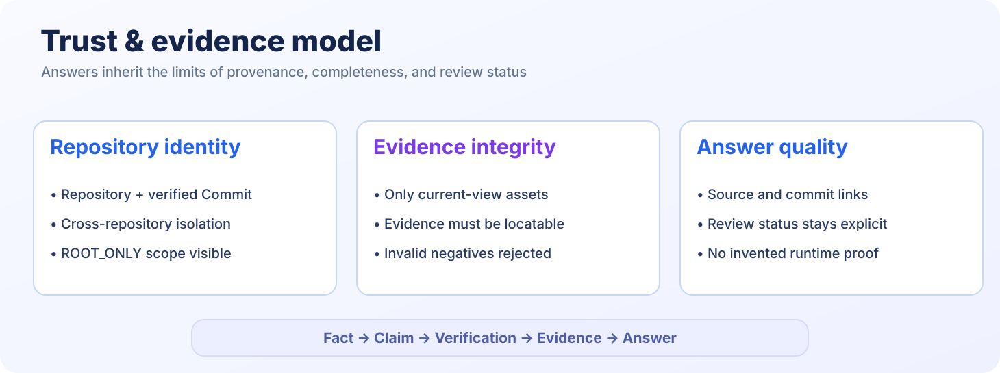

# SourceLore Security and Authorization

> Schematic illustration, not a runtime test or a claim of complete feature coverage.

This document describes SourceLore's security boundaries, authorization model, data-handling rules, and known areas that have not been hardened. Every factual statement here is grounded in source code or existing acceptance artifacts; anything unhardened, unverified, or a known risk is labeled as such rather than overstated. The Chinese version is [docs/zh-CN/SECURITY.md](../zh-CN/SECURITY.md); facts, interfaces, and statuses are identical in both languages.

## 1. Scope and threat model

SourceLore is a **local, read-only, evidence-groundable** GitHub knowledge-base tool. It captures path observations, content bytes, and source declarations from a fixed commit of a public repository into verifiable, re-queryable knowledge assets (Fact / Claim / Verification / Evidence), which it exposes to agents through a Skill plus CLI. It is **not** a general-purpose web crawler, code executor, or distribution channel.

The threat model is organized around three principles:

1. **Source trustworthiness** — every conclusion must be bound to a specific commit and repository identity and must be re-checkable.
2. **No data leakage or misuse** — third-party content is for internal analysis only; it is never promoted to instructions, never executed, and never distributed without authorization.
3. **Fail conservatively** — unknown authorization means deny the write; unresolvable evidence means downgrade the verdict; incomplete coverage means label it honestly; never guess.

## 2. Source authorization and trust boundaries

### 2.1 Input URL validation

`parse_github_url()` in `src/skill_interface/analyze.py` is the single entry point for all repository inputs and applies a strict allowlist:

- Only addresses pointing at `github.com` / `www.github.com` are accepted; **internal addresses, non-GitHub hosts, and unusual ports are rejected** (`HOST_NOT_ALLOWED` / `INVALID_URL`).
- The canonical form is `https://github.com/<owner>/<repo>`, with an optional `tree/<ref>` suffix; only default HTTP/HTTPS ports are allowed.
- The owner and name must match `[A-Za-z0-9_.-]+`, preventing path injection.
- Private repositories are out of scope.

### 2.2 GitHub API client restrictions

`src/collector/github_client.py` implements a restricted client governed by five rules (G1–G5):

- **G1 Fixed target**: only the verified `api.github.com` is contacted (`ALLOWED_HOST`, `ALLOWED_SCHEME=https`); user input is never handed to a general downloader as a URL. Protocol-relative paths (`//host`), parent-directory traversal, and empty segments are rejected before URL assembly, and the host/scheme are re-verified with `urlsplit` afterward.
- **G2 Error classification**: 401/403/404/429/5xx must not be collapsed into "empty repository"; they are classified by response headers and body.
- **G3 Rate-limit detection**: determination uses `x-ratelimit-remaining`, `retry-after`, and the response body message, not status code alone; primary and secondary rate limits are distinguished.
- **G4 Bounded retries**: a limited number of retries with backoff; unbounded retries and rate-limit circumvention are prohibited.
- **G5 Token confidentiality**: the token is never written to logs, checkpoints, snapshots, or any commit.

Each capture has hard limits (`DEFAULT_LIMITS`): 20-second request timeout, 40 requests maximum, 3 retries maximum per request, 120-second cap on server-suggested wait, 2,000 Tree entries maximum, 1,000,000 bytes per blob, 4,000,000 bytes total, and a recursion depth limit of 12. The Skill path (`analyze.py`) tightens this further to `max_retries=0` and `max_retry_after=0`: on rate limiting it fails fast, reports the condition faithfully, returns the decision to the user, and neither waits for long nor circumvents the quota.

### 2.3 Five-dimensional authorization gate

Content-acquisition authorization is decided independently in `src/collector/content_acquisition_policy.py` (`POLICY_VERSION = content-authz/2`). Five actions are evaluated **separately and must never be merged**:

| Dimension | Operation code | Meaning |
|---|---|---|
| FETCH | `fetch` | Read bytes from GitHub |
| PERSIST | `persist_bytes` | Persist raw bytes for internal analysis |
| DERIVE_FACTS | `derive_facts` | Derive Facts from content |
| PREVIEW | `internal_preview` | Internal preview / copy into cards |
| DISTRIBUTE | `external_distribution` | Redistribute externally |

Key rules:

- Authorization must come from a **structured authorization reference** (`build_authorization_ref`); a bare boolean is never accepted as authorization. The reference carries `authorization_kind`, `repository_id`, `scope`, `source`, and `verification_status`.
- The four kinds — `PROJECT_OWNED_WORK`, `ORIGINAL_TEST_FIXTURE`, `LICENSE_OBSERVED_AND_APPLICABLE`, and `USER_EXPLICIT_GRANT` — cover only the four internal actions (FETCH/PERSIST/DERIVE_FACTS/PREVIEW); **none covers DISTRIBUTE**.
- Binding checks: a wrong repository, an unknown kind, or an unverified (`UNVERIFIED`) reference is denied or judged `UNKNOWN`.
- **Distribution is always blocked**: `evaluate_operation` returns `DENY` for `OP_DISTRIBUTE` whenever the gate has not been independently closed, with reason code `DISTRIBUTION_GATE_OPEN_BLOCKED` and fixed limitations `B-1/B-2/B-3 OPEN` and `copy_permitted=false`. The actual state is `distribution_allowed=false` and `copy_permitted=false`; output is internal preview only.
- Path safety (`path_is_safe`): absolute paths, backslashes, `..` traversal, overlong paths (>255), and sensitive filenames (`.env`, `.npmrc`, `id_rsa`, `credentials`, etc.) are rejected even if they would otherwise match the allowlist.

### 2.4 Read-side second gate

Even after bytes have been persisted, the read path re-validates them in `src/content/captured_blob_loader.py:42-52`: an acquisition policy of `AUTHORIZATION_UNKNOWN`, `ACQUISITION_BLOCKED`, or `METADATA_ONLY` yields `CONTENT_ACQUISITION_BLOCKED`; a `completeness_status` other than `COMPLETE` yields `CONTENT_PARTIAL`; reading the same path at a different commit yields `COMMIT_MISMATCH`. This loader **never accesses the network**.

## 3. Data security

### 3.1 Read-only capture, zero execution

SourceLore performs read-only capture only: it **never pushes, never creates Issues, never executes repository scripts**, and never uses `exec`, `eval`, imports, test runs, or shell execution. Content from the analyzed repository is always treated as data to be analyzed and is never promoted to system-level instructions. This discipline is fixed in the F1-B security decisions as seven checkable rules (A-1 through A-7, each with a `rule_id` + `detection_method` + `failure_action`):

- A-1 README / SKILL.md / Issues / comments / configuration values are data, not instructions.
- A-2 External content may not request execution of local shell commands.
- A-3 An analysis task may not be used as a pretext to read unrelated private files or environment variables.
- A-4 Tool calls follow least privilege.
- A-5 Local private source code may not be uploaded to a third-party service without explicit authorization.
- A-6 Sensitive information may not enter reports or knowledge cards directly.
- A-7 The review procedure is decided by SourceLore; an external repository is only the object under review (a meta-level constraint).

### 3.2 Token handling

`GITHUB_TOKEN` is **read only from the process environment** (`github_client.py` and `analyze.py`) and is assembled only in memory into an `Authorization: Bearer` header; it is never written to logs, assets, checkpoints, or Git. `analyze --no-token` disables it for a single invocation even when the variable is present; offline queries never require a token. The unauthenticated quota is 60 requests/hour.

### 3.3 Data root and Git exclusion

The knowledge-base data root defaults to `~/.sourcelore/` and can be overridden with `--data-root` or `SOURCELORE_DATA_ROOT`; the database file `kb.db` is **never written into the source repository**. `.gitignore` excludes `knowledge/`, `cache/`, `upstreams/`, project-level `/.dsh/skills/`, `.env` and `.env.*`, `*.key` / `*.pem` / `secrets/` / `*.token`, as well as Python build and editor artifacts, so knowledge assets and credentials are never pushed with the code.

### 3.4 Areas not hardened (recorded honestly)

- The database file is created with the default `0644` permissions and directories with `0755`; **no additional permission hardening is applied**. On a multi-user host this is an item for the operator to evaluate; the tool makes no claim of isolation.
- The project **has not chosen a first-party open-source license**. Its source repository remains private pending historical privacy and licensing review; the owner has requested eventual public visibility. This decision is separate from blocked redistribution of third-party knowledge. See [Public release readiness](PUBLIC-RELEASE.md).

## 4. Privacy

- **Known risk**: several historical progress documents (under `progress/`) contain private local paths such as `/home/arlune_innersea/...` and `/mnt/Server_Data_Center/...`. Before pushing any document or repository externally, these paths **must be checked and cleaned**, otherwise the local directory structure and username will be exposed.
- Credentials, keys, and local configuration are excluded by `.gitignore` and should not enter version control.
- Sensitivity classification and redaction are defined in F1-B as a four-stage gate: P-1 classification, P-2 redaction (machine), P-3 human review, and P-4 release approval (human only). Passing redaction does not imply permission to publish; AI may not mark an artifact requiring human approval as approved; keeping raw scan output off disk is a structural constraint, not an after-the-fact deletion.

## 5. Network budget

- Network access occurs only during capture; **queries, `answer`, and card generation make zero network requests** (asserted via `network_requests=0`).
- The unauthenticated GitHub quota is 60 requests/hour; rate limits are reported faithfully and are neither circumvented nor retried without bound.
- Content-level budgets: 256 KiB per blob, 2 MiB per batch, at most 32 candidate paths, and at most 100 Facts per file. These caps also serve to limit how much byte content enters local assets.

## 6. Third-party content boundary

- Six upstream projects were audited read-only during development, recorded in `THIRD_PARTY_NOTICES.md` and `docs/upstream-manifest.json`. This repository contains no third-party source code, prompts, rule text, or templates.
- UPSTREAM-01 through 05 use MIT / MIT / CC BY 4.0 / MIT / Apache-2.0 respectively, and convey **only abstract design ideas, with no code or text copying**.
- **UPSTREAM-06 (Consensys/repo-security-review) has no license and was copied zero times**: its source code, prompts, rule text, and templates may not be copied; only the shape of its mechanisms is described and SourceLore's own contracts were designed independently. Snapshot copies under `upstreams/` are excluded by `.gitignore`, never entered repository history, and its `setup.sh` was never executed.
- The project depends on no code from those upstreams and on none of the scanners they install (gitleaks, osv-scanner, semgrep, pip-audit, grype); none of those tools was installed or run.

## 7. Distribution restrictions

All third-party-derived knowledge output (knowledge cards, reports, repository-derived documents) is **internal preview only**: `distribution_allowed=false`, `copy_permitted=false`, and distribution gates B-1/B-2/B-3 remain open. Any external distribution must first resolve these three gates and the licensing questions and complete human P-3 / P-4 approval; no compliant public distribution path exists at present.

## 8. Trust rules (evidence-related)

- A commit is trusted only when bound to a registered snapshot of that repository; 40-hex placeholder values such as `aaaa…`, `0000…`, and `ffff…` are never authenticated.
- Claims and Facts are identity-checked against the repository and commit; cross-repository commits are blocked.
- Only the current view (`current_view`) decides which assets are valid now; historical verdicts are never silently mixed in.
- Evidence completeness is `FULLY_LOCATABLE`, `PARTIALLY_LOCATABLE`, or `UNRESOLVED_NO_INTEGRITY`; an unresolvable reference downgrades a verdict to `insufficient_evidence`, **never** to `refuted`.
- `ROOT_ONLY` means only the repository root was enumerated and is **never** presented as full `COMPLETE` coverage; missing content is "not analyzed", not "does not exist".

## 9. References

- Source: `src/collector/content_acquisition_policy.py`, `src/collector/github_client.py`, `src/content/captured_blob_loader.py`, `src/skill_interface/analyze.py`, `src/trust/policy.py`, `src/trust/tree_scope.py`
- Decisions and notices: `docs/fusion/F1B_SECURITY_DECISIONS.md`, `THIRD_PARTY_NOTICES.md`, `docs/upstream-manifest.json`
- Related documents: [Testing](TESTING.md), [Roadmap](ROADMAP.md), [Installation](INSTALLATION.md)
