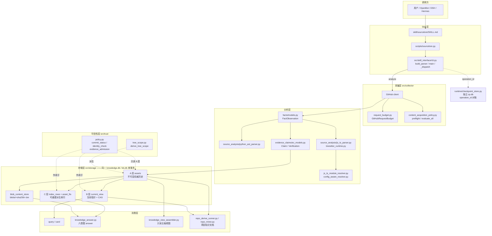
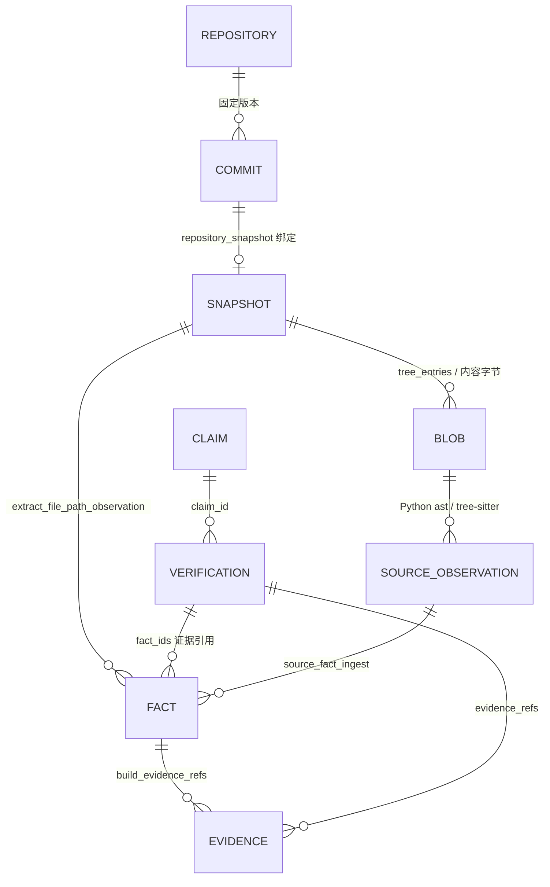

# SourceLore 系统架构

> 本文描述**当前实现**，依据 `src/` 源码、`tests/` 与 `docs/implementation/`、`docs/fusion/` 设计记录取证。每条结论都标注了可核对的源码路径或设计记录；历史规划与当前实现分开陈述，不做推测。命令、状态码、枚举值一律保持源码原文。

## 5.1 总体架构

SourceLore 是一个**本地、证据可回查的 GitHub 知识库**，不是模型服务，也不执行第三方代码（`README.md`）。它把公开仓库固定到某个 Commit，把可机械验证的观察登记为资产，再通过 Skill + CLI 供 OpenBot、DSH、Hermes 等 Agent 调用。核心立场是「观察，不推断」「固定版本」「当前视图显式化」「离线优先」。

### 端到端数据流

用户 / OpenBot / DSH / Hermes → **Skill**（`skill/sourcelore/SKILL.md` + `scripts/sourcelore.py`）→ **CLI**（`src/skill_interface/cli.py`：`analyze` / `query` / `answer` / `derive` / `card`）→ **采集器**（`src/collector/`：GitHub client、请求预算、采集授权）→ **分析器**（`src/facts/`、`src/source_analysis/`：内容抽取、Python `ast`、JS/TS tree-sitter、模块解析）→ **Fact / Claim / Verification / Evidence** → **存储**（`src/storage/`：A/B/C 层）→ **Query / Answer / 派生视图**（`src/views/`、`src/skill_interface/knowledge_answer.py`）→ **项目知识文档**（`repo_miner` 产出的 documents）。



**关键架构判断**（均有源码依据）：

1. **单一权威库**：A/B/C 三层放在同一个库文件里、一个事务约束；逻辑名 `knowledge.db`（`docs/implementation/F2_P1B_STORAGE_ARCHITECTURE.md`），实际由 `src/skill_interface/paths.py` 的 `db_path()` 解析为 `<data_root>/kb.db`。checkpoint 是独立的 `cp.db`，二者之间没有全局 ACID，靠 `operation_id` 对账（`src/runtime/asset_checkpoint_coordinator.py`）。
2. **Skill 是薄 CLI**：`skill_interface` 只做参数解析与分发，禁止第二套 GitHub 实现或第二套 Renderer（`docs/implementation/F2_P5A_SKILL_CONTRACT.md`）。
3. **可信性判定只有一套**：`src/trust/policy.py` 供 Asset Ingest / Index Rebuild / Current View / Knowledge Query / Evidence Resolver / Claim Verifier / Derived Views 共用，只读 A 层，不创造新 reason_code。
4. **不执行仓库代码**：解析只用 Python `ast` 与 tree-sitter grammar，缺则 `PARSER_UNAVAILABLE`，绝不降级为正则猜测（`src/source_analysis/treesitter_runtime.py`）。

---

## 5.2 模块设计

下表逐模块给出真实源码路径、职责、依赖、输入/输出、错误处理与「为何需要」。路径均相对项目根 `SourceLore/`。

| 模块（源码路径） | 职责 | 主要依赖 | 输入 → 输出 | 错误处理 | 为何需要 |
|---|---|---|---|---|---|
| `src/skill_interface/cli.py` | 统一 CLI：`build_parser()` 定义命令；`main()` 解析参数与退出码；`_dispatch()` 分发到既有模块；`_preflight_budget()` 远程采集预算预检 | `paths`、`result`、各业务模块 | argv → stdout 结构化 JSON / stderr 摘要 / 退出码 0/1/2/3 | `SkillError` → `emit_error`；其它异常转 `INTERNAL_ERROR`（带 traceback 尾三行），不吞底层错误 | Agent 只有一个入口；保持「stdout 恒为 JSON」的机器可读契约 |
| `src/skill_interface/knowledge_answer.py` | 面向用户的知识问答：`detect_intent()` 六意图；`answer()` 只读检索、`audit` 按需附加 | `repo_miner`、`repo_derive_runner`、`paths`、`trust/policy`、`knowledge_store` | repository_id + 自然语言问题 → `{intent, blocks[], audit, network_requests:0, wrote_assets:0}` | 仓库未登记 → `REPOSITORY_NOT_REGISTERED` | 普通用户要的是用途/安装/示例，不是 Fact/Claim 统计；内容优先、审计隔离 |
| `src/skill_interface/paths.py` | 数据根、包根、导入路径单一权威来源；`db_path()`、`guard_inside_project_db()` | 无 | --data-root / 环境变量 / 配置文件 → 数据根 | 库路径落进工程根 → `RuntimeError` | 不依赖 cwd、不硬编码机器路径；CLI/Skill/定时任务共用一套发现规则 |
| `src/collector/request_budget.py` | `GitHubRequestBudget`：计划项、响应头观察、三重闸门 `can_spend()`；`classify_rate_limit()` 区分主/次级限流 | 无 | plan item + 响应头 → `BUDGET_OK` / `REQUEST_BUDGET_INSUFFICIENT` / `BUDGET_EXHAUSTED` / `BUDGET_RATE_LIMITED` | 无权威响应头 → 视为不足（宁可不发） | 本地记录 ≠ 网络侧真实配额（匿名配额按 IP、其他进程也消耗），只用响应头推断剩余 |
| `src/collector/content_acquisition_policy.py` | 内容采集前置授权：`preflight()` 与五维 `evaluate_operation()` / `evaluate_all()` | 无 | 仓库/Commit/路径/授权引用 → `ACQUISITION_ALLOWED` / `METADATA_ONLY` / `ACQUISITION_BLOCKED` / `AUTHORIZATION_UNKNOWN`；五维 `ALLOW`/`DENY`/`UNKNOWN` | 路径不安全、身份不全、目的非 `internal_analysis` → `DENY`；分发恒 `DISTRIBUTION_GATE_OPEN_BLOCKED` | 公开可见 ≠ 允许永久复制；`fetch`/`persist_bytes`/`derive_facts`/`internal_preview`/`external_distribution` 五动作分别判 |
| `src/storage/asset_models.py` | A/B/C 共用资产模型：`AssetDraft`、`Asset`、`SourceSnapshot`；`content_hash_of()`、`reject_sensitive()`、`validate_id()` | 无 | payload → 合法草稿 / `ModelError` | 非法类型 / ID 字符 / 敏感字段 / 版本 < 1 → `ModelError`（写库前拒绝） | 逻辑身份 ≠ 内容哈希 ≠ 物理版本，三者不能互相替代；敏感字段按名硬拒 |
| `src/storage/knowledge_store.py` | 权威存储：`_init_schema()` 建 A/B/C 表与触发器；`append_asset_and_advance()` 实现 W-1..W-5；`current_pointer()`、`bind_repo()`、`rebuild` 无关但 `history()` 等 | `asset_models` | `AssetDraft` + expected_version → `{ok, asset_id, pointer_version}` | `CONFLICT` / `NOT_FOUND` / `PERMISSION_DENIED` / `CHECKPOINT_CORRUPT` | A/B 同事务、postcondition 提交前执行；跨仓库同名不得合并；ID 内部生成避免路径穿越 |
| `src/storage/index_store.py` | C 层：`rebuild_index()` 从 A 层重灌；`query()` 结构化 + 全文检索；`_decorate()` 补出处 | `knowledge_store`、`trust/policy` | 过滤条件 → 带 `asset_id`/`is_current`/`authority` 的结果 | 索引表不存在 → `INDEX_MISSING`（不返回空列表） | 索引缺失 ≠ 知识不存在；FTS5 可用则用、不可用退化 LIKE，代码不依赖它 |
| `src/storage/blob_content_store.py` | 内容字节按 `content_sha256` 存 `<data_root>/blobs/<sha256>.bin`，`get_bytes()` 校验后返回 | 无 | data_root + digest → raw bytes 或 error | 摘要不符 → 校验失败 | 正文不在资产 payload 里（只有元数据），字节与元数据由 digest 强绑定 |
| `src/facts/models.py` | 确定性观察：`FactObservation`、`make_fact_id()`、`make_content_hash()`、`build_evidence_refs()`；三观察态 + UNKNOWN 原因码 | 无 | 快照 + 规则 + 参数 → Fact | 非法观察态 / UNKNOWN 无原因 → `ValueError` | 事实身份不含 `observed_at`；UNKNOWN 不能用 `[]`/`False`/`NOT_FOUND` 冒充 |
| `src/evidence_claims/ec_models.py` | 命题与裁决：`Claim`、`Verification`、`make_claim_id()`、`make_verification_id()`；支持的 claim 类型与 reason_code 封闭表 | `facts`（路径规则同口径） | Fact 集合 + 规则 → Verification | 不支持的命题 → `UNSUPPORTED_CLAIM_TYPE`；`insufficient_evidence` 必须带 reason_code | claim_id 只看命题本身不看证据；证据/规则变则新 verification_id |
| `src/trust/policy.py` | 统一可信性：`commit_status()`、`identity_check()`、`current_asset_ids()`、`resolve_verification_for_claim()`、`evidence_admission()`、`refutation_soundness()` | `knowledge_store` | payload + 快照集 → `{ok, reasons[], commit_status}` | 跨仓库/占位/冲突 Commit → `REPOSITORY_MISMATCH`/`COMMIT_MISMATCH` | P0 统一准入，避免各消费端各自判身份、把历史裁决当当前 |
| `src/trust/tree_scope.py` | 从快照客观字段派生真实树覆盖：`derive_tree_scope()`、`snapshot_for_commit()` | `knowledge_store` | snapshot payload → `COMPLETE`/`ROOT_ONLY`/`PARTIAL` | 只读派生，不改冻结快照 | 历史快照把 ROOT_ONLY 误标 COMPLETE；本模块重建真实覆盖度，不伪造 COMPLETE |
| `src/source_analysis/python_ast_parser.py` | Python 源码结构：符号声明 + 静态导入，Python 内置 `ast` | Python `ast` | 已采字节 → observation | 解析失败 → 明确状态，不猜测 | 不执行仓库代码，只做静态结构观察 |
| `src/source_analysis/treesitter_runtime.py` | tree-sitter 运行时：`get_parser()`、`parse_bytes()`、`language_for_path()`；grammar 版本固定 | 项目 `.venv` 内 grammar | 字节 + 语言 → tree + 诊断 | 缺 grammar → `PARSER_UNAVAILABLE`；`TREE_SITTER_CORE_MISSING` / `GRAMMAR_LOAD_FAILED` | 依赖隔离，不自动下载；防恶意大树的 `MAX_NODES`/`MAX_DEPTH` 预算 |
| `src/source_analysis/js_ts_import_export_rules.py` / `js_ts_module_resolver.py` / `config_aware_resolver.py` | JS/TS 导入导出静态规则与模块解析 | tree-sitter | AST 节点 → 导入/导出观察 + 解析状态 | 动态说明符 → `DYNAMIC_MODULE_SPECIFIER`；子路径缺失 → `SUBPATH_NOT_IN_EXPORTS` | `require("x")` 记为 `LITERAL_REQUIRE_CALL_OBSERVED`（调用观察），不冒充 ESM 声明；多条件 `MULTIPLE_CONDITIONS_AVAILABLE` 不任选 |
| `src/views/repo_miner.py` | 项目知识挖掘：`mine_project_knowledge()` 组装 5 类文档；**不调用任何 LLM**，只做确定性组装 | `blob_content_store`、`bot_card` | 已采字节 + 树 + Claim → documents + project 元信息 | 正文/快照缺失 → 写「未分析」，不编造 | 把证据组织成可阅读的项目文档；README 首段、manifest 字段直接引用，不推断 |
| `src/views/knowledge_view_assembler.py` | D 层只读投影：`assemble_from_verification()`，五状态轴分离，不合并成 `is_valid` | `view_models`、`view_integrity`、`lc_models` | 已提交资产 → KnowledgeView 或诊断码 | 证据损坏 → `EVIDENCE_CORRUPT`；无可用证据照常装配并标注 | 没有第二套裁决器；历史观测不冒充当前实时状态 |
| `src/views/repo_derive_runner.py` | 把派生视图生成固化为可复现命令 `derive <rid>`；`_load_assets()` / `_code_rows()` | `repo_graph_derivation`、`repo_card_projection`、`repo_miner`、`query` | 仓库 ID → 派生视图 + 项目文档 | 无快照 → `NO_SNAPSHOT` | 取代一次性临时脚本，纳入源码、入口与测试 |
| `src/lifecycle/lc_models.py` | 新鲜度模型：`VERSION_ALIGNED` / `POSSIBLY_STALE` / `UNKNOWN` / `NOT_APPLICABLE_TO_PINNED` | 无 | 观测 ref 与基线 → freshness 评估 | 非法状态/缺失可信 commit → `ValueError` | 固定 Commit 的知识是否可能过时，是独立于证据裁决的一根状态轴 |
| `src/runtime/asset_checkpoint_coordinator.py` | 跨库对账：`RECONCILED` / `RETRY_SAFE` / `NEEDS_HUMAN` | `checkpoint_store`、`knowledge_store` | operation_id → 对账状态 | 库不可读 / checkpoint 损坏 → `NEEDS_HUMAN` | 两库无全局事务，只用持久化记录判定，不靠「我记得提交了」 |

---

## 5.3 数据架构（A/B/C/D 分层）

### 分层含义

| 层 | 载体 | 权威性 | 可变性 | 源码依据 |
|---|---|---|---|---|
| **A 不可变来源资产** | 同库 `assets` 表 | 知识权威 | 只追加；`UPDATE`/`DELETE` 被触发器 `A_LAYER_IMMUTABLE` 硬拦 | `knowledge_store.py` `_init_schema()` |
| **B 当前指针** | 同库 `current_view` 表 | 当前有效版本权威 | 以 `pointer_version` CAS 推进 | `knowledge_store.py` `append_asset_and_advance()` |
| **C 派生索引** | 同库 `index_rows` + `asset_fts` | **非权威** | 可删除重建，重建不改 A/B，返回 `a_b_unchanged` | `index_store.py` `rebuild_index()` |
| **D 只读视图** | 内存投影 KnowledgeView | 非权威 | 纯只读；五轴分离，无 `is_valid` | `knowledge_view_assembler.py`、`F2_P3D_VIEW_CONTRACT.md` |

- **A/B/C 在同一库文件、一个事务**：这是刻意决定。设计记录 `F2_P1B_STORAGE_ARCHITECTURE.md` 实测过 `ATTACH` 跨库提交，结论是「SQLite 不承诺两个各自为 WAL 的库跨库原子提交」，因此把 A/B/C 放进同库、用 `BEGIN IMMEDIATE` 一个事务同时约束三层。
- **checkpoint 独立 `cp.db`**：`src/runtime/checkpoint_store.py` 维护，独立事务边界；与知识库靠 `operation_id` 对账（`operation_log.result_hash` 与 `checkpoints.result_digest` 必须同值）。三种结局：`RECONCILED`（资产已提交、checkpoint 补齐）、`RETRY_SAFE`（未提交、可幂等重试）、`NEEDS_HUMAN`（读不出/矛盾/损坏，绝不自动重做）。
- **schema_version = 1**（`meta` 表）。打开时版本不符直接 `RuntimeError`，不静默迁移；损坏不当空库、不自动重建（`PRAGMA integrity_check` 非 ok → `CHECKPOINT_CORRUPT`）。
- **PRAGMA 顺序刻意固定**：`busy_timeout=5000` → `synchronous=FULL` → `foreign_keys=ON` → `journal_mode=WAL`（带幂等重试，P1A 实证顺序错误后果）。

### 写入契约 W-1..W-5（`append_asset_and_advance`）

```
W-1 构造 AssetDraft（模型层校验：类型 / ID 字符 / 敏感字段 / 版本）
W-2 校验结构与引用（含 source_snapshot 的 sha 格式）
W-3 读 current_view 的 pointer_version，与 expected_version 比较 → 不等即 CONFLICT
W-4 INSERT assets + UPDATE/INSERT current_view（同一事务）
     + postcondition(cursor) 在 COMMIT 之前执行
     + C 层索引增补 + operation_log 写入（同事务）
W-5 COMMIT；任何异常 → ROLLBACK，不暴露部分状态
```

`postcondition` 抛异常即回滚，测试 `test_failing_postcondition_rolls_back_everything` 断言 A 层 0 行、B 层无指针、C 层 0 行。指针状态三值：`ok`、`dangling_pointer`（指向资产不存在，带 `last_known_good` 仅供诊断）、无记录 `NOT_FOUND`；**dangling 绝不能报成 `NOT_FOUND`**。

---

## 5.4 知识模型

### 实体关系



- **Repository / Commit / Blob**：`repository_id` 是仓库锚点；`commit_sha` 是版本身份（40 位十六进制）；`captured_blob_content` 资产只存元数据，真实字节在 `<data_root>/blobs/<sha256>.bin`，由 `blob_content_store.get_bytes()` 按 `content_sha256` 校验读回（`src/views/repo_miner.py` 的审计纠正）。
- **Snapshot**：`repository_snapshot` 资产的 payload 含 `commit_sha`、`root_tree_sha`、`tree_query_ref`、`tree_entries`、`completeness_status`。三字段**语义不同不可互换**——GitHub Trees API 以 commit-ish 为 ref 时返回 `sha` 是**请求回显**而非根 tree SHA（`docs/fusion/BASELINE.md` F0-D01）。
- **Fact**：`FactObservation`，身份 `SL-FACT-<sha256前40>` 由 `repository_id + snapshot_logical_identity + rule_id + rule_version + normalized_parameters + item_key` 派生，不含 `observed_at`。三观察态：`OBSERVED_PRESENT`、`OBSERVED_ABSENT_IN_COVERED_SCOPE`、`UNKNOWN`。
- **Claim**：`Claim`，身份 `SL-CLAIM-<sha256前40>` 由命题本身（repository_id / commit_sha / claim_type / normalized_parameters / schema）决定，**不含证据**。支持类型包括 `repository_path_exists`、内容级命题与源码结构命题。
- **Verification**：`Verification`，身份 `SL-VERIF-<sha256前40>` 由 `claim_id + 已排序 fact_ids + 已排序 fact_content_hashes + rule_version + 参数` 决定，时间戳不参与。三裁决：`supported` / `refuted` / `insufficient_evidence`。
- **Evidence**：结构化 `evidence_refs`（`source_snapshot` + `tree_entry`），不是自然语言；证据对象存在 ≠ 证据足以支持结论。

### 数据流示例（路径命题）

1. `analyze <url>` → 固定 Commit → 抓 tree → `repository_snapshot` 资产入库（A 层）。
2. `extract_file_path_observation` 对目标路径产出 Fact：`OBSERVED_PRESENT`（有真实 tree_entry）或 `OBSERVED_ABSENT_IN_COVERED_SCOPE`（仅 COMPLETE 覆盖下）或 `UNKNOWN`（带 `UNKNOWN_REASONS` 之一）。
3. `verify_path_claim` 取 Fact 集合 + 规则 → Verification：`supported` 需支持性事实；反证需 `refutation_soundness` 通过（路径精确匹配、覆盖声明满足）。
4. A/B 同事务推进指针；C 层索引增补。
5. `query --type claims` / `card` / `derive` / `answer` 从 B/C 指针与 A 资产投影；历史裁决只在 `list_historical_verifications()` 与视图 `history_refs` 中体现，不混入当前结论。

---

## 5.5 可信性架构

这一节集中说明 P0 修复后的可信性机制，每条都结合源码与历史缺陷。

### Commit 绑定与三字段分离

`commit_status()`（`src/trust/policy.py`）给出**五码**：`COMMIT_UNKNOWN`（非 40 位十六进制）、`COMMIT_FORMAT_VALID`（格式合法但未绑定本仓库快照，或已知占位 `aaaa…`/`000…`/`ffff…`）、`COMMIT_BOUND_TO_REPOSITORY`（命中该仓库 `repository_snapshot` 的 commit）、`COMMIT_SNAPSHOT_VERIFIED`（命中且有 payload）、`COMMIT_IDENTITY_CONFLICT`（同 commit 多 payload 的 `root_tree_sha` 不一致）。只有 `is_authenticated_commit()` 认可的两码能作为当前可信版本身份。`identity_check()` 对跨仓库 Commit 和占位 Commit 一律给出 `COMMIT_MISMATCH`，**即使 payload.repository_id 伪装正确**——这修掉了 P0/D1「Claim 挂跨仓库 Commit」的缺陷。

`SourceSnapshot` 的 `commit_sha` / `root_tree_sha` / `tree_query_ref` 三字段独立且各自校验（后者允许与 commit 相同但不等于 tree sha），依据 F0-D01 的 Trees API 回显实验。

### 跨仓库污染防护

`repository_id` 是仓库锚点，`subject_id` 是知识主体身份，`commit_sha` 是版本，`workspace_id` 是运行作用域、**不是 Subject 身份**。`repo_bindings` 必须带 `evidence_ref`；`bind_repo()` 无证据引用直接 `PERMISSION_DENIED`。`same_subject_across_repos()` 只列关系不合并身份。`rebuild_index()` 用 `identity_check()` 对 `repository_snapshot` 以外的资产做准入，污染/占位资产进 `quarantined` 清单、不进 C 层，但 A 层原封不动。

### 当前视图隔离

`current_asset_ids()` 是**唯一**允许的「当前有效资产」来源：JOIN `current_view` 与 `assets`，只返回被当前指针采纳且实存、身份匹配的资产。`resolve_verification_for_claim()` 只认当前 verification；历史版本通过 `list_historical_verifications()` 查询。`answer()` 的审计统计也按 `current_asset_ids()` 过滤，未被当前指针采纳的历史 Verification 不混入。`dangling_pointer` 返回 `CHECKPOINT_CORRUPT` + `last_known_good`，不等于 `NOT_FOUND`。

### 证据完整性门禁

`evidence_admission()` 定义四级：`EV_FULL = FULLY_LOCATABLE`、`EV_PARTIAL = PARTIALLY_LOCATABLE`、`EV_UNRESOLVED = UNRESOLVED_NO_INTEGRITY`、`EV_NONE = NO_EVIDENCE`。只有 `FULLY_LOCATABLE` 才采信原始 verdict；其余一律降级为 `insufficient_evidence` 并带 reason_code（`EVIDENCE_FIELD_MISSING` / `FACT_NOT_FOUND` / `PARTIAL_EVIDENCE_INSUFFICIENT`）。**非当前视图裁决不采信**（`SCOPE_NOT_COVERING`）。

### 三态裁决与反证约束

`VERIFICATION_STATES = {supported, refuted, insufficient_evidence}`。`insufficient_evidence` 必须带封闭 reason_code 表中的原因；`supported` 必须有支持性事实；非 insufficient 不得带 reason_code。`refutation_soundness()` 要求反证事实声明 `COMPLETE` 覆盖；目录子树未展开的非根级路径不构成反证（`PARTIAL_CANNOT_REFUTE`）；路径必须精确匹配（README ≠ README.md，Git 大小写敏感），否则 `PATH_MISMATCH`。

### 未采集 ≠ 不存在 / ROOT_ONLY

`UNKNOWN` 绝不用 `[]` / `False` / `NOT_FOUND` 冒充，必须带 `UNKNOWN_REASONS`（如 `SCOPE_NOT_COVERING`、`TREE_TRUNCATED`、`PARTIAL_SNAPSHOT`）。`OBSERVED_ABSENT_IN_COVERED_SCOPE` 只在已完整覆盖范围内成立。历史快照把 ROOT_ONLY 误标 COMPLETE，`derive_tree_scope()`（P0/D5）从客观字段重新派生：`DEEP_WALK_COMPLETE` 且未截断 → `COMPLETE`；根层枚举但有未展开子树 → `ROOT_ONLY`（`ROOT_ONLY_SUBTREES_UNENUMERATED`）；截断 → `PARTIAL`。`repo_miner` 的 `coverage_note` 如实标注「仅根层；子目录内容未采集」，`derive` 的 `tree_status=ROOT_ONLY` 不得「修正」成 COMPLETE。

### 不可变资产保护

`assets_no_update` / `assets_no_delete` 触发器以 `A_LAYER_IMMUTABLE` 硬拦原地修改；查重走 `UNIQUE(repository_id, logical_identity, asset_version)` 而非 content_hash（两条不同知识可有相同 payload）；同版本同内容按幂等处理，同版本不同内容 `CONFLICT`。资产 ID 内部生成 `SL-A-` + sha256 前 32 位且含 `repository_id`，避免跨仓库同名撞主键；用户输入只作数据，不参与决定文件或 ID。

---

## 5.6 知识问答架构

### 意图分流

`detect_intent()`（按 `_PATTERNS` 顺序优先级，无法识别回退 `introduce`）把自然语言映射为六意图：`usage`（怎么使用/安装/API/示例）、`evidence`（为什么可信/证据）、`completeness`（完整性/覆盖）、`architecture`（架构/模块/依赖）、`code`（源码/函数/符号）、`introduce`（介绍/用途/概览，默认）。`_INTENT_PLAN` 为每个意图指定要展示的 `document_id` + `section_id`，中英标题关键词映射（`使用/安装 → install/usage`、`性能 → benchmark` 等）让中文问题命中英文 README 标题。

### 为何默认输出项目知识而非统计

`knowledge_answer.py` 的铁律是「内容优先」：默认回答用途/能力/使用/结构/代码；`audit`（`claim_count` / `verdict_distribution` / `coverage_note` 等）只在 `evidence` / `completeness` 意图附加，其余意图 `audit=null`，避免统计淹没普通答案。答案块取 `blocks[].body`（真实正文），`refs` 用于追溯，`distribution_allowed=false`、`freeze_state=FROZEN_INTERNAL_RESTRICTED`、`network_requests=0`、`wrote_assets=0`。

### 正文与字面匹配的现状

`repo_miner.mine_project_knowledge()` 从 `<data_root>/blobs/*.bin` 读已验证字节：README 首段直接引用为「项目用途」，manifest 字段直接引用为「技术栈」。源码符号有两条路径：
- **AST 路径**：`answer()` 先调用 `repo_derive_runner._code_rows()`（经 `query --type code`）取源码结构观察（符号/导入/导出）；`repo_miner` 的 `entrypoints` / `imports` 段落优先使用这些 `code_rows`（`refs` 标 `source_fact`）。
- **字面回退路径**：当没有 AST 观察时，`extract_symbols_from_source()` 用正则从已采原文抽符号，并在正文中明确写「本 Commit 未做 AST 结构分析，故按字面匹配」；`require` 记为 `LITERAL_REQUIRE_CALL_OBSERVED`，匿名导出记为 `(anonymous function)` 不编造名字。

### 已知限制：AST Facts 尚未充分接入 answer

当前 `answer` 的「项目用途」「技术栈」「文件结构」等段落主要来自 README / manifest / tree，而非直接消费 `extracted_fact` / `source_structure_observation` 资产；`code_rows` 只在有源码观察时进入导出/依赖段落，且 `repo_miner` 仍保留正则回退。也就是说，已有的 AST Facts 与 `source_import_declared` 等命题尚未在所有意图中充分贯通到 answer——这是消费层缺口，不是分析层缺失（参见 `content-qa.md`「先盘点已有能力再动手建内容理解」）。所有缺失处一律写「未分析 / 证据不足」，不从文件名推断功能。

---

## 5.7 Agent 集成

### Skill 安装与单一维护源

唯一维护源是仓库内 `SourceLore/skill/sourcelore/`（`SKILL.md`、`references/`、`scripts/sourcelore.py`），受控复制到 `~/.agents/skills/sourcelore/`。安装目录带 `.sourcelore-skill.json` 记录 `project`、`project_root`、`source`、`source_tree_hash`，用于判断安装版是否与工程版同步；不同步需重新安装，不在安装目录里改逻辑。入口恒为：

```
python3 ~/.agents/skills/sourcelore/scripts/sourcelore.py <子命令>
```

`src/` 下扁平模块由 `paths.ensure_import_path()` 注入 `sys.path`，不依赖 cwd。Skill frontmatter 的 `description` 与触发词决定 DSH 侧发现（skill 目录扫描 + frontmatter description 触发）。

### OpenBot / Hermes-ACP / DSH 关系

`README.md` 说明答案通过「Skill + CLI」供 OpenBot、DSH、Hermes 等 Agent 调用。设计记录 `docs/fusion/F1B_DSH_ADAPTER_DECISIONS.md` 明确：DSH 侧由 skill 目录扫描 + frontmatter description 触发发现（「部分验证」）；**BotHarness 侧发现机制未实测 → UNVERIFIED**；工具执行权限与用户审批传递在 DSH 侧存在但 Skill 内部审批传递 **UNVERIFIED**。这些是如实标注的覆盖边界，不臆测。

### 数据根发现

优先级（单一权威来源）：`--data-root` 参数 → `SOURCELORE_DATA_ROOT` 环境变量 → `~/.config/sourcelore/config.json` 的 `data_root` → `~/.sourcelore`（旧默认）。当前 `config.json` 指向 `SourceLore_Data`。`db_path()` 返回 `<data_root>/kb.db`；内容字节在 `<data_root>/blobs/<sha256>.bin`。`guard_inside_project_db()` 拒绝把知识库写进 Git 仓库。`answer()` 对 `data_root=None` 用 `data_root or DEFAULT_DATA_ROOT` 兜底，避免误报「内容未采集」。

### CLI 调用链

`main()` → `build_parser()` → `_dispatch()`。命令集：`status`、`repositories`、`inspect`、`history`、`analyze`、`query`（`--type` = `path`/`claims`/`version`/`content`/`code`/`relation`/`project`）、`derive`、`answer`、`card`。远程采集必经 `_preflight_budget()`：建请求 DAG → 盘点本地资产标 `LOCAL_REUSE` → 至多一次 bootstrap 取权威响应头 → 三条件判定；预检不过则不采集，已完成资产仍可查询。`analyze --resume` 接真实恢复盘点；`--language` / `--relation` 等「声明式空参数」已被删除（D-61），不留假能力。

### 已知限制（如实标注）

- `answer` / `derive` 全程只读零网络、不写库；内容已捕获时复用，不为回答重新联网。
- 卡片 `distribution_allowed=false`、`freeze_state=FROZEN_INTERNAL_RESTRICTED`。
- 历史缺陷 D-1（`index_rows.commit_sha` 曾全 NULL，改为 payload 回退解析）、D-2（限流挂起约 8 分钟，analyze 实例化 `max_retries=0, max_retry_after=0` 后 2 秒内返回 `RATE_LIMITED`）已修复并留记录。
- 不声称跨两库全局 ACID；不声称外部 GitHub 请求 exactly-once；不实现 Claim 语义状态机；无自定义数据库文件权限模型（默认 umask）。
- 无 LLM 参与组装；不执行仓库代码；tree-sitter grammar 缺则 `PARSER_UNAVAILABLE`，不降级猜测。
