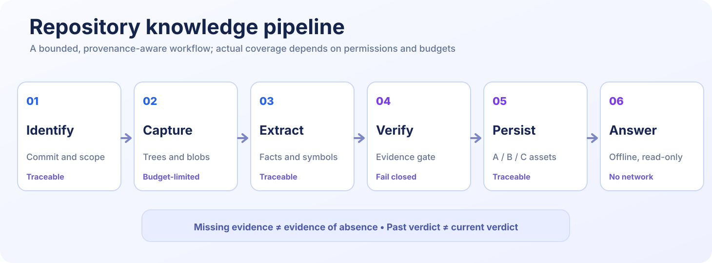

# SourceLore 处理流水线



> 概念示意图，不等于完整功能或运行验收；具体能力与限制以本文为准。

> 本文描述一条仓库知识从「公开 GitHub 仓库」到「可查询、可引用的项目知识」的真实处理路径，以及每步的 CLI 命令、状态码与恢复方式。命令来自真实 CLI 的 `--help` 与源码（`src/skill_interface/cli.py`、`src/collector/`、`src/runtime/`）；若与本文有出入，以实际 `--help` 输出为准。设计取舍见 [设计思路](DESIGN-RATIONALE.md)，结构见 [系统架构](ARCHITECTURE.md)。

---

## 1. 全览

```mermaid
flowchart TD
    U[用户 / Skill / Agent] --> CLI[CLI: analyze / query / answer / derive / card]
    CLI --> OFF{离线优先判定}
    OFF -->|--commit 命中完整快照| REUSE[复用本地快照, 0 次网络请求]
    OFF -->|--offline 且本地无| MISS[OFFLINE_CACHE_MISS, 退出码 3]
    OFF -->|需要新版本| NET[受限 HTTP 客户端 + 请求预算预检]
    NET --> TREE[Git Tree 采集: 解析 ref, 枚举 tree, 标 COMPLETE/PARTIAL/ROOT_ONLY]
    TREE --> BLOB[Blob 捕获: Git OID + sha256 校验, 五维授权门禁]
    BLOB --> BYTES[(blobs/: 已验证字节)]
    BYTES --> EXTRACT[内容抽取: README / package.json / pyproject.toml, 预算受限]
    TREE --> AST[源码解析: Python ast / JS-TS tree-sitter]
    EXTRACT --> FACTS[Fact 入库, A 层不可变]
    AST --> FACTS
    FACTS --> EC[Claim / Verification / Evidence 裁决, 三态]
    EC --> STORE[(Storage: A 不可变 / B current_view / C 派生索引)]
    STORE --> DERIVE[derive: 派生 D 层项目知识文档]
    STORE --> QUERY[query / answer / card 消费]
    DERIVE --> DOC[project-overview 等五篇文档]
    STORE -.operation_id 对账.--> CP[(checkpoint 库, 独立事务)]
```

三种存储职责：
- **A 层** `assets`：不可变权威资产，触发器 `A_LAYER_IMMUTABLE` 保护。
- **B 层** `current_view`：当前指针，CAS 决定哪条资产有效。
- **C 层** `index_rows` / FTS：可重建派生索引，**非权威**。
- **checkpoint 库**：执行状态权威，与资产库独立事务，靠 `operation_id` 对账。

---

## 2. 入口与全局约定

```sh
python3 <技能目录>/scripts/sourcelore.py <子命令> [选项]
```

- stdout 为结构化 JSON，stderr 为错误摘要，**退出码真实**。
- 数据根默认 `~/.sourcelore`，可用 `--data-root` 或 `SOURCELORE_DATA_ROOT` 覆盖；数据库文件名为 `kb.db`，**绝不写入源码仓库**（`paths.guard_inside_project_db`）。
- 核心子命令：`status`、`repositories`、`help`、`analyze`、`inspect`、`history`、`query`、`derive`、`answer`、`card`。

**CLI 退出码**（`src/skill_interface/result.py` / SKILL.md）：

| 退出码 | 含义 |
|---|---|
| 0 | 成功（stdout JSON 带 `ok: true`） |
| 1 | 执行失败（含 GitHub 错误） |
| 2 | 参数错误 |
| 3 | 知识库不可用 / 未建立（如 `KNOWLEDGE_DB_MISSING`、`OFFLINE_CACHE_MISS`、`REPOSITORY_NOT_REGISTERED`） |

**结果五态**（`src/runtime/execution_result.py`，与退出码正交）：`SUCCESS` / `FAILED` / `TIMEOUT` / `CANCELLED` / `UNKNOWN`。硬规则：`TIMEOUT` 不推断为「未执行」；`UNKNOWN` 既不是 `FAILED` 也不是 `NOT_FOUND`，是「无可判定证据」，且为非终态——副作用可能已发生而回执缺失时只允许 `UNKNOWN`。存储/授权错误另立：`NOT_FOUND` / `CONFLICT` / `PERMISSION_DENIED` / `CHECKPOINT_CORRUPT`。

---

## 3. 阶段一：仓库登记与离线优先判定

```sh
# 登记仓库、查看状态
sourcelore status
sourcelore repositories
sourcelore analyze https://github.com/<owner>/<repo> --commit <sha>
```

`analyze` 先做本地查找再决定是否联网（SKILL.md「离线优先与缓存」）：

| 情况 | 行为 |
|---|---|
| `--commit <sha>` 且本地有完整快照 | **直接复用，0 次网络请求** |
| `--offline` 且本地有 | 复用，明确标「未访问 GitHub」 |
| `--offline` 且本地无 | `OFFLINE_CACHE_MISS`，退出码 3，不伪造 |
| `--refresh` | 允许联网重新采集新版本 |
| 无 `--commit`（可变分支） | 返回 `branch_current_unknown: true` |

**关键纪律**：本地快照只证明「过去观测过的版本」，不证明分支当前仍指向它。已保存的历史版本 ≠ 远程当前最新版本。

---

## 4. 阶段二：Git Tree 采集

复核固定 Commit 后，按 ref 解析并枚举文件树（`src/collector/tree_collector.py`）。

**三字段分离**（F0-D01 / F2-P1C）：

| 字段 | 唯一合法来源 |
|---|---|
| `commit_sha` | `/commits/{ref}` 响应的 `sha` |
| `root_tree_sha` | **Commit 对象的 `commit.tree.sha`**，绝不用 Trees API 响应的 `sha` |
| `tree_query_ref` | 本次实际请求的 ref |

**Tree 三态**：

| 状态 | 条件 |
|---|---|
| `COMPLETE` | 递归或逐层遍历确实走完，且无截断 |
| `PARTIAL` | 命中资源上限，或逐层遍历也被截断（reason 如 `TREE_ENTRY_LIMIT_EXCEEDED`） |
| `INCOMPLETE` | 请求失败 |

`truncated=true` 时**绝不**直接标 `COMPLETE`：记 `truncated_seen`，退回逐层遍历（受 `max_depth` / `max_tree_entries` / `max_requests` 约束），逐层走完无截断才可为 `COMPLETE` 且留痕；仍截断则 `PARTIAL`。视图层另报 `tree_status: ROOT_ONLY` 并写入 limitations——**ROOT_ONLY 只枚举根目录，绝不冒充 COMPLETE**。

---

## 5. 阶段三：Blob 捕获与字节校验

```sh
# 从已保存快照抽取内容知识（读 Blob，无字节则明确报告）
sourcelore analyze https://github.com/<owner>/<repo> --commit <sha> --include-content
# 只报内容可用性，不采集、不联网
sourcelore analyze https://github.com/<owner>/<repo> --commit <sha> --content-status
```

- 每个 Blob 计算 `content_sha256 = sha256(raw)` 并核对 Git Blob OID（`src/collector/blob_fetcher.py`），校验通过才落 `blobs/`。
- **五维授权门禁**（`src/collector/content_acquisition_policy.py`，F2-P5E）：FETCH / PERSIST / DERIVE_FACTS / PREVIEW / DISTRIBUTE 各自独立判定；`distribution_allowed=false` 恒定，`preview_allowed=true` 不等于可分发，分发门禁 B-1/B-2/B-3 仍开放。无许可依据时 PERSIST 被拒绝、不发请求（`PERSIST_BLOCKED`）。
- 内容状态码：`CONTENT_NOT_CAPTURED`（无字节）/ `BLOB_TOO_LARGE` / `BINARY_CONTENT` / `UNSUPPORTED_ENCODING` / `CONTENT_PARSE_FAILED` / `CONTENT_PARTIAL`。

**预算**（第一版安全上限，`src/content/content_budget.py`、`src/collector/request_budget.py`）：

| 项 | 上限 |
|---|---|
| 单 Blob | 256 KiB |
| 单批 | 2 MiB |
| 候选路径 | 32 |
| 单文件 Facts | 100 |
| 单次采集请求 | 默认 8（保留 5） |

超限返回 `BLOB_TOO_LARGE` / `BATCH_BYTE_LIMIT` / `BATCH_PATH_LIMIT`；请求侧返回 `REQUEST_BUDGET_INSUFFICIENT` / `BUDGET_RATE_LIMITED`。

---

## 6. 阶段四：事实提取

事实只从已提交的 `repository_snapshot` 资产读取（`store.get_asset(..., verify=True)` 是唯一入口）：抽取器源码无网络 import、无 SQL、不看当前分支、不猜缺失文件。完整性校验失败 → `U_ASSET_INTEGRITY_FAILED`。

两类来源：
- **内容抽取**：README / `package.json` / `pyproject.toml` 等（`github_knowledge_extract.py`），`ContentEvidenceRef` 同时给**字节偏移**（权威）与**行号**（派生可读）；缺任一维即 `ref_complete=false`。`label` 只放结构化描述，不回显不可信原文。
- **源码解析**：Python `ast` / JS-TS `tree-sitter` 静态观察符号、导入、导出与模块关系；解析器缺失报 `PARSER_UNAVAILABLE`，不退化为正则，不执行仓库代码、不产出调用图或运行时行为。

**静态模块关系（P2-A）**：三条采集路径——GitHub 在线、本地 Git、离线补全——共用同一条管线（`module_relation_pipeline.py`）：已验证字节 → 现有解析器 → 导入观察 → 同 Commit 已登记 Tree → 语言解析器（Python `local_module_resolver`、JS `js_ts_module_resolver`、TS `config_aware_resolver`）→ 证据校验 → 幂等 `module_relation_ingest`。导入方、配置、目标三类证据身份严格分离；观察 ID 不冒充已落库 Fact ID，配置 blob 不冒充导入源码 blob。未解析导入写成 B 层 `module_resolution_attempt` 审计记录，绝不写成 A 层权威 Fact。在线采集从捕获文件元数据继承 provenance；离线 `cli.py backfill-relations <rid> --commit <sha>` 仅复用已捕获字节、零网络。查询状态（`status` / `status_counts`）诚实区分未分析、Tree 覆盖不足、配置缺失、候选歧义、动态/不支持形式与已解析关系——`NO_RELATIONS` 不再等于「已证实无依赖」。

Fact 写入 A 层（不可变），每条带 `commit_sha` 与证据引用，可被机械复算。

**派生知识图谱（P2-B）**：`derive <rid> --commit <sha>` 经 `versioned_assets.py` 按 repository_id + commit_sha 严格选版本，Snapshot / 正文 / AST 符号 / 关系 / Claim 全部同版本；指定 Commit 缺失返回 `COMMIT_NOT_FOUND`，不回退新版本，未指定走 `current_view`。源码符号以 AST 事实为准，正则仅在无适用 AST 观察时标为 `LITERAL_FALLBACK`；derive 通过正式 `source_knowledge.query_code()` 分页读取历史源码观察，不以固定上限冒充完整图谱。图谱节点/边 ID 含仓库、Commit、路径、作用域和导入方；P2-A 关系只有证据验证的本地解析才生成 `RESOLVES_TO`，未解析只保留观察节点，IMPORTS 不称为 CALLS。Tree 不完整时以 `in_tree=false` 补建证据节点，覆盖与限制如实记录；输出 `code-graph.json`（契约 `repo-graph/1`）带确定性 `graph_digest`，不覆盖历史产物。

---

## 7. 阶段五：Claim / Verification / Evidence 裁决

`src/trust/policy.py` 与 `src/evidence_claims/` 执行确定性裁决，不调 LLM：

- **身份核对**：Commit 必须绑定到本仓库快照才可信（`COMMIT_SNAPSHOT_VERIFIED` / `COMMIT_BOUND_TO_REPOSITORY`）；格式合法但未绑定的 40 位十六进制（含 `aaaa…` 占位）只到 `COMMIT_FORMAT_VALID`，作为当前版本身份会被 `COMMIT_MISMATCH` 阻断。
- **Verification 三态**：`supported` / `refuted` / `insufficient_evidence`。前置校验任一失败（如 `NO_FACTS`、`FACT_NOT_FOUND`、`FACT_INTEGRITY_FAILED`、`COMMIT_MISMATCH`、`PATH_MISMATCH`）→ `insufficient_evidence` 并带 reason_code。
- **证据完整性**：`FULLY_LOCATABLE` / `PARTIALLY_LOCATABLE` / `UNRESOLVED_NO_INTEGRITY`；不完整引用使裁决**降级**为 `insufficient_evidence`，绝不变为 `refuted`。引用可定位 ≠ 结论正确。
- **反证门禁**：`refutation_soundness()` 要求反证事实声明 `COMPLETE` 覆盖；未展开子树且非根级路径不可反证；缺路径不等于不存在。
- **当前视图**：只有 B 层 `current_view` 中的 Verification 参与当前结论，历史裁决走 `list_historical_verifications()` 独立通道。
- **审核态**：`review_status=approved` 只能由人产生，CLI 裁决记为 `pending_review`。

---

## 8. 阶段六：派生文档与消费

```sh
# 生成 D 层项目知识文档（离线，不联网）
sourcelore derive <repository_id>

# 查询（不重采集）
sourcelore query <repository_id> --commit <sha> --type claims
sourcelore query <repository_id> --commit <sha> --type content --path README.md
sourcelore query <repository_id> --commit <sha> --type code
sourcelore query <repository_id> --commit <sha> --type relation
sourcelore query <repository_id> --commit <sha> --type project

# 自然语言问答（内容优先，只读零网络，确定性不接 LLM）
sourcelore answer <repository_id> "介绍这个项目"

# 知识卡片
sourcelore card --repository-id <repository_id> --claim-id <claim_id>
```

- `derive` 产出五篇 D 层文档：`project-overview.md`、`file-structure.md`、`module-dependencies.md`、`claim-network.md`、`evidence-index.md`。数据源全部是已登记权威资产，离线、不联网。
- `answer` 只做确定性检索与组装，意图映射到文档章节；无来源就说「未分析 / 证据不足」，不接 LLM、不从文件名猜功能。
- `query` 查询结果必带出处，并标注「C 层派生索引，未经 A 层回查不得视为已验证事实」。
- 卡片与报告标 `distribution_allowed=false`，仅供内部预览。

---

## 9. 阶段七：预算预检、恢复与对账

```sh
# 只读缺口盘点：不联网、不写资产
sourcelore analyze <url> --plan
# 零网络恢复盘点：按 Storage 缺口续跑
sourcelore analyze <url> --resume --commit <sha>
# 限定请求上限与保留配额
sourcelore analyze <url> --include-content --request-limit 8 --reserve-requests 5
```

**预算预检**（`cli.py` 的 `_preflight_budget`）：先建请求 DAG → 盘点本地已有资产标 `LOCAL_REUSE` → 取权威响应头（至多一次 bootstrap）→ 三条件判定。预检不过则不采集，但已完成资产仍可查询。`--plan` 是只读版本：`network_requests=0`、`wrote_assets=0`。`--resume` 是零网络恢复盘点，只列缺口。

**跨库对账**（`src/runtime/asset_checkpoint_coordinator.py`）：资产库与 checkpoint 库独立事务，**无全局 ACID**；靠 `operation_log.operation_id` 收敛：

| 状态 | 条件 | 动作 |
|---|---|---|
| `RECONCILED` | 已提交，checkpoint 缺失或只有意图无回执 | 补写 checkpoint，**不重复写资产** |
| `RETRY_SAFE` | 未提交且无确定外部副作用 | 可按幂等规则重试 |
| `NEEDS_HUMAN` | 库读不出 / 摘要矛盾 / 损坏 | **绝不自动重做**，交人工 |

判定只依据持久化记录（`operation_log.result_hash` 与 `checkpoints.result_digest` 必须同值），不看模型上下文。不声称 GitHub 请求 exactly-once——本地幂等只覆盖本地登记。

---

## 10. 状态码速查

| 类别 | 取值 |
|---|---|
| CLI 退出码 | `0` 成功 / `1` 执行失败 / `2` 参数错误 / `3` 知识库不可用 |
| 执行五态 | `SUCCESS` / `FAILED` / `TIMEOUT` / `CANCELLED` / `UNKNOWN` |
| Tree 三态 | `COMPLETE` / `PARTIAL` / `INCOMPLETE`（视图另标 `ROOT_ONLY`） |
| 裁决三态 | `supported` / `refuted` / `insufficient_evidence` |
| 证据完整性 | `FULLY_LOCATABLE` / `PARTIALLY_LOCATABLE` / `UNRESOLVED_NO_INTEGRITY` |
| 对账三态 | `RECONCILED` / `RETRY_SAFE` / `NEEDS_HUMAN` |
| 内容状态 | `CONTENT_NOT_CAPTURED` / `BLOB_TOO_LARGE` / `BINARY_CONTENT` / `UNSUPPORTED_ENCODING` / `CONTENT_PARSE_FAILED` / `CONTENT_PARTIAL` |
| 预算状态 | `REQUEST_BUDGET_INSUFFICIENT` / `BUDGET_RATE_LIMITED` / `BLOB_TOO_LARGE` / `BATCH_BYTE_LIMIT` / `BATCH_PATH_LIMIT` |
| 指针状态 | `ok` / `dangling_pointer` / `NOT_FOUND` |
| Commit 状态 | `COMMIT_FORMAT_VALID` / `COMMIT_BOUND_TO_REPOSITORY` / `COMMIT_SNAPSHOT_VERIFIED` / `COMMIT_UNKNOWN` / `COMMIT_IDENTITY_CONFLICT` |

> 退出码 0 / `ok:true` 不等于知识可信；审计类请求必须以原始资产复核为准。
