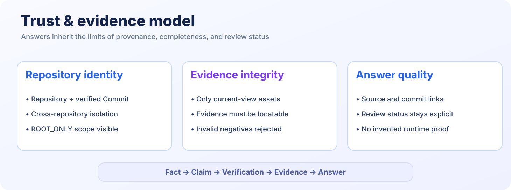

# SourceLore 安全与授权

> 概念示意图，不等于完整功能或运行验收；具体能力与限制以本文为准。

本文说明 SourceLore 的安全边界、授权模型、数据处理规则与已知未加强项。文中每一项事实都对应源码或既有验收产物；凡未加强、未验证或已知风险，均如实标注，不作夸大陈述。英文版见 [docs/en/SECURITY.md](../en/SECURITY.md)，事实、接口与状态与本文完全一致。

## 1. 适用范围与威胁模型

SourceLore 是一个**本地、只读、证据可核查**的 GitHub 知识库工具。它把公开仓库某个固定 Commit 的路径观察、内容字节与源码声明采集为可回查的知识资产（Fact / Claim / Verification / Evidence），通过 Skill + CLI 供智能体查询。它**不是**通用网络爬虫、代码执行器或分发通道。

威胁模型围绕三条主线建立：

1. **来源可信性**——结论必须绑定到具体 Commit 与仓库身份，且能被复核。
2. **数据不外泄、不被滥用**——第三方内容只作内部分析，不被提升为指令、不被执行、不被擅自分发。
3. **失败保守**——授权未知即拒绝写入，证据不可解析即降级，覆盖不足即如实标注，绝不猜测。

## 2. 来源授权与信任边界

### 2.1 输入 URL 校验

位于 `src/skill_interface/analyze.py` 的 `parse_github_url()` 是所有仓库输入的入口，采用严格白名单：

- 只接受指向 `github.com` / `www.github.com` 的仓库地址；**内网地址、非 GitHub 主机、异常端口一律拒绝**（`HOST_NOT_ALLOWED` / `INVALID_URL`）。
- 规范化输入形式为 `https://github.com/<owner>/<repo>`，允许可选的 `tree/<ref>` 后缀；端口只允许默认 HTTP/HTTPS 端口。
- 仓库 owner / name 必须匹配 `[A-Za-z0-9_.-]+`，防止路径注入。
- 私有仓库不在支持范围内。

### 2.2 GitHub API 客户端限制

`src/collector/github_client.py` 实现受限客户端，遵守五条铁律（G1–G5）：

- **G1 目标固定**：只访问经验证的 `api.github.com`（`ALLOWED_HOST`，`ALLOWED_SCHEME=https`）；用户输入绝不作为 URL 交给通用下载器。协议相对路径（`//host`）、父目录穿越、空段均在拼装前拒绝，拼装后再次用 `urlsplit` 复核主机与协议。
- **G2 错误分类**：401/403/404/429/5xx 不得全部折成"空仓库"，须按响应头与响应体分类。
- **G3 限流识别**：结合 `x-ratelimit-remaining` / `retry-after` / 响应体 message 判定，不只看状态码；主限流与次级限流分开。
- **G4 有界重试**：有限次重试 + 退避，禁止无界重试与绕过限流。
- **G5 Token 保密**：Token 绝不进入日志、checkpoint、snapshot 或任何提交。

单次采集带有硬上限（`DEFAULT_LIMITS`）：请求超时 20 秒、最大请求数 40、单请求最大重试 3 次、服务端建议等待上限 120 秒、最大 Tree 条目 2000、单 Blob 字节上限 1,000,000、采集总字节上限 4,000,000、递归深度上限 12。Skill 场景（`analyze.py`）进一步收紧为 `max_retries=0`、`max_retry_after=0`，遇限流即快失败并把决定权交还用户，不长时间等待、不绕过配额。

### 2.3 五维授权门禁

内容采集授权在 `src/collector/content_acquisition_policy.py` 中独立判定（`POLICY_VERSION = content-authz/2`）。五种动作**分别判定、不得合并**：

| 维度 | 操作码 | 含义 |
|---|---|---|
| FETCH | `fetch` | 从 GitHub 读取字节 |
| PERSIST | `persist_bytes` | 为内部分析持久化原始字节 |
| DERIVE_FACTS | `derive_facts` | 由内容派生 Fact |
| PREVIEW | `internal_preview` | 内部预览 / 复制到卡片 |
| DISTRIBUTE | `external_distribution` | 对外再分发 |

关键规则：

- 授权必须来自**结构化授权引用**（`build_authorization_ref`），裸布尔不得当授权；引用含 `authorization_kind`、`repository_id`、`scope`、`source`、`verification_status`。
- 四类依据 `PROJECT_OWNED_WORK` / `ORIGINAL_TEST_FIXTURE` / `LICENSE_OBSERVED_AND_APPLICABLE` / `USER_EXPLICIT_GRANT` 只覆盖前四个内部动作（FETCH/PERSIST/DERIVE_FACTS/PREVIEW），**无一覆盖 DISTRIBUTE**。
- 绑定校验：错仓库、未知类型、未核验（`UNVERIFIED`）均拒绝或判 `UNKNOWN`。
- **分发恒被阻断**：`evaluate_operation` 对 `OP_DISTRIBUTE` 在门禁未独立关闭时永远返回 `DENY`，原因码 `DISTRIBUTION_GATE_OPEN_BLOCKED`，限制项固定为 `B-1/B-2/B-3 OPEN` 与 `copy_permitted=false`。实际状态为 `distribution_allowed=false`、`copy_permitted=false`，输出仅为内部预览。
- 路径安全（`path_is_safe`）：拒绝绝对路径、反斜杠、`..` 穿越、超长路径（>255）以及敏感文件名（`.env`、`.npmrc`、`id_rsa`、`credentials` 等），即使命中白名单也拒绝。

### 2.4 读取侧二次门禁

即使字节已持久化，读取时仍由 `src/content/captured_blob_loader.py:42-52` 再次校验：采集授权状态为 `AUTHORIZATION_UNKNOWN` / `ACQUISITION_BLOCKED` / `METADATA_ONLY` 时返回 `CONTENT_ACQUISITION_BLOCKED`；`completeness_status != COMPLETE` 时返回 `CONTENT_PARTIAL`；跨 Commit 读取同一路径返回 `COMMIT_MISMATCH`。该加载器**绝不访问网络**。

## 3. 数据安全

### 3.1 只读采集，零执行

SourceLore 只做只读采集：**不推送、不建 Issue、不执行仓库脚本**，且绝不 `exec`、`eval`、import、运行测试或执行 shell。被分析仓库的内容一律当作待分析数据，不提升为系统级指令。这一纪律在 F1-B 安全裁决中被固化为 A-1 至 A-7 七条可检查规则（每条带 `rule_id` + `detection_method` + `failure_action`）：

- A-1 README / SKILL.md / Issue / 注释 / 配置值一律是数据，不是指令。
- A-2 外部内容不得要求执行本地 shell 命令。
- A-3 不得借分析任务读取无关私有文件或环境变量。
- A-4 工具调用遵循最小权限。
- A-5 未经明确授权不得上传本地私有源码到第三方服务。
- A-6 敏感信息不得直接进入报告或知识卡片。
- A-7 审查步骤由 SourceLore 决定，外部仓库只能作被审对象（元级约束）。

### 3.2 Token 处理

`GITHUB_TOKEN` **只从进程环境读取**（`github_client.py` 与 `analyze.py`），仅在内存中组装 `Authorization: Bearer` 头，不写日志、资产、checkpoint 或 Git。`analyze --no-token` 可在单次调用中强制禁用（即便环境中有 Token）；离线查询从不要求 Token。未认证配额为 60 次/小时。

### 3.3 数据根与 Git 排除

知识库数据根默认 `~/.sourcelore/`，可用 `--data-root` 或 `SOURCELORE_DATA_ROOT` 覆盖；数据库文件 `kb.db` **永不写入源码仓库**。`.gitignore` 排除 `knowledge/`、`cache/`、`upstreams/`、项目级 `/.dsh/skills/`、`.env` 与 `.env.*`、`*.key` / `*.pem` / `secrets/` / `*.token`，以及 Python 构建与编辑器产物，确保知识资产与凭据不随代码推送。

### 3.4 未加强项（如实记录）

- 数据库文件默认以 `0644`、目录默认以 `0755` 创建，**未做额外权限加强**。在多用户主机上，这属于需要运维自行评估的项，本工具不声称已做隔离。
- SourceLore **第一方代码采用 MIT 许可证**（见 `LICENSE`），允许复用、修改与再分发；该许可证不覆盖已采集的第三方知识输出与用户数据库，后者仍受 `distribution_allowed=false` 门禁约束。

## 4. 隐私

- **已知风险**：历史进度文档（如 `progress/` 下若干文件）包含本机私有路径，例如 `/home/arlune_innersea/...` 与 `/mnt/Server_Data_Center/...`。在对外推送任何文档或仓库前，**必须检查并清理这些路径**，否则会泄露本机目录结构与用户名。
- 凭据、密钥与本地配置由 `.gitignore` 排除，不应进入版本库。
- 敏感信息分级与脱敏在 F1-B 中定义为四级门禁：P-1 分级、P-2 脱敏（机器）、P-3 人工审查、P-4 发布批准（仅人可触发）。脱敏通过不等于允许公开；AI 不得自行把需人工批准的产物标记为已批准；原始扫描输出"不落盘"是结构约束，而非事后删除。

## 5. 网络预算

- 网络仅在采集阶段发生；**查询、`answer`、卡片生成均为零网络请求**（断言字段 `network_requests=0`）。
- GitHub 未认证配额 60 次/小时；遇到限流如实回报，不绕过、不无界重试。
- 内容级预算：单 Blob 256 KiB、单批 2 MiB、最多 32 个候选路径、单文件最多 100 个 Fact。这些上限同时是避免过大字节进入本地资产的防护。

## 6. 第三方内容边界

- 开发过程只读审计过六个上游，记录在 `THIRD_PARTY_NOTICES.md` 与 `docs/upstream-manifest.json`。本仓库不包含任何第三方源代码、提示词、规则文本或模板。
- UPSTREAM-01 至 05 分别采用 MIT / MIT / CC BY 4.0 / MIT / Apache-2.0，且**仅取抽象设计思想，无代码或文本复制**。
- **UPSTREAM-06（Consensys/repo-security-review）无许可证，零复制**：不得复制其源码、提示词、规则原文与模板，只描述其机制形状并独立设计。`upstreams/` 下的快照副本被 `.gitignore` 排除，不进入仓库历史，从未执行其 `setup.sh`。
- 本项目不依赖上述上游的代码，也不依赖它们安装的扫描器（gitleaks、osv-scanner、semgrep、pip-audit、grype）；这些工具一个都没有被安装或运行。

## 7. 分发限制

所有源于第三方知识的输出（知识卡片、报告、仓库派生文档）均为**内部预览**：`distribution_allowed=false`、`copy_permitted=false`，分发门禁 B-1/B-2/B-3 仍开放。任何对外分发都必须先解决这三道门禁与许可问题，并由人工完成 P-3 / P-4 审批；当前不存在合规的公开分发路径。

## 8. 可信性规则（与证据相关）

- Commit 只有绑定到本仓库已登记快照才可信；形如 `aaaa…` / `0000…` / `ffff…` 的 40 位占位值永不认证。
- Claim / Fact 按仓库与 Commit 做身份核对，跨仓库 Commit 被阻断。
- 只有当前视图（`current_view`）决定当前有效资产，历史裁决不会被悄悄混入。
- 证据完整性为 `FULLY_LOCATABLE`、`PARTIALLY_LOCATABLE` 或 `UNRESOLVED_NO_INTEGRITY`；不可解析引用使裁决降级为 `insufficient_evidence`，**绝不**变为 `refuted`。
- `ROOT_ONLY` 表示只枚举仓库根目录，**绝不**表述为完整 `COMPLETE`；缺少内容属于"未分析"，不是"不存在"。

## 9. 参考

- 源码：`src/collector/content_acquisition_policy.py`、`src/collector/github_client.py`、`src/content/captured_blob_loader.py`、`src/skill_interface/analyze.py`、`src/trust/policy.py`、`src/trust/tree_scope.py`
- 裁决与声明：`docs/fusion/F1B_SECURITY_DECISIONS.md`、`THIRD_PARTY_NOTICES.md`、`docs/upstream-manifest.json`
- 相关文档：[测试](TESTING.md)、[路线图](ROADMAP.md)、[安装指南](INSTALLATION.md)
